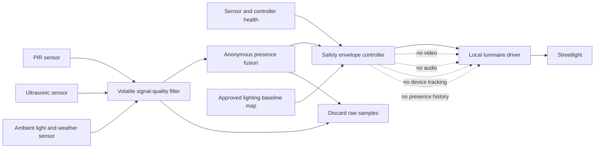

# Adaptive Street Lighting With Non-Tracking Presence Detection

## Purpose

This design specifies an adaptive public-lighting system that reduces unnecessary electricity use while preserving safe, accessible, and equitable illumination for pedestrians, mobility-device users, cyclists, transit users, night workers, people seeking cooling or emergency assistance, and all public-space users.

The system adjusts lighting only within a pre-approved operating envelope.

It does not identify, count, recognize, track, classify, profile, or score people. It does not retain motion history, biometric data, device identifiers, video, audio, or location traces.

The system must never use adaptive lighting to make an area less safe, inaccessible, unwelcoming, or selectively surveilled.

## Core guarantees

\[
D_{\text{person,persistent}} = 0
\]

\[
D_{\text{motion-history}} = 0
\]

\[
D_{\text{biometric}} = 0
\]

\[
D_{\text{device}} = 0
\]

\[
L(x,t) \geq L_{\min}(x)
\]

\[
A_{\text{pedestrian-lighting}} = 1
\]

Where:

- \(D_{\text{person,persistent}}\) is persistent person-derived information.
- \(D_{\text{motion-history}}\) is retained presence or motion history.
- \(D_{\text{biometric}}\) is retained face, body, gait, voice, thermal-body, or related biometric information.
- \(D_{\text{device}}\) is retained phone, Bluetooth, Wi-Fi, cellular, NFC, or other device identifier information.
- \(L(x,t)\) is maintained illuminance at location \(x\) and time \(t\).
- \(L_{\min}(x)\) is the approved minimum maintained illumination for that location.
- \(A_{\text{pedestrian-lighting}}\) represents the availability of safe public lighting.

The baseline policy is:

\[
\operatorname{SensorUnavailable}
\Rightarrow
P(t) = P_{\text{safe-baseline}}
\]

not:

\[
\operatorname{SensorUnavailable}
\Rightarrow
P(t) = P_{\min}
\]

## Lighting hierarchy

Public-lighting safety is determined first by site classification, engineering design, pedestrian use, crossing conditions, accessibility routes, transit activity, local policy, and physical verification—not by whether a sensor detects activity.

The adaptive controller can vary lighting only between:

\[
P_{\text{safe-baseline}}
\leq
P(t)
\leq
P_{\max}
\]

Such that:

\[
L(x,t)
\geq
L_{\min}(x)
\]

for all protected walkway, crossing, transit-stop, curb-ramp, and accessible-route locations.

A nominal value such as:

\[
L_{\min} = 10 \text{ lux}
\]

may be a useful local design requirement for a pedestrian-only walkway, but it should not be treated as a universal standard. FHWA materials describing RP-8-based guidance include maintained walkway values that vary by pedestrian area and context; examples include 10 lux average and 5 lux minimum for pedestrian-only areas in some categories, while mixed vehicle-and-pedestrian settings can call for higher maintained levels. [229][232]

Crosswalk and roadway conditions may require a separate vertical-illuminance analysis. FHWA material notes a 20 lux vertical-illuminance result at a specified measurement height in a crosswalk-lighting design context. [228][234]

## System architecture



## Sensor selection

### Preferred non-imaging sensors

| Sensor | Useful signal | Privacy advantage | Main limitations |
|---|---|---|---|
| PIR | Heat-change and motion event | Does not require camera imagery or identity recognition | Can miss slow movement; affected by weather and heat conditions |
| Ultrasonic | Local range-change or motion event | No video and no identity required | Can be affected by wind, vegetation, reflective surfaces, and geometry |
| Microwave or radar motion sensor | Motion and range-change estimate | Can operate without visible imagery | Must be configured to avoid tracking or storing trajectories |
| Ambient light sensor | Existing illumination level | Environmental-only signal | Does not detect pedestrian need |
| Luminaire electrical sensor | Driver, lamp, and energy state | Operational-only signal | Does not determine public safety alone |
| Fixed illuminance meter | Measured local light level | Measures environment, not people | Requires calibration and maintenance |
| Weather sensor | Wind, rain, dust, temperature | Environmental-only signal | Must not be used as a proxy for public presence |

### Excluded sensors

Do not use:

```text
camera video
thermal imaging that can form person silhouettes
face recognition
gait recognition
body-shape classification
microphone recording
speech detection
Bluetooth discovery
Wi-Fi probe collection
cellular identifier collection
mobile application location
license-plate recognition
persistent radar tracks
device fingerprinting
identity or demographic inference
```

NIST identifies privacy and security risks in IoT systems with sensors and actuators, including sensor categories such as location, presence, and identity. The design response is data minimization at the sensing boundary: retain no raw sensor observations or durable presence records. [227][231]

## Anonymous presence state

### Coarse local state

The controller may use only a coarse, short-lived local state:

```text
no-activity-confirmed
activity-likely
sensor-uncertain
sensor-fault
```

It must not create a count, identity, route, speed profile, dwell-time profile, or occupancy history.

Let:

\[
p_{\text{pir}} \in \{0,1\}
\]

\[
p_{\text{ultra}} \in \{0,1\}
\]

\[
q_{\text{pir}}, q_{\text{ultra}} \in [0,1]
\]

Where:

- \(p_{\text{pir}}\) is the current PIR event state.
- \(p_{\text{ultra}}\) is the current ultrasonic event state.
- \(q_{\text{pir}}\) and \(q_{\text{ultra}}\) are local signal-quality scores.

Define the fused temporary activity score:

\[
S(t) =
w_p q_{\text{pir}} p_{\text{pir}}
+
w_u q_{\text{ultra}} p_{\text{ultra}}
\]

With:

\[
w_p + w_u = 1
\]

The controller may set:

\[
\operatorname{activityLikely}(t) =
\begin{cases}
1, & S(t) \geq \tau_a \\
0, & S(t) < \tau_a
\end{cases}
\]

The signal must be held only for a bounded transition interval:

\[
T_{\text{state}} \leq T_{\text{hold,max}}
\]

and then erased:

\[
\operatorname{persist}
\left(
S(t),
p_{\text{pir}},
p_{\text{ultra}}
\right)
=
\varnothing
\]

### Presence fusion policy

A conservative policy uses confirmation or persistence:

\[
\operatorname{activityLikely}(t) =
(p_{\text{pir}} \land p_{\text{ultra}})
\lor
\operatorname{persistentPIR}(t)
\lor
\operatorname{persistentUltrasonic}(t)
\]

The persistence window must be brief, local, and non-recorded.

For example:

\[
T_{\text{confirmation}} = 2 \text{ seconds}
\]

\[
T_{\text{hold}} = 30 \text{ seconds}
\]

These are engineering parameters requiring site-specific testing; they are not universal values.

### Animal and wind filtering

The controller should not infer species, personhood, or identity. It should only classify the event as adequate or inadequate evidence for temporary lighting increase.

Use environmental consistency gates:

\[
G_{\text{fusion}} =
G_{\text{PIR}}
\land
G_{\text{ultrasonic}}
\land
G_{\text{weather}}
\land
G_{\text{duration}}
\land
G_{\text{fault}}
\]

Examples:

- Reject a single ultrasonic event during high-wind vegetation movement if PIR is inactive.
- Treat a transient low-confidence signal as uncertain rather than “no activity.”
- Maintain the safe baseline during uncertainty.
- Increase brightness when either safety policy or repeated fusion evidence indicates activity.
- Never lower below the approved baseline because a sensor predicts “empty.”

## Illumination control

### Baseline plus temporary increase

Let:

- \(P_{\max}\) be the rated or approved high-output power.
- \(P_{\text{safe-baseline}}\) be the lowest approved power that still maintains the site lighting requirement.
- \(P_{\text{boost}}\) be the temporary presence-response power.
- \(s(t)\) be the activity-likely state.

\[
P(t) =
\begin{cases}
P_{\text{boost}}, & s(t)=1 \\
P_{\text{safe-baseline}}, & s(t)=0
\end{cases}
\]

With:

\[
P_{\text{safe-baseline}}
\geq
P(L_{\min})
\]

Where \(P(L_{\min})\) is the required fixture output needed to maintain the approved local lighting floor.

The controller should use gradual ramps:

\[
P(t+\Delta t) =
\operatorname{clip}
\left(
P(t) +
r \Delta t,
P_{\text{safe-baseline}},
P_{\text{boost}}
\right)
\]

Where \(r\) is a configured ramp rate.

Gradual dimming and brightening reduces glare, sudden visual change, and disorientation. A safe system must never make a person choose between saving energy and seeing where they are going.

### Minimum illumination constraint

For every protected point \(x\) in a public pedestrian zone:

\[
L(x,t) \geq L_{\min}(x)
\]

For a locally approved pedestrian-only walkway baseline:

\[
L(x,t) \geq 10 \text{ lux}
\]

If the lighting design has a lower approved baseline based on local engineering assessment, the adaptive controller must use that approved floor. The controller itself may not independently reduce the lighting standard.

### Uniformity constraint

Average illuminance alone is insufficient when severe dark patches remain.

Let:

- \(E_{\text{avg}}\) be average maintained illuminance.
- \(E_{\min}\) be minimum maintained illuminance.

Define:

\[
U =
\frac{
E_{\min}
}{
E_{\text{avg}}
}
\]

A safe lighting plan must preserve a locally approved uniformity level:

\[
U \geq U_{\min}
\]

FHWA reduced-lighting guidance reports maintained illuminance and average-to-minimum uniformity ratios that vary across roadway, pedestrian, and land-use contexts. [229][232]

## Energy accounting

### Energy saving

Let \(P_{\max}\) be a reference full-output schedule and \(P(t)\) actual luminaire power.

\[
E_{\text{saved}} =
\int_{t_0}^{t_1}
\left(
P_{\max} - P(t)
\right)
dt
\]

For discrete controller intervals:

\[
E_{\text{saved}}
\approx
\sum_{k=1}^{n}
\left(
P_{\max} - P_k
\right)
\Delta t_k
\]

The energy objective is constrained:

\[
\max E_{\text{saved}}
\]

subject to:

\[
L(x,t) \geq L_{\min}(x)
\]

\[
U(t) \geq U_{\min}
\]

\[
A_{\text{pedestrian-lighting}} = 1
\]

\[
D_{\text{motion-history}} = 0
\]

### Safe energy efficiency

A rights-preserving efficiency score is:

\[
\eta_{\text{lighting}} =
\frac{
E_{\text{saved}}
}{
E_{\text{reference}}
}
\cdot
C_{\text{lighting}}
\cdot
C_{\text{privacy}}
\cdot
C_{\text{access}}
\]

Where:

- \(C_{\text{lighting}} = 1\) only if all illumination and uniformity constraints are met.
- \(C_{\text{privacy}} = 1\) only if no person-derived information is retained.
- \(C_{\text{access}} = 1\) only if no public area loses required accessible lighting.

If any mandatory condition fails:

\[
\eta_{\text{lighting}} = 0
\]

This prevents the system from claiming an energy success that was achieved by creating a safety, privacy, or access failure.

## Fail-safe behavior

| Condition | Required response |
|---|---|
| PIR sensor fault | Keep safe baseline illumination; flag non-personal maintenance condition |
| Ultrasonic sensor fault | Keep safe baseline illumination; flag non-personal maintenance condition |
| Fusion disagreement | Keep safe baseline; optionally use conservative temporary boost |
| Ambient-light sensor fault | Use approved nighttime fallback schedule |
| Controller reset | Restore safe baseline before adaptive logic resumes |
| Network loss | Continue local lighting policy with no cloud dependency |
| Time-sync failure | Use conservative local nighttime schedule |
| Power-quality event | Restore approved safe state after recovery |
| Calibration overdue | Continue approved baseline, disable energy optimization if verification is needed |
| Lamp output below required floor | Raise maintenance alert and deploy repair response; do not claim adaptive operation is compliant |
| Excessive false positives | Preserve safety baseline while tuning proceeds; do not remove light to compensate |

## Public governance requirements

Publish:

- Site classification.
- Approved minimum illumination and uniformity requirements.
- Sensor types.
- Explicit list of excluded surveillance capabilities.
- Presence-state retention period.
- Whether raw sensor data is ever retained.
- Local control and network-independence behavior.
- Fault behavior.
- Energy-accounting method.
- Maintenance and calibration schedule.
- Accessibility review results.
- Public correction route.
- Seasonal wildlife and ecological lighting considerations.
- Change log and version history.

Use clear public notice:

```text
This lighting system adjusts brightness within a safe minimum level.

It does not use cameras, microphones, facial recognition, mobile-device tracking, or stored movement history.

Lighting remains available even when sensors are unavailable.
```

## Ecological responsibility

Adaptive lighting can reduce energy use and unnecessary nighttime light exposure, but it must also consider habitat, pollinators, birds, bats, and nearby vegetation.

Use a community-reviewed ecological lighting policy that considers:

- Light direction and shielding.
- Color temperature and spectral output.
- Spill into habitat areas.
- Seasonal ecological sensitivity.
- Maintenance windows.
- Required pedestrian safety lighting.
- Accessibility and wayfinding.
- Emergency-response needs.
- Local community preferences.

Ecological considerations must not be used to reduce required safe lighting on public pedestrian routes. Prefer fixture shielding, directionality, efficient luminaires, and carefully designed baseline levels over darkening public paths below approved requirements.

## Verification and testing

### Lighting tests

- Measure maintained illuminance at protected walkway, curb-ramp, crossing, transit-stop, and accessible-route points.
- Measure average and minimum illumination.
- Validate uniformity under baseline and boost modes.
- Test wet-weather and dust conditions where relevant.
- Test after luminaire aging and maintenance intervals.
- Verify gradual transition rate and glare performance.
- Verify that sensor output cannot set lighting below the approved baseline.

### Privacy tests

- Verify no camera, microphone, thermal image, Bluetooth, Wi-Fi, NFC, cellular, or location-tracking input exists in the deployed system.
- Verify PIR and ultrasonic readings exist only in volatile memory.
- Verify no event history, movement history, identity record, count history, device identifier, or raw sensor stream is stored.
- Verify local diagnostic records contain only device health and aggregate energy data.
- Verify the maintenance interface cannot export person-derived information because no person-derived information exists.

### Fusion tests

- Test wind-blown vegetation.
- Test rain, dust, and temperature extremes.
- Test small animals and larger animals where site-appropriate.
- Test moving pedestrians, slower walkers, mobility-device users, cyclists, and groups.
- Test a stationary person or slow movement near a crossing.
- Test simultaneous PIR and ultrasonic activation.
- Test individual sensor faults.
- Test intermittent false positive conditions.
- Test sensor uncertainty and timeout behavior.

### Accessibility tests

- Verify lighting remains adequate for mobility-device travel, curb-ramp navigation, tactile-route use, low-vision travel, crossing detection, and assistance-panel access.
- Verify public notices are available in plain language and accessible formats.
- Verify physical maintenance activity does not block accessible routes.
- Verify reported lighting failures receive timely repair.
- Verify people can report a concern without account, identity, phone, or application requirement.

## Project metrics

| Metric | Formula | Target |
|---|---|---:|
| Minimum-light compliance | \(\frac{\text{measured protected points meeting }L_{\min}}{\text{measured protected points}}\) | 1 |
| Uniformity compliance | \(\frac{\text{intervals with }U \geq U_{\min}}{\text{measured intervals}}\) | 1 |
| Presence-history retention | \(\frac{\text{retained presence records}}{\text{controller intervals}}\) | 0 |
| Raw-media retention | \(\frac{\text{retained raw media records}}{\text{controller intervals}}\) | 0 |
| Fail-safe baseline availability | \(\frac{\text{fault cases preserving safe baseline}}{\text{fault cases tested}}\) | 1 |
| Sensor-fusion false boost rate | \(\frac{\text{verified unnecessary boosts}}{\text{fusion decisions}}\) | Report and improve without lowering safety floor |
| Lighting-response false dim rate | \(\frac{\text{unsafe dim events}}{\text{controller intervals}}\) | 0 |
| Energy reduction | \(\frac{E_{\text{reference}}-E_{\text{actual}}}{E_{\text{reference}}}\) | Report only when all safety and privacy constraints pass |
| Repair response coverage | \(\frac{\text{verified lighting barriers mitigated or repaired}}{\text{verified lighting barriers}}\) | At least 0.95 |

## Project metrics

| Metric | Score | Basis |
|---|---:|---|
| knowledge_factor | 0.91 | Explicit illumination, uniformity, sensor-fusion, privacy, fault, and verification constraints provide a reviewable technical basis |
| eco_impact_value | 0.86 | Reduces electricity use and unnecessary light output while protecting public routes and considering habitat-sensitive lighting |
| harm_risk | 0.17 | No imaging, audio, device tracking, motion history, identity inference, or sensor-driven lowering below an approved baseline |
| accessibility_impact | 0.95 | Requires minimum lighting, uniformity, standard fault behavior, accessible routes, public notices, and correction pathways |
| rights_alignment | 0.98 | Supports privacy, dignity, equal public access, safety, ecological responsibility, local resilience, and accountable maintenance |
