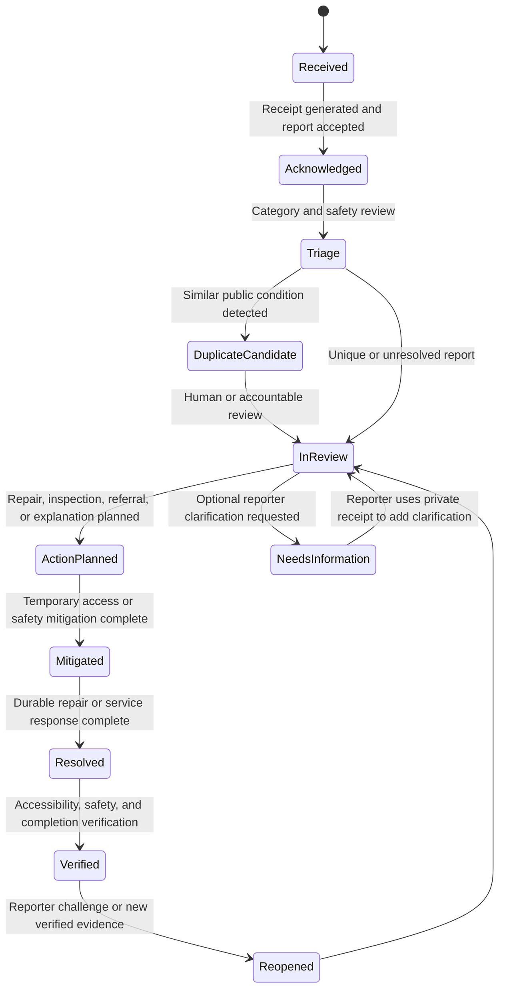

# Anonymous Civic Feedback Platform With Review Integrity

## Purpose

This design specifies an anonymous civic-feedback platform for reporting public infrastructure issues such as:

- Potholes.
- Broken streetlights.
- Blocked curb ramps.
- Damaged sidewalks.
- Inaccessible entrances.
- Unsafe crossings.
- Broken public kiosks.
- Water-service access problems.
- Transit-stop barriers.
- Public sanitation concerns.
- Park-path accessibility barriers.
- Signage, lighting, and wayfinding problems.

The platform enables a person to:

- Submit a report without an account.
- Decline identity disclosure.
- Receive a private report-tracking capability.
- Check report status later.
- Add clarification using the private capability.
- View public aggregate resolution progress.
- Challenge an inaccurate closure.
- Receive accessible and plain-language updates.
- Use the platform without an application, phone, social-media identity, or device registration.

The platform does not create a civic surveillance system. It must not use reports to infer identity, location history, disability, augmentation status, political activity, housing status, immigration status, health information, or other sensitive personal facts.

## Core service invariants

\[
G_{\text{account}} = 0
\]

\[
G_{\text{identity}} = 0
\]

\[
G_{\text{phone}} = 0
\]

\[
G_{\text{device}} = 0
\]

\[
D_{\text{device-identifier}} = 0
\]

\[
D_{\text{network-identifier}} = 0
\]

\[
D_{\text{reporter-identity}} = 0
\]

\[
D_{\text{tracking-linkage}} = 0
\]

\[
A_{\text{anonymous-reporting}} = 1
\]

Where:

- \(G_{\text{account}}\) is an account-creation gate.
- \(G_{\text{identity}}\) is an identity-verification gate.
- \(G_{\text{phone}}\) is a phone, app, or phone-number requirement.
- \(G_{\text{device}}\) is a mandatory device-registration requirement.
- \(D_{\text{device-identifier}}\) is persistent browser, device, radio, or hardware identification.
- \(D_{\text{network-identifier}}\) is persistent IP address or network-identity storage.
- \(D_{\text{reporter-identity}}\) is reporter identity collection or inference.
- \(D_{\text{tracking-linkage}}\) is the ability to connect separate reports to the same reporter.
- \(A_{\text{anonymous-reporting}}\) is anonymous report availability.

The platform may support an optional contact channel only when a reporter deliberately chooses it for a defined purpose. The anonymous path must remain equally functional.

## Architecture

```mermaid
flowchart LR
    Reporter[Community member] --> LocalReceipt[Browser generates private receipt secret]
    Reporter --> ReportForm[Accessible report form]
    LocalReceipt --> ReportForm
    ReportForm --> Validate[Local and server-side input validation]
    Validate --> Normalize[Category, coarse location cell, text normalization]
    Normalize --> Duplicate[Privacy-preserving duplicate candidate check]
    Duplicate --> Store[Store report and receipt verifier hash]
    Store --> Review[Accountable human review]
    Review --> PublicStatus[Public aggregate status]
    Review --> Resolution[Repair, response, or explanation]

    Reporter --> Status[Present private receipt secret]
    Status --> ReceiptCheck[Verify one-way receipt hash]
    ReceiptCheck --> PrivateStatus[Private report status and correction path]

    Store -. no account .-> Review
    Store -. no device identifier .-> Review
    Store -. no network identifier .-> Review
    LocalReceipt -. secret stays with reporter .-> Reporter
```



## Report receipt capability

### Concept

A report receipt is a private secret created locally by the reporter’s browser or client. It is not a username, account, phone number, public identifier, or identity credential.

The receipt enables the reporter to return later and prove control of the report without revealing who they are.

The user receives a message such as:

```text
Save this private report receipt.

It is the only way to check this report or add information later.
The city cannot recover it for you.
It does not reveal your identity.
```

### Receipt generation

Generate a cryptographically random secret:

\[
s \leftarrow \{0,1\}^{256}
\]

Encode it in a human-manageable format such as base64url or a word-based recovery representation.

The server stores only a verifier:

\[
v =
\operatorname{SHA256}
(
\text{domain-separation}
\parallel
s
)
\]

The original secret must not be stored server-side.

To check a report, the reporter presents \(s\), and the server computes:

\[
v' =
\operatorname{SHA256}
(
\text{domain-separation}
\parallel
s
)
\]

The receipt is accepted when:

\[
v' = v
\]

Use constant-time comparison for verifier values.

### Why this is privacy-preserving

The server cannot derive \(s\) from \(v\) with feasible computation. The receipt does not require a person to reveal a name, email address, phone number, device identity, government identity, or persistent account.

The server should never log the secret. It must redact receipt secrets from diagnostics, access logs, crash reports, tracing systems, and error messages.

### Receipt handling

| Action | Allowed? | Requirement |
|---|---:|---|
| Create receipt locally | Yes | Use cryptographically secure randomness |
| Store verifier hash server-side | Yes | Use domain-separated SHA-256 and constant-time comparison |
| Store original receipt secret server-side | No | Never persist it |
| Email receipt automatically | No | Would create contact linkage |
| Print receipt locally | Optional | Clearly explain physical privacy risks |
| Copy receipt to clipboard | Optional | Explain clipboard privacy risk and clear on request |
| Recover a lost receipt | No | No recovery prevents identity-linking backdoors |
| Use receipt to check status | Yes | Require only current possession of receipt |
| Use receipt to append clarification | Yes | Rate limit privately and do not disclose identity |
| Use receipt as an identity credential | No | It is only a report-scoped capability |

## Anonymous report data model

### Required report fields

```text
Issue category.
Plain-language description.
Coarse public location or selected public map point.
Optional precise public infrastructure location.
Accessibility impact category.
Public safety urgency category.
Date or time window observed.
Reporter-selected report visibility.
Optional attachment only if privacy-safe.
Private receipt verifier.
Review status.
Resolution status.
Public explanation.
```

### Prohibited report fields

```text
reporter name
phone number
email address
account identifier
government identifier
device fingerprint
advertising identifier
Bluetooth address
Wi-Fi identifier
precise device location trace
IP address retention
facial image
voice recording
biometric data
augmentation data
medical data
disability proof
home address unless voluntarily necessary and separately protected
unnecessary personal information about another person
```

### Attachment safety

Attachments create a high privacy risk because photographs may contain people, vehicles, license plates, addresses, screens, medical information, or other sensitive details.

The safest baseline is:

\[
\operatorname{attachmentsEnabled} = \text{false}
\]

If attachments are later enabled, apply:

1. Clear notice to avoid photographing people, faces, homes, license plates, or private information.
2. Local metadata stripping before upload.
3. Local face and plate redaction where technically reliable.
4. Manual privacy review before any public publication.
5. Immediate rejection of files that cannot be processed safely.
6. Short retention and clear deletion policy.
7. No automatic public display.
8. Alternative text-only reporting path with equal priority.

## Spam resistance without identity tracking

### Principle

Spam prevention must not require accounts, phone verification, browser fingerprinting, device tracking, CAPTCHA systems that exclude assistive-technology users, or retention of network identity.

Use layered, privacy-preserving friction and review:

- Request-size limits.
- Strict input validation.
- Per-submission proof-of-work with accessibility bypass through a human-assisted route.
- Session-local rate limiting without persistent identity.
- Coarse time-bucket overload control.
- Semantic duplicate candidate detection.
- Human review.
- Abuse-resistant queueing.
- Public correction and appeal.
- Separate incident response for coordinated platform attacks.

### Local proof of work

A browser may solve a small computational puzzle before submission:

\[
\operatorname{SHA256}
(
\text{challenge}
\parallel
\text{nonce}
)
<
2^{256-d}
\]

Where \(d\) is the configured difficulty.

The server verifies the work without requiring an account.

Proof of work must not become a barrier to reporting. Provide alternatives:

- Accessible staff-assisted intake.
- Paper or phone reporting route.
- Community-service desk submission.
- Low-compute accessibility exemption token issued only for the current session.
- Deferred review queue without proof of work when infrastructure capacity permits.

Do not use proof-of-work difficulty as a hidden exclusion mechanism.

### Anonymous rate limiting

Rate limit by short-lived server-issued anonymous submission tickets, not by persistent device identity.

A ticket may be:

\[
\tau =
\operatorname{MAC}
(
K_{\text{server}},
\text{expiry}
\parallel
\text{scope}
\parallel
\text{randomness}
)
\]

The ticket:

- Expires quickly.
- Is scoped to one report submission or a short submission window.
- Is not linked to a reporter identity.
- Is not reusable beyond its allowed scope.
- Is not stored as a cross-session tracking identifier.

When capacity is constrained, the platform should slow public submissions fairly and provide accessible alternate intake rather than silently refusing reports.

## Duplicate detection

### Goal

Duplicate detection identifies reports that may concern the same public infrastructure condition. It should reduce duplicate review work while preserving every reporter’s right to receive an independent receipt and status path.

A suspected duplicate is not deleted automatically.

\[
\operatorname{duplicateCandidate}
\Rightarrow
\operatorname{humanReview}
\]

not:

\[
\operatorname{duplicateCandidate}
\Rightarrow
\operatorname{discard}
\]

### Coarse spatial key

Quantize report locations into a public operational cell:

\[
g =
\operatorname{cell}
(
\text{publicLocation},
r
)
\]

Where \(r\) is a publicly documented spatial resolution.

For a location pair \(a,b\), use geodesic or projected distance:

\[
d(a,b)
\leq
r_{\text{duplicate}}
\]

as one duplicate candidate condition.

Use different spatial thresholds for different categories:

| Issue category | Typical spatial matching approach |
|---|---|
| Pothole | Short road-segment or intersection buffer |
| Broken streetlight | Pole, block-face, or short segment buffer |
| Blocked curb ramp | Intersection or ramp-level public location |
| Sidewalk obstruction | Sidewalk segment buffer |
| Park-path barrier | Path segment buffer |
| Broken kiosk | Fixed facility identifier or public facility location |
| Transit-stop barrier | Stop or platform public location |
| Water access issue | Public fixture or facility buffer |

### Text similarity

Normalize text into a privacy-minimized feature representation:

1. Normalize Unicode.
2. Remove excessive whitespace.
3. Remove obvious personal contact strings.
4. Remove long numeric sequences that may be account, phone, or identity values.
5. Tokenize.
6. Remove common stop words.
7. Hash token shingles using a keyed hash.
8. Use locality-sensitive hashing only to generate duplicate candidates.
9. Retain reviewable category, coarse location, and a bounded description according to policy.
10. Do not treat the similarity representation as anonymous if it could still encode sensitive content.

A MinHash-style similarity estimate may use:

\[
J(A,B) =
\frac{
|A \cap B|
}{
|A \cup B|
}
\]

Where \(A\) and \(B\) are token-shingle sets from sanitized reports.

A candidate duplicate score can be:

\[
S_{\text{dup}} =
w_l S_{\text{location}}
+
w_t S_{\text{text}}
+
w_c S_{\text{category}}
+
w_\Delta S_{\text{time}}
\]

Where:

- \(S_{\text{location}}\) is coarse spatial similarity.
- \(S_{\text{text}}\) is sanitized-text similarity.
- \(S_{\text{category}}\) is category compatibility.
- \(S_{\text{time}}\) is observation-window proximity.

With:

\[
w_l + w_t + w_c + w_\Delta = 1
\]

A duplicate candidate may be flagged when:

\[
S_{\text{dup}} \geq \tau_{\text{dup}}
\]

The threshold must be validated against false-positive and false-negative error rates by issue category.

### Duplicate response

When a report is likely related to an existing public issue:

- Keep the new reporter’s private receipt active.
- Associate the report with the existing incident only after human or accountable automated review.
- Tell the reporter in plain language:
  ```text
  This may be related to an existing public issue.
  Your report remains recorded and can add useful confirmation.
  You can use your private receipt to follow the review.
  ```
- Allow the reporter to challenge an incorrect merge.
- Do not reveal another reporter’s description, receipt, contact details, identity, or private update history.
- Do not expose a precise sensitive location if publication creates safety or privacy risk.

## Review integrity

### Review state machine



### Required review record

Every report must have an accountable status record:

```text
Public issue category.
Public location scope.
Report received time.
Acknowledgement time.
Review status.
Responsible service area.
Safety or accessibility impact.
Duplicate-review status.
Action planned.
Temporary mitigation.
Resolution status.
Verification method.
Resolution explanation.
Correction or challenge route.
Public publication level.
```

The review record must not include reporter identity or receipt secret.

### Resolution-time service target

Let:

- \(N\) be reports received in a reporting interval.
- \(N_{24}\) be reports acknowledged within 24 hours.

\[
SLA_{\text{ack},24} =
\frac{
N_{24}
}{
\max(N,1)
}
\]

The target is:

\[
SLA_{\text{ack},24}
\geq
0.90
\]

Report acknowledgment means the system has accepted the report, provided a receipt capability, and placed it into an accountable review queue. It does not mean the issue is resolved.

### Repair-first metrics

Let:

- \(t_r\) be report receipt time.
- \(t_a\) be acknowledgement time.
- \(t_m\) be temporary mitigation time.
- \(t_c\) be durable completion time.
- \(t_v\) be verified completion time.

\[
T_{\text{ack}} = t_a - t_r
\]

\[
T_{\text{mitigation}} = t_m - t_r
\]

\[
T_{\text{repair}} = t_c - t_r
\]

\[
T_{\text{verified}} = t_v - t_r
\]

The platform should publish aggregate category-level distributions rather than only averages, because averages can hide long-unresolved accessibility and safety barriers.

## Public transparency

### Public issue map

A public map may show aggregate or reviewed public infrastructure conditions. It must not show:

- Reporter location.
- Reporter identity.
- Receipt identifier.
- Network identifier.
- Exact report timestamp if it creates safety risk.
- Private narrative.
- Sensitive personal information.
- Unsafe attachment.
- Small-cell report counts that could expose a person.

### Public dashboard metrics

Publish:

```text
Reports received.
Reports acknowledged within 24 hours.
Reports under review.
Reports mitigated.
Reports resolved.
Reports verified.
Median acknowledgement time.
Median verified resolution time.
Accessibility-barrier repair status.
Streetlight repair status.
Pothole repair status.
Duplicate-candidate precision and recall estimates.
False merge correction rate.
Anonymous reporting availability.
Public correction requests.
System uptime.
Known backlog and resource constraints.
```

### Small-cell dignity rule

If a category, facility, neighborhood area, or time window has too few reports, suppress or merge it.

\[
n_c < k
\Rightarrow
\operatorname{publish}(c) = \varnothing
\]

Use complementary suppression if arithmetic subtraction would reveal the suppressed cell.

## Accessibility requirements

The platform must support:

- Plain-language reporting.
- Screen-reader-compatible forms.
- Keyboard-only use.
- Switch-compatible input where supported.
- Large text and high contrast.
- Clear focus visibility.
- Touch targets with adequate size and spacing.
- Multilingual content.
- Voice output without voice recording.
- Print-friendly reporting instructions.
- Non-digital reporting routes.
- Accessible maps with text alternatives.
- Easy report-receipt storage instructions.
- Staff-assisted report submission without forced identity disclosure.

A person must be able to report an issue without using a map. Offer:

```text
Nearest cross streets.
Public facility name.
Transit stop name.
Street segment.
Building entrance description.
Landmark description.
Accessible route description.
```

## Security requirements

### Server-side protections

- Use parameterized database statements.
- Enforce strict payload-size limits.
- Validate location ranges and issue categories.
- Use constant-time receipt verifier comparison.
- Use secure random-number generation.
- Hash receipt secrets with domain separation.
- Encrypt data at rest where the platform stores non-public report content.
- Separate public map data from private report details.
- Apply rate controls without persistent device tracking.
- Use content security policy and secure headers for the web interface.
- Redact secrets and personal data from logs.
- Sign public status snapshots and policy packages.
- Maintain an auditable software-bill-of-materials process.
- Run accessibility, privacy, and security regression tests for every release.

### Reporter safety

- Warn reporters not to confront hazards or enter unsafe areas.
- Provide emergency contact directions for immediate danger.
- Avoid requiring exact location for sensitive reports.
- Permit delayed public publication for safety-sensitive reports.
- Offer a “do not publish exact map point” option.
- Do not expose reporter text publicly without a privacy review.

## Research directions

### Duplicate detection evaluation

Study duplicate detection separately by issue type.

Measure:

\[
\operatorname{Precision} =
\frac{
TP
}{
TP+FP
}
\]

\[
\operatorname{Recall} =
\frac{
TP
}{
TP+FN
}
\]

Where:

- \(TP\) is correctly identified duplicate candidates.
- \(FP\) is incorrectly merged distinct reports.
- \(FN\) is missed duplicate relationship.

The program should prioritize avoiding harmful incorrect merges for safety and accessibility reports.

### Receipt usability study

Evaluate:

- Whether people understand that the receipt is private.
- Whether people can store the receipt in an accessible way.
- Whether paper, large-print, tactile, and digital formats work.
- Whether loss of a receipt is explained clearly.
- Whether reporters can check status without identity disclosure.
- Whether reporters can challenge an incorrect resolution.

Do not collect identity information merely to evaluate receipt usability.

### Review-integrity study

Evaluate:

- Acknowledgement SLA.
- Resolution time distribution.
- Reopen rate.
- Incorrect-merge correction rate.
- Accessibility barrier mitigation time.
- Public explanation completeness.
- Public correction response time.
- Reporter satisfaction through voluntary anonymous feedback.

## Project metrics

| Metric | Formula | Target |
|---|---|---:|
| Anonymous reporting availability | Available anonymous reporting time divided by scheduled operation time | At least 0.99 |
| Acknowledgement SLA | \(SLA_{\text{ack},24}\) | At least 0.90 |
| Receipt verifier compromise | Stored receipt secrets divided by reports | 0 |
| Device identifier retention | Retained device identifiers divided by reports | 0 |
| Duplicate false merge rate | Incorrect merges divided by merged reports | Publicly reported and reduced over time |
| Accessibility repair coverage | Verified accessibility barriers mitigated or repaired divided by verified accessibility barriers | At least 0.95 |
| Private status access success | Successful receipt-based status checks divided by valid receipt attempts | At least 0.99 |
| Public explanation coverage | Resolved reports with a plain-language explanation divided by resolved reports | 1 |
| Correction review coverage | Substantively reviewed correction requests divided by correction requests | At least 0.95 |

## Project metrics

| Metric | Score | Basis |
|---|---:|---|
| knowledge_factor | 0.92 | Receipt-capability design, duplicate scoring, review states, SLA equations, privacy controls, and evaluation metrics are explicit and testable |
| eco_impact_value | 0.84 | Timely repair of lights, sidewalks, water access, and public infrastructure supports safer, more efficient, durable civic systems |
| harm_risk | 0.17 | No account, identity, device tracking, receipt-secret retention, or automatic duplicate deletion; attachments are constrained and review is accountable |
| accessibility_impact | 0.97 | Provides anonymous intake, non-map options, accessible forms, plain language, private receipts, non-digital pathways, and repair-first review |
| rights_alignment | 0.99 | Supports privacy, dignity, civic participation, accessibility, repair, transparency, accountable review, and non-discriminatory public access |
