# Consent-Bound Integration and Rights Decision Flow

## Purpose

This architecture defines two coordinated but independently governed flows:

- An optional, consent-bound integration-depth verification flow
- A rights-preserving essential-service and governance decision flow

The flows may share privacy-minimized governance receipts. They must not share raw neural, biometric, health, augmentation, financial, telemetry, or identity data by default.

No essential service, public benefit, accommodation, grievance route, or civic participation pathway may be conditioned on:

- integration depth
- augmentation status
- cryptographic credential possession
- wallet ownership
- financial status
- continuous connectivity
- optional telemetry
- a proprietary device
- consent to unrelated data processing
- completion of an optional integration workflow

## Security and Rights Boundaries

The integration-depth flow governs only a voluntary, narrowly defined integration-state update.

It must not determine a person's dignity, identity validity, recognition, social standing, service eligibility, accommodation availability, public priority, or access to essential services.

The rights-decision flow is authoritative for service continuity, accessibility, contestability, correction, appeal, and human review.

A rights decision must remain valid when the integration subsystem is absent, offline, unavailable, declined, revoked, or unable to produce a cryptographic proof.

## Data Classes

| Data class | Permitted use | Storage rule | Default sharing |
|---|---|---|---|
| Raw physiological signal | Local corridor computation only | Do not persist unless an independently authorized purpose requires bounded retention | Never shared with the contract or rights evaluator |
| Encrypted physiological input | Local protected computation only | Delete after verdict and audit-retention requirements are satisfied | Never published or placed on-chain |
| Integration depth | Voluntary integration-state progression only | Store only where a person has authorized the update | Not used by essential-service policy |
| Zero-knowledge proof | Verifies an authorized bounded state transition | Retain only as long as required for integrity and dispute handling | May be submitted to an approved verification endpoint |
| Commitment | Binds a bounded transition without disclosing raw delta | Store with a bounded audit record | May be submitted to an approved verification endpoint |
| Rights decision receipt | Explains a service or governance decision | Store minimally with review and appeal retention limits | Shared only with the affected person and accountable reviewers |
| Identity material | Authentication only where necessary | Use purpose-bound, minimal disclosure | Never used as a wealth, status, or eligibility proxy |

## Required Preconditions

An optional integration-depth update is permitted only when all conditions hold:

\[
\texttt{IntegrationUpdateAllowed} =
\texttt{explicitConsent}
\land
\texttt{purposeBound}
\land
\texttt{corridorVerdictValid}
\land
\texttt{nonDecreasingDepth}
\land
\texttt{proofVerified}
\land
\texttt{signatureVerified}
\land
\texttt{revocationNotEffective}
\]

The no-downgrade condition is:

\[
d_{\mathrm{new}} \ge d_{\mathrm{current}}
\]

The bounded-delta condition is:

\[
\Delta = d_{\mathrm{new}} - d_{\mathrm{current}}
\]

\[
0 \le \Delta \le \Delta_{\mathrm{max}}
\]

The integration flow must reject the requested update if any precondition fails.

A rejected optional integration request must not trigger recognition demotion, an adverse rights decision, a service restriction, or a reduction in accommodation availability.

## Required Rights Properties

The rights evaluator must preserve the following invariants:

\[
\Box(\texttt{essential\_service\_request} \Rightarrow \neg \texttt{wealth\_dependent})
\]

\[
\Box(\texttt{recognition} \not\Rightarrow \texttt{financial\_rank})
\]

\[
\Box(\neg \texttt{valid\_purpose\_and\_consent} \Rightarrow \neg \texttt{sensitive\_processing})
\]

\[
\Box(\texttt{adverse\_decision} \Rightarrow
\texttt{accessible\_notice} \land
\texttt{reason} \land
\texttt{correction\_path} \land
\texttt{appeal\_path})
\]

\[
\Box(\texttt{rest\_or\_inactivity} \Rightarrow \neg \texttt{recognition\_demotion})
\]

Where an essential-service request needs additional human assessment:

\[
\texttt{essential\_service} \land \texttt{require\_review}
\Rightarrow
\texttt{provide\_equivalent\_accessible\_path}
\]

## Verified Integration Flow

```mermaid
flowchart LR
    subgraph HostLayer["Host Local Environment"]
        H0["Collect minimum necessary local state inputs"]
        H1["Validate explicit purpose, consent scope, revocation state, and retention limit"]
        H2["Encrypt authorized local inputs for protected corridor evaluation"]
        H3["Delete transient raw inputs after local processing and required audit preparation"]
    end

    subgraph ProtectedEvaluation["Protected Corridor Evaluation"]
        O0["Receive encrypted authorized inputs and requested nonnegative depth change"]
        O1["Evaluate declared safety, continuity, autonomy, and privacy corridors"]
        O2["Produce encrypted valid or invalid verdict with purpose-bound integrity digest"]
    end

    subgraph ConsentBoundProof["Local Consent-Bound Proof Builder"]
        P0["Decrypt verdict in the authorized local trust boundary"]
        P1{"Valid verdict and active consent?"}
        P2["Compute nonnegative proposed change from current authorized depth"]
        P3["Create commitment to bounded change with fresh blinding randomness"]
        P4["Create a zero-knowledge proof for bounded nonnegative change"]
        P5["Bind proof transcript to authorized subject, purpose, integrity digest, and expiry"]
        P6["Sign a minimal update bundle with an authorized signing key"]
    end

    subgraph VerificationEndpoint["Approved Verification Endpoint"]
        V0["Receive minimum disclosure update bundle"]
        V1["Check subject binding, purpose binding, consent receipt status, expiry, and integrity digest"]
        V2["Require proposed depth not less than current authorized depth"]
        V3["Verify authorized signature"]
        V4["Verify supported zero-knowledge proof using the approved verifier"]
        V5{"All integrity checks pass?"}
        V6["Record authorized nondecreasing integration depth"]
        V7["Emit privacy-minimized update receipt"]
    end

    H0 --> H1
    H1 --> H2
    H2 --> O0
    O0 --> O1
    O1 --> O2
    O2 --> P0
    P0 --> P1
    P1 -- "No" --> PX["Reject optional update and preserve all rights and service access"]
    P1 -- "Yes" --> P2
    P2 --> P3
    P3 --> P4
    P4 --> P5
    P5 --> P6
    P6 --> V0
    V0 --> V1
    V1 --> V2
    V2 --> V3
    V3 --> V4
    V4 --> V5
    V5 -- "No" --> VX["Reject optional update and retain an appeal-capable receipt"]
    V5 -- "Yes" --> V6
    V6 --> V7

    subgraph RightsDecision["Rights and Service Decision Flow"]
        R0["Receive service or governance request"]
        R1["Evaluate wealth independence, purpose, minimization, consent, and accessibility"]
        R2{"Unsafe wealth, ranking, purpose, minimization, or consent condition?"}
        R3["Deny unsafe action with accessible notice, correction, appeal, and audit receipt"]
        R4{"Recognition at Rest or rest-based demotion attempt?"}
        R5["Provide equivalent accessible path and preserve recognition"]
        R6{"Human review required?"}
        R7["Provide equivalent accessible service path and begin accountable review"]
        R8["Require accessible human review for nonessential decision"]
        R9{"Accessible route available?"}
        R10["Urgent human handoff with equivalent accessible path"]
        R11["Allow authorized request"]
    end

    R0 --> R1
    R1 --> R2
    R2 -- "Yes" --> R3
    R2 -- "No" --> R4
    R4 -- "Yes" --> R5
    R4 -- "No" --> R6
    R6 -- "Essential service" --> R7
    R6 -- "Nonessential request" --> R8
    R6 -- "No" --> R9
    R9 -- "No" --> R10
    R9 -- "Yes" --> R11
```

## Integration and Rights Isolation

The integration flow may send only a privacy-minimized update receipt to a governance system.

The receipt may state:

- the update was requested
- the request was authorized or rejected
- the authorized purpose
- the effective time
- the expiry time
- the proof-verification status
- the nondecreasing transition status
- the local policy version
- the retention deadline

The receipt must not contain:

- raw physiological readings
- neural signals
- biometric templates
- health conditions
- clinical interpretations
- pain, fear, fatigue, or emotional measurements
- device telemetry
- full identity credentials
- private cryptographic keys
- wallet balances
- financial records
- a generalized human ranking

## Failure Behavior

| Condition | Optional integration outcome | Rights and service outcome |
|---|---|---|
| Consent absent, expired, or revoked | Reject update | Preserve access; do not infer negative status |
| Protected corridor verdict invalid | Reject update | Preserve access; provide explanation if requested |
| Depth decrease requested | Reject update | Preserve recognition and existing authorized state |
| Proof unavailable or unsupported | Reject update or route to accountable technical review | Preserve access; do not treat proof absence as a negative identity signal |
| Signature invalid | Reject update | Preserve access; record a minimal integrity event |
| Accessibility path unavailable | Suspend nonessential update and provide accessible human support | Urgent human handoff and equivalent accessible service path |
| System offline | Do not make unverified update | Preserve offline or non-digital essential-service route |
| Review required | Hold nonessential update for accountable review | Preserve essential services pending review |
| Rest or inactivity | Do not infer integration or recognition decrease | Preserve Recognition at Rest |

## Operational Requirements

- Perform protected evaluation locally whenever technically feasible.
- Collect only data categories necessary to the declared voluntary integration purpose.
- Use independent consent scope, retention, revocation, and audit records.
- Generate fresh proof randomness for each valid update attempt.
- Bind proofs to a narrowly defined purpose and short validity window.
- Verify update requests before committing state.
- Keep verification keys and proof-system parameters versioned and auditable.
- Support a local-only or offline record path for people who do not use external networks.
- Provide accessible notices and human assistance before treating a failure as final.
- Separate technical integrity review from any decision about essential services or civic standing.
