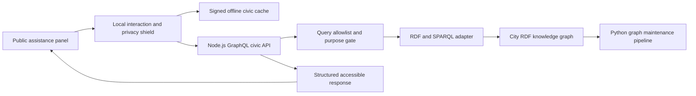

# Assistance Panel Integration with City RDF Knowledge Graph

## Purpose

This architecture connects public assistance panels to a city-wide civic knowledge graph represented in RDF and queried through SPARQL.

The integration provides structured answers about:

- Transit arrivals, disruptions, and accessible routes.
- Cooling centers, public facilities, and service hours.
- Water, heat, weather, and emergency information.
- Accessibility features such as step-free entry, accessible restrooms, elevators, tactile wayfinding, hearing-loop availability, and offline service paths.
- Public health, shelter, food, charging, sanitation, and civic-support resources.

The system is public-information infrastructure. It is not an identity system, surveillance platform, access-control mechanism, location-tracking service, social-scoring system, or automated eligibility decision engine.

SPARQL defines a query language for RDF and supports querying across diverse data sources. [246][249] Federated SPARQL also creates security considerations because distributed queries can dereference remote service locations; the panel gateway therefore uses an approved query registry and does not execute arbitrary panel-originated SPARQL. [251]

## Core Architecture



## Data Flow

```text
Panel input
    |
    +--> Local intent extraction
    |
    +--> Offline cache lookup
    |       |
    |       +--> Return signed local answer if current and relevant
    |
    +--> GraphQL public-information query
            |
            +--> Query allowlist
            |
            +--> Parameter validation
            |
            +--> RDF-to-SPARQL adapter
            |
            +--> City knowledge graph
            |
            +--> Structured civic response
            |
            +--> Local rendering in text, speech, sign, and accessible display formats
```

The panel does not send camera frames, audio, biometric information, personal identity, device identifiers, augmentation status, health information, location history, free-text transcript, or persistent session token to the city graph.

## RDF Information Model

Use public, service-oriented RDF entities:

```text
civic:Service
civic:Facility
civic:TransitStop
civic:TransitRoute
civic:AccessibilityFeature
civic:EmergencyNotice
civic:OpeningHours
civic:ServiceDisruption
civic:CoolingCenter
civic:WaterDistributionPoint
```

Core properties:

```text
civic:hasName
civic:hasServiceCategory
civic:hasAccessibleEntrance
civic:hasAccessibleRestroom
civic:hasHearingLoop
civic:hasStepFreeAccess
civic:hasTactileWayfinding
civic:hasOfflineServicePath
civic:hasServiceHours
civic:hasCurrentStatus
civic:hasPlainLanguageSummary
civic:hasAccessibilityNotice
civic:updatedAt
civic:expiresAt
civic:operatedBy
```

The graph stores civic facts. It must not store or infer personal cybernetic, augmentation, disability, health, neural, biometric, or behavioral profiles for panel users.

## Approved SPARQL Query Registry

The gateway maintains a fixed registry of parameterized query templates.

Permitted query categories:

- `nearby_accessible_transit`
- `transit_disruption`
- `cooling_center_status`
- `facility_accessibility_features`
- `public_restroom_accessibility`
- `water_service_location`
- `emergency_notice`
- `service_hours`
- `offline_assistance_directory`

The panel sends only a bounded intent and coarse public context. It never sends arbitrary SPARQL text.

Example: cooling-center status query.

```sparql
PREFIX civic: <https://augmented-hub.example/ns/civic#>

SELECT ?facility ?name ?status ?summary ?updatedAt ?expiresAt
WHERE {
  ?facility a civic:CoolingCenter ;
            civic:hasName ?name ;
            civic:hasCurrentStatus ?status ;
            civic:hasPlainLanguageSummary ?summary ;
            civic:updatedAt ?updatedAt ;
            civic:expiresAt ?expiresAt .
  FILTER(?status = "open")
}
ORDER BY DESC(?updatedAt)
LIMIT 20
```

Example: accessibility-features query.

```sparql
PREFIX civic: <https://augmented-hub.example/ns/civic#>

SELECT ?facility ?name ?stepFree ?restroom ?hearingLoop ?offlinePath ?updatedAt
WHERE {
  ?facility a civic:Facility ;
            civic:hasName ?name ;
            civic:hasAccessibleEntrance ?stepFree ;
            civic:hasAccessibleRestroom ?restroom ;
            civic:hasOfflineServicePath ?offlinePath ;
            civic:updatedAt ?updatedAt .
  OPTIONAL { ?facility civic:hasHearingLoop ?hearingLoop . }
  FILTER(?stepFree = true)
}
ORDER BY DESC(?updatedAt)
LIMIT 50
```

## GraphQL API Boundary

The GraphQL API exposes public-information types only.

```graphql
type CivicAnswer {
  answerType: String!
  title: String!
  plainLanguageText: String!
  speechText: String!
  signResponseKey: String!
  sourceUpdatedAt: String
  expiresAt: String
  offlineAvailable: Boolean!
  accessibilityNotices: [String!]!
}

type Query {
  coolingCenters(language: String!): [CivicAnswer!]!
  accessibleFacilities(category: String!, language: String!): [CivicAnswer!]!
  transitStatus(route: String!, language: String!): [CivicAnswer!]!
  emergencyNotices(language: String!): [CivicAnswer!]!
}
```

The gateway must reject:

```text
arbitrary_sparql
user_identifier
device_identifier
precise_location_history
camera_data
audio_data
free_text_transcript
augmentation_status
health_data
neural_data
biometric_data
persistent_session_token
```

## Privacy Layer

The privacy layer enforces:

- Anonymous public queries by default.
- No account requirement.
- No persistent panel-user identifier.
- No user-specific query history.
- No background location collection.
- Coarse, service-area context only where strictly needed for a query.
- Local text processing where feasible.
- Rotating short-lived request identifiers for transport troubleshooting only.
- Strict log minimization.
- Small-count suppression in aggregate usage reporting.
- No cross-linking to transit fare, Wi-Fi, camera, law-enforcement, benefit, employment, health, or identity systems.
- Outbound-only panel connections.
- Encryption in transit between panel, API, and graph services.
- Accessible privacy notice and local no-network fallback.

## Offline Cache

The panel maintains a signed cache containing:

- Emergency notices.
- Cooling-center directory and accessibility features.
- Transit accessibility information.
- Public restroom and water-service directory.
- Facility hours.
- Shelter and food-service information.
- Municipal contact and grievance routes.
- Accessibility help information.
- Plain-language and multilingual response bundles.
- Sign-language response keys and local avatar assets.

Each cache object contains:

```text
resource_type
resource_key
content_version
source_updated_at
expires_at
signature
content_hash
language
accessibility_profiles
offline_fallback
```

Cache validity is:

\[
\operatorname{CacheValid}
=
\operatorname{SignatureValid}
\land
\operatorname{CurrentTime} \le \operatorname{expiresAt}
\]

If no current graph connection exists, the panel uses the newest valid signed cache. If a cached record has expired, the panel displays the most recent record with an explicit freshness warning and offers a human-assistance contact path.

## Cache Refresh

The Python graph-maintenance service:

- Ingests authorized transit, facility, service, emergency, and accessibility records.
- Validates source ownership, time range, schema, and accessibility fields.
- Converts approved records to RDF.
- Updates the RDF store through versioned transactions.
- Produces signed offline cache packages.
- Publishes cache manifests.
- Preserves prior package hashes for audit, not user interaction histories.
- Runs consistency checks to prevent contradictory open/closed, accessible/inaccessible, or expired/current records.
- Requires human review for high-impact emergency or access-status changes.

## Failure States

| Condition | Panel behavior |
|---|---|
| RDF graph unavailable | Use valid local cache and show offline state |
| GraphQL gateway unavailable | Use valid local cache and accessible municipal contact path |
| Query not in registry | Reject query and show supported civic topics |
| SPARQL timeout | Return offline fallback or a clear unavailable status |
| Cache signature invalid | Reject cached content and use the next valid signed package |
| Cache expired | Show freshness notice, use best available offline information, and offer help contact |
| Accessibility data missing | Do not claim accessibility; display “accessibility details need confirmation” |
| High-impact data conflict | Hold live update, retain previously validated result where safe, and route to authorized review |

## Metrics

| Metric | Value | Basis |
|---|---:|---|
| knowledge_factor | 0.93 | Uses RDF service modeling, query allowlists, GraphQL schema controls, signed cache packages, source validation, and failure handling |
| eco_impact_value | 0.60 | Helps residents use transit, cooling, water, and civic resources efficiently while minimizing unnecessary travel and repeated inquiry traffic |
| harm_risk | 0.17 | Reduced through anonymous access, no arbitrary graph queries, strict data exclusions, signed offline cache, and human review for critical updates |
| accessibility_impact | 0.99 | Delivers accessible facility, transit, and service information through text, speech, sign, offline, and no-account pathways |
| rights_alignment | 0.99 | Protects privacy, dignity, non-discrimination, offline access, public-information equality, and accountable civic data governance |
