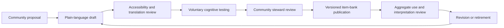
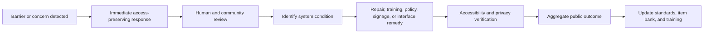

# Augmented Identity Public-Benefit Conventions

## Purpose

This document gives operational definitions for eight public-benefit ideas:

- Accessibility dividend ledger.
- No-disclosure usability standard.
- Community-owned item bank.
- Restorative response reviews.
- Interoperability parity testing.
- Participatory interpretation sessions.
- Small-cell dignity rule.
- Repair-first performance measure.

Together, these conventions help public institutions, civic-technology teams, researchers, libraries, transit agencies, cooling centers, parks, service kiosks, and assistance panels evaluate whether a system is becoming more welcoming and usable without collecting unnecessary personal, health, disability, augmentation, biometric, or device data.

The conventions are designed for public interfaces and public services. They do not create an identity registry, medical classification process, eligibility system, surveillance program, behavioral score, or requirement that a person disclose whether they use an augmentation or assistive technology.

## Shared baseline

Every participating system must uphold:

\[
G_{\text{identity}} = 0
\]

\[
G_{\text{augmentation-disclosure}} = 0
\]

\[
G_{\text{disability-proof}} = 0
\]

\[
G_{\text{device-required}} = 0
\]

\[
D_{\text{person,persistent}} = 0
\]

\[
A_{\text{standard-access}} = 1
\]

Where:

- \(G_{\text{identity}}\) is an identity requirement for core service use.
- \(G_{\text{augmentation-disclosure}}\) is a requirement to declare an augmentation or assistive interface.
- \(G_{\text{disability-proof}}\) is a request for diagnosis, medical evidence, or proof before access or accommodation.
- \(G_{\text{device-required}}\) is a mandatory phone, app, account, proprietary device, or internet connection requirement.
- \(D_{\text{person,persistent}}\) is persistent personal or person-derived interaction data.
- \(A_{\text{standard-access}}\) means standard accessible interaction remains available.

The protected baseline experience is:

```text
A person can enter the public space.
A person can obtain core service information.
A person can use the interface.
A person can request assistance.
A person can report a barrier.
A person can use a non-digital or standard accessible alternative.
A person can decline to disclose personal or augmentation-related information.
```

## Accessibility dividend ledger

### Definition

An accessibility dividend ledger is an aggregate public record of improvements that make a public system more usable for everyone.

It records **system benefits**, not the cost or identity of people who need access support.

The ledger recognizes that improvements such as tactile controls, captioning, readable notices, keyboard support, broad touch targets, interoperable input, simple language, quiet areas, step-free routes, and offline public information often benefit many people at once.

### What it records

| Ledger field | Meaning |
|---|---|
| Improvement description | What changed in the public service or interface |
| Service context | Kiosk, transit gate, cooling center, library, park, assistance panel, public website |
| Access pathway improved | Touch, tactile, keyboard, screen reader, switch, speech output, language, route access, printed information |
| Baseline result | Aggregate usability or barrier measure before the change |
| Post-change result | Aggregate usability or barrier measure after the change |
| Evidence method | Audit, voluntary survey, conformance test, repair record, community review |
| Public benefit | Time saved, barrier removed, task completion increase, complaint reduction, reliability improvement |
| Remaining limitation | What still needs attention |
| Review status | Pending, community reviewed, independently reviewed, completed |
| Privacy status | Confirms no person-level data was retained |

### Example entry

```text
Improvement: Added tactile Home, Back, Repeat, Volume, Contrast, and Start Over controls.
Service context: Public assistance kiosk.
Access pathway improved: Tactile physical input and low-vision navigation.
Baseline result: No independently usable physical navigation pathway.
Post-change result: Essential tasks completed through tactile controls in inclusive usability testing.
Evidence method: Voluntary test panel and accessibility audit.
Public benefit: More people can recover from navigation errors and reset sessions independently.
Remaining limitation: Audio-output hardware is scheduled for a later upgrade.
Privacy status: Only aggregate task outcomes retained.
```

### Dividend calculation

Let:

- \(C_0\) be aggregate task-completion rate before an improvement.
- \(C_1\) be aggregate task-completion rate after an improvement.
- \(B_0\) be aggregate barrier rate before an improvement.
- \(B_1\) be aggregate barrier rate after an improvement.
- \(R_0\) be median time to resolve a verified barrier before the improvement.
- \(R_1\) be median time to resolve a verified barrier after the improvement.

An accessibility dividend can be expressed as:

\[
D_{\text{access}} =
w_c(C_1-C_0)
+
w_b(B_0-B_1)
+
w_r
\left(
\frac{R_0-R_1}{\max(R_0,\epsilon)}
\right)
\]

Where:

\[
w_c + w_b + w_r = 1
\]

and \(\epsilon > 0\) prevents division by zero.

This value is a public-system improvement measure. It must not be used to rank individuals, staff members, device users, or communities.

### Why it matters

The ledger reframes accessibility as shared civic infrastructure. Instead of treating a ramp, clear signage, tactile button, accessible transit route, or offline public-service kiosk as a special cost for a specific population, it records the measurable collective benefit of a more usable environment.

## No-disclosure usability standard

### Definition

The no-disclosure usability standard requires that a person can complete core public-service tasks without disclosing disability status, augmentation status, medical information, identity, income, housing status, device ownership, or other sensitive attributes.

This is a system-design requirement, not an optional courtesy.

### Core tasks

A participating public site must demonstrate that a person can:

```text
Find the entrance or public-service point.
Enter through an accessible route or obtain an equivalent accessible route.
Obtain core information.
Use a standard accessible interaction method.
Request help.
Use a fallback if a preferred interaction method fails.
Receive an accommodation on request.
Submit a correction or barrier report.
Leave or reset a session without persistent tracking.
```

### Required proof

The standard is demonstrated by task testing, not by asking users to explain their bodies, devices, diagnoses, or identities.

For task set \(T\), define:

\[
U_{\text{no-disclosure}} =
\frac{
\left|
\left\{
t \in T :
\operatorname{complete}(t)
\land
\operatorname{noDisclosureRequired}(t)
\right\}
\right|
}{
|T|
}
\]

The target is:

\[
U_{\text{no-disclosure}} = 1
\]

### Examples

| Public task | Compliant design | Non-compliant design |
|---|---|---|
| Use a transit gate | Offers standard accessible gate, tactile input, staff assistance, or equivalent route | Requires a person to identify a device or show medical documentation |
| Obtain cooling-center access | Walk-in entry with water, seating, accessible route, and support on request | Requires proof of age, disability, income, address, or medical vulnerability |
| Use a kiosk | Touch, tactile, keyboard, speech output, and plain-language controls available to all | Requires a proprietary augmentation, mobile app, account, or Bluetooth pairing |
| Request help | “Request assistance” control with accessible staff contact | Requires a disability explanation before staff will provide basic assistance |
| Report a barrier | Anonymous or identified options, accessible formats, no account required | Requires login, phone verification, or disclosure of diagnosis |

### Operational rule

A person may choose to share information when they want a particular voluntary support arrangement, but the public site must not make disclosure the default path to ordinary access.

\[
\operatorname{Access}(p)
\not\Leftarrow
\operatorname{Disclosure}(p)
\]

\[
\operatorname{Access}(p)
\Leftarrow
\operatorname{PublicServiceNeed}(p)
\]

## Community-owned item bank

### Definition

A community-owned item bank is a versioned, publicly reviewable collection of survey questions, accessibility test prompts, translations, plain-language explanations, cognitive-interview notes, usability scenarios, and retired-language records.

It prevents a research team or vendor from silently changing the meaning of “acceptance,” “inclusion,” “accessibility,” or “belonging.”

The item bank is community-owned in the governance sense: people affected by the public system have an ongoing role in proposing, reviewing, approving, translating, revising, and retiring items.

### Contents

```text
Survey item text.
Plain-language explanation.
Intended construct.
Response scale.
Translation versions.
Reading-level review.
Cognitive-test notes.
Accessibility review.
Known limitations.
Version history.
Approval status.
Retirement reason.
Use restrictions.
Privacy classification.
```

### Example item

```json
{
  "item_id": "public-service-autonomy-v1",
  "construct": "autonomy",
  "plain_language_text": "I could use this service without sharing personal information I did not want to share.",
  "response_scale": [
    "strongly disagree",
    "disagree",
    "not sure",
    "agree",
    "strongly agree",
    "prefer not to answer"
  ],
  "use_contexts": [
    "public kiosks",
    "cooling centers",
    "transit stations",
    "libraries"
  ],
  "privacy_classification": "voluntary-anonymous-response",
  "accessibility_review_status": "community-reviewed",
  "language_status": "plain-language-reviewed",
  "retirement_status": "active"
}
```

### Item lifecycle



### Retirement of stigmatizing language

An item should be retired if it:

- Pressures a person to disclose sensitive information.
- Assumes augmentation is a defect, threat, novelty, or burden.
- Frames assistive technology as abnormal.
- Treats self-asserted identity as something to verify.
- Invites covert observation.
- Cannot be understood in tested plain language.
- Produces avoidable harm or misunderstanding.
- Measures a construct more safely through an environmental or service audit.

A retirement record should preserve accountability without reproducing harmful language more widely than needed.

### Why it matters

Community-based participatory research emphasizes equitable partnership and shared power across research stages, from defining questions through dissemination. [202][204] In accessibility evaluation, W3C recommends involving users with disabilities and recognizes that different kinds of expertise and lived experience strengthen evaluations. [203][205][209]

## Restorative response reviews

### Definition

A restorative response review is a structured process for turning a reported barrier, harmful interaction, inaccessible interface, or policy failure into a transparent repair action.

The purpose is to improve the public system, restore access, and prevent recurrence. It is not a tool for creating punitive profiles of people who report harm, public-service users, staff, or community members.

### Review inputs

A review may begin from:

- Anonymous barrier report.
- Voluntary survey response.
- Accessibility audit.
- Conformance test failure.
- Public correction request.
- Community steward observation.
- Maintenance report.
- Translation or plain-language concern.
- Privacy concern.
- Interoperability failure.
- Site-level access incident.

### Review output

The public-facing result should contain only aggregate, non-identifying information:

```text
Barrier category.
Service context.
Impact on public access.
Immediate mitigation.
Root system condition.
Corrective action.
Responsible public unit or project role.
Target completion period.
Verification method.
Accessibility review status.
Privacy review status.
Current status.
```

### Restorative cycle



### Root-system categories

Use categories that describe conditions, not people:

```text
Interface design gap
Physical access barrier
Information clarity gap
Language-access gap
Staff training need
Interoperability limitation
Fallback failure
Privacy-design gap
Maintenance backlog
Procurement or repair-part gap
Policy ambiguity
Emergency continuity gap
```

### Resolution metric

Let:

- \(N_r\) be the number of verified barriers received.
- \(N_m\) be barriers with an immediate access-preserving mitigation.
- \(N_c\) be barriers closed after verified remediation.

\[
C_{\text{mitigation}} =
\frac{N_m}{\max(N_r,1)}
\]

\[
C_{\text{remediation}} =
\frac{N_c}{\max(N_r,1)}
\]

A good program reports both. A site should not claim success merely because a report was acknowledged; it should show whether access was restored and whether recurrence was reduced.

## Interoperability parity testing

### Definition

Interoperability parity testing verifies that optional augmentation-compatible interaction and standard accessible interaction both meet the same core service-completion expectations.

The goal is not to privilege one access path. The goal is to ensure that every person can use a public system whether they use touch, tactile controls, keyboard, switch input, speech output, an optional assistive interface, or no augmentation at all.

### Required interaction pathways

A public interface should test, when applicable:

```text
Touch interaction.
Physical tactile controls.
Keyboard navigation.
Switch-compatible input.
Screen-reader-compatible structure.
Speech output.
High-contrast display.
Text enlargement.
Optional intent-only augmentation interface.
Standard fallback after augmentation-interface failure.
```

### Essential task set

```text
Reach the home screen.
Find core information.
Move focus.
Activate a control.
Return to a previous screen.
Repeat information.
Change text size.
Change contrast.
Request help.
End or reset the session.
Complete the core public-service task using standard controls after an optional method fails.
```

### Parity calculation

Let:

- \(S_m\) be successful task completions for mode \(m\).
- \(A_m\) be attempts for mode \(m\).

\[
C_m =
\frac{S_m}{\max(A_m,1)}
\]

For two modes \(m_1\) and \(m_2\), parity gap is:

\[
G_{m_1,m_2} =
\left|
C_{m_1} - C_{m_2}
\right|
\]

The system should satisfy:

\[
C_m \geq C_{\min}
\]

for every supported mode, and:

\[
G_{m_1,m_2} \leq \delta
\]

Where:

- \(C_{\min}\) is the adopted completion threshold.
- \(\delta\) is the maximum acceptable disparity between supported modes.

A strict fallback rule is:

\[
C_{\text{standard fallback}} = 1
\]

for tested preferred-method failure cases.

### Testing interpretation

If an optional augmentation pathway performs well but standard controls fail, the interface is not inclusive.

If standard controls perform well but an optional accessible pathway fails, the interface has an interoperability gap that needs repair.

If a test produces a low completion rate, do not attribute failure to a participant’s body, device, or identity. Investigate the interface, instructions, timing, physical environment, staffing, and available alternatives.

## Participatory interpretation sessions

### Definition

Participatory interpretation sessions are facilitated reviews in which affected communities, public-service users, disability advocates, augmented citizens, staff, researchers, and accessibility practitioners interpret aggregate study results before the results are published as conclusions.

They prevent a narrow technical team from assigning meaning to data without the people most affected by public-space design.

### What participants review

- Survey item interpretation.
- Missing or underrepresented perspectives.
- Accessibility of the results themselves.
- Data-quality limitations.
- Non-response and sampling limits.
- Potentially stigmatizing interpretations.
- Whether the proposed remedy is likely to help.
- Whether publication could expose a small group.
- Whether public language is respectful and clear.
- Whether an intervention changes access equitably.

### Session protocol

1. Publish accessible pre-reading or audio summary.
2. State the purpose, privacy boundary, and decision scope.
3. Provide multiple participation modes: in-person, remote, written, phone/relay, interpreter-supported, and asynchronous comment options.
4. Do not require attendees to identify as augmented or disabled.
5. Present only aggregate, small-cell-safe results.
6. Separate observed findings from proposed interpretations.
7. Record themes and decisions without attributing statements to identifiable attendees unless someone explicitly requests attribution.
8. Publish an accessible summary of what changed because of the session.
9. Provide a correction path after publication.

### Interpretation confidence

Let:

- \(K_d\) be data-quality confidence.
- \(K_c\) be calibration or measurement confidence.
- \(K_p\) be participatory-review completeness.
- \(K_u\) be uncertainty disclosure quality.

\[
K_{\text{interpretation}} =
K_d
\cdot
K_c
\cdot
K_p
\cdot
K_u
\]

This multiplicative form means a weak element remains visible. Strong participation cannot turn weak data into strong evidence, and strong data does not justify excluding affected communities from interpretation.

## Small-cell dignity rule

### Definition

The small-cell dignity rule protects people from being exposed through overly detailed public reporting.

Even a report that omits names can reveal a person or small group when it combines a rare characteristic, a narrow location, a specific time, a small service setting, or a distinctive device or access method.

The rule therefore prioritizes dignity and safety over maximum analytic detail.

### Suppression rule

Let \(n_c\) be the number of valid responses or observations in reporting cell \(c\), and let \(k\) be the minimum reporting threshold selected through governance and privacy review.

\[
n_c < k
\Rightarrow
\operatorname{publish}(c) = \varnothing
\]

Where publication may instead be:

- Suppressed.
- Merged with a broader category.
- Merged across a longer time period.
- Reported only as a qualitative theme.
- Reviewed by a privacy steward before release.

### Complementary suppression

If publishing one total and several categories would reveal a suppressed category by subtraction, suppress enough related values to preserve the boundary.

For a total \(T\) and published categories \(x_1, \ldots, x_{m-1}\):

\[
x_m =
T -
\sum_{j=1}^{m-1}x_j
\]

If \(x_m < k\), publishing all other values reveals the suppressed result. The release must therefore use complementary suppression, coarser aggregation, or a different reporting form.

### Examples

| Risky publication | Dignity-preserving publication |
|---|---|
| “One neural-input user reported a barrier at this specific station this month.” | “A small number of accessibility reports were received across multiple stations; individual counts are not published.” |
| “Two people using a rare device type reported problems at a named library.” | “Interoperability concerns were reported and are under review; device-specific counts are suppressed.” |
| “The only wheelchair user in a small program could not access the kiosk.” | “The kiosk did not meet the access standard in testing; remediation is in progress.” |

### Why it matters

The aim is not only technical de-identification. It is to prevent public reporting from turning rare access needs or self-asserted identities into public exposure.

NIST’s Privacy Framework describes privacy-risk management as a collaborative, consensus-based process; its privacy-engineering guidance includes data minimization and processing that limits identification. [201][210]

## Repair-first performance measure

### Definition

A repair-first performance measure evaluates a public system by how quickly and effectively it restores accessibility after a verified barrier is identified.

It avoids the harmful pattern of treating barriers as mere complaint volume while allowing infrastructure to remain inaccessible for long periods.

### Time measures

Let:

- \(t_r\) be the time a verified barrier is reported.
- \(t_a\) be the time the report is acknowledged.
- \(t_m\) be the time immediate mitigation becomes available.
- \(t_c\) be the time durable remediation is completed.
- \(t_v\) be the time remediation is verified through accessibility and privacy testing.

Then:

Acknowledgement time:

\[
T_{\text{ack}} =
t_a - t_r
\]

Mitigation time:

\[
T_{\text{mitigation}} =
t_m - t_r
\]

Durable repair time:

\[
T_{\text{repair}} =
t_c - t_r
\]

Verified repair time:

\[
T_{\text{verified}} =
t_v - t_r
\]

### Repair-first score

Let:

- \(M\) be the proportion of verified barriers with an immediate mitigation.
- \(V\) be the proportion of completed repairs that pass verification.
- \(\widetilde{T}_{\text{repair}}\) be median durable repair time.
- \(T_{\text{target}}\) be the adopted target repair time.

\[
R_{\text{first}} =
0.35M +
0.35V +
0.30
\left(
1 -
\min
\left(
\frac{
\widetilde{T}_{\text{repair}}
}{
T_{\text{target}}
},
1
\right)
\right)
\]

This measure is not intended to hide difficult repairs. When capital work, procurement, or site reconstruction is required, the public record should distinguish:

```text
Immediate mitigation completed.
Durable repair planned.
Funding or procurement dependency.
Expected completion period.
Temporary accessible alternative.
Verification plan.
```

### Examples of mitigation

- Provide an accessible alternate entrance while a door control is repaired.
- Provide staff-assisted but autonomy-preserving access while a tactile panel is replaced.
- Restore printed and spoken service information while a kiosk display is repaired.
- Provide a manual accessible gate route while an automated transit control is fixed.
- Offer local offline service information when a network-dependent interface fails.
- Add a temporary high-contrast sign and physical assistance route while permanent signage is fabricated.

The mitigation must not become the permanent substitute for an accessible system.

## Minimal implementation sequence

1. Adopt the no-disclosure usability standard and task list.
2. Add a public barrier-reporting route that accepts anonymous submissions.
3. Establish the repair-first clock and publish aggregate response data.
4. Create a small initial item bank with plain-language, voluntary questions.
5. Conduct inclusive, voluntary parity testing across standard interaction modes.
6. Establish small-cell suppression before publishing any findings.
7. Convene participatory interpretation sessions before final reports.
8. Publish an accessibility dividend ledger that shows what improved and what remains unresolved.

## Metrics

| Metric | Formula | Target |
|---|---|---:|
| No-disclosure usability | \(U_{\text{no-disclosure}}\) | 1 |
| Standard access availability | \(A_{\text{standard-access}}\) | 1 |
| Interaction completion | \(C_m = S_m / A_m\) | At least adopted threshold for every supported mode |
| Parity gap | \(G_{m_1,m_2} = |C_{m_1}-C_{m_2}|\) | At most adopted disparity threshold |
| Immediate mitigation coverage | \(C_{\text{mitigation}}\) | At least 0.95 |
| Verified remediation coverage | \(C_{\text{remediation}}\) | At least 0.95 |
| Small-cell publication violations | Count of releases below the threshold without safe aggregation | 0 |
| Item-bank review coverage | Reviewed active items divided by active items | 1 |
| Participatory interpretation coverage | Published reports reviewed through the participatory process divided by published reports | 1 |

## Project metrics

| Metric | Score | Basis |
|---|---:|---|
| knowledge_factor | 0.91 | Definitions map to measurable system outcomes, public documentation, accessible testing, and reviewable formulas |
| eco_impact_value | 0.74 | Repair-first and interoperable design extend public-interface life, reduce replacement pressure, and improve equitable access to eco-social infrastructure |
| harm_risk | 0.16 | The standard excludes identity and device tracking, requires small-cell protection, prohibits disclosure gates, and favors restorative improvement |
| accessibility_impact | 0.98 | It makes standard access, fallback access, accessible research participation, parity testing, and repair verification explicit requirements |
| rights_alignment | 0.99 | It supports dignity, autonomy, non-discrimination, privacy, accessibility, repair, accountability, and civic participation |
