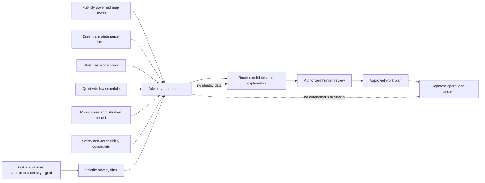

# City Maintenance Bot Path Planning with Recognition-at-Rest

## Purpose

This design defines a privacy-preserving path-planning method for municipal maintenance support systems operating around public parks, quiet neighborhoods, libraries, schools, cooling locations, transit areas, pedestrian corridors, and other community spaces.

The system aims to reduce avoidable disturbance while preserving timely essential maintenance, including litter collection, sanitation, accessibility hazard response, water-service support, infrastructure inspection, and emergency cleanup.

The system is advisory by default:

- It generates route candidates, cost explanations, projected disturbance, energy use, and service-coverage evidence.
- An authorized human operator reviews and selects or approves an operational plan.
- It does not independently authorize vehicle movement, deploy physical systems, identify people, infer health or disability, classify behavior, or make service-priority decisions about specific persons.
- It does not use facial recognition, person re-identification, device tracking, phone identifiers, biometric templates, voiceprints, or persistent location traces.

The design follows an essential-service principle:

\[
\text{Rest-aware routing}
\not\Rightarrow
\text{reduced sanitation, safety, accessibility, water, or emergency service}
\]

## Rights and safety invariants

The planner must preserve all of the following invariants:

\[
D_{\text{person,persistent}} = 0
\]

\[
I_{\text{identity}} = 0
\]

\[
I_{\text{biometric}} = 0
\]

\[
I_{\text{device-tracking}} = 0
\]

\[
I_{\text{raw-audio}} = 0
\]

\[
I_{\text{raw-video}} = 0
\]

\[
C_{\text{essential}} \geq C_{\min}
\]

Where:

- \(D_{\text{person,persistent}}\) is retained person-derived information.
- \(I_{\text{identity}}\) is identity inference or identity collection.
- \(I_{\text{biometric}}\) is biometric processing or retention.
- \(I_{\text{device-tracking}}\) is collection of persistent device-linked information.
- \(I_{\text{raw-audio}}\) and \(I_{\text{raw-video}}\) represent raw recording or retention.
- \(C_{\text{essential}}\) is essential-maintenance coverage.
- \(C_{\min}\) is the community-governed minimum coverage threshold.

Rest-aware routing is a disturbance-reduction feature. It is never an excuse to leave waste, hazards, blocked accessible routes, flood debris, or sanitation issues unresolved.

## Terminology

| Term | Meaning | Not a proxy for |
|---|---|---|
| Rest zone | Publicly defined area and time window where reduced operational disturbance is beneficial | A record that a particular person is present, sleeping, inactive, disabled, or vulnerable |
| Quiet window | Publicly governed time interval with stricter disturbance preference | A curfew, exclusion zone, or denial of maintenance |
| Essential task | Maintenance activity required for sanitation, safety, accessibility, water, or emergency continuity | A discretionary convenience activity |
| Soft constraint | A cost increase that encourages but does not force route avoidance | A hard prohibition |
| Hard constraint | A condition that cannot be violated by a route candidate | A subjective preference |
| Anonymous density signal | Coarse, short-lived occupancy estimate that cannot identify or track individuals | Facial recognition, device tracking, or person counting with retention |
| Disturbance | Estimated route-related sound, light, vibration, obstruction, or repeated passage burden | A judgment about people’s worthiness or behavior |

## Architecture



The route planner is separated from the operational control stack. It emits route plans and evidence, not driving commands, motor commands, manipulator commands, or actuator instructions.

## Cost-map model

### Layered representation

Model the traversable environment as a graph:

\[
G = (V, E)
\]

Where:

- \(V\) is the set of navigation cells or nodes.
- \(E\) is the set of allowed transitions between nodes.

Each edge \(e \in E\) has cost:

\[
J(e,t) =
w_d C_d(e)
+
w_t C_t(e)
+
w_e C_e(e)
+
w_r C_r(e,t)
+
w_a C_a(e)
+
w_h C_h(e,t)
\]

Where:

- \(C_d\) is travel distance cost.
- \(C_t\) is estimated travel-time cost.
- \(C_e\) is estimated energy cost.
- \(C_r\) is rest-zone disturbance cost.
- \(C_a\) is accessibility-corridor protection cost.
- \(C_h\) is hazard or safety cost.
- \(w_d, w_t, w_e, w_r, w_a, w_h\) are weights selected through public governance and operational testing.

A complete route \(P\) has cost:

\[
J(P) =
\sum_{e \in P} J(e,t_e)
\]

The selected route is:

\[
P^* =
\arg \min_{P \in \mathcal{F}}
J(P)
\]

Where \(\mathcal{F}\) is the set of feasible paths satisfying all hard constraints.

### Hard constraints

The planner must reject candidate paths that violate:

\[
\mathcal{F} =
\left\{
P :
\begin{aligned}
&\operatorname{collisionFree}(P) \\
&\land\ \operatorname{accessibilityClearance}(P) \\
&\land\ \operatorname{emergencyAccess}(P) \\
&\land\ \operatorname{taskDeadline}(P) \\
&\land\ \operatorname{batteryReserve}(P) \\
&\land\ \operatorname{operationalSafety}(P)
\end{aligned}
\right\}
\]

A rest zone never overrides a hard safety requirement. For example, a hazardous obstruction in an accessible route, a sanitation emergency, or a water-infrastructure issue must remain eligible for prompt action.

### Soft rest-zone cost

For a cell or edge \(x\), define:

\[
C_r(x,t) =
Z(x)
\cdot
W(t)
\cdot
N(x,t)
\cdot
M_{\text{task}}
\]

Where:

- \(Z(x)\) is a publicly defined rest-zone intensity.
- \(W(t)\) is a quiet-window multiplier.
- \(N(x,t)\) is an optional anonymous, coarse density estimate.
- \(M_{\text{task}}\) is a task-type multiplier.

All components are nonnegative:

\[
Z(x), W(t), N(x,t), M_{\text{task}} \geq 0
\]

A simple bounded form is:

\[
Z(x) \in [0, 1]
\]

\[
W(t) \in [1, W_{\max}]
\]

\[
N(x,t) \in [0, 1]
\]

\[
M_{\text{task}} \in [0, 1]
\]

The rest-zone cost is a routing preference, not an exclusion rule:

\[
C_r(x,t) < \infty
\]

This preserves the ability to serve essential tasks when alternatives are unavailable.

### Task urgency override

Let \(U_q\) be the urgency level for task \(q\), normalized to \([0,1]\). Let \(M_{\text{task}}\) be:

\[
M_{\text{task}} = 1 - U_q
\]

Then:

\[
U_q = 1
\Rightarrow
M_{\text{task}} = 0
\]

For a high-urgency sanitation, safety, flood, fire, water, or accessibility task, the rest-zone penalty does not suppress the essential response. The planner still records expected disturbance and provides the least-disturbing feasible route.

### Service-quality preservation

Define task completion quality:

\[
Q_{\text{service}} =
\alpha C_{\text{coverage}}
+
\beta T_{\text{timeliness}}
+
\gamma A_{\text{accessibility}}
+
\delta S_{\text{safety}}
\]

Where every component is normalized to \([0,1]\).

The planner must satisfy:

\[
Q_{\text{service}} \geq Q_{\min}
\]

A rest-aware plan is admissible only if it also maintains baseline essential-service coverage:

\[
C_{\text{coverage,rest-aware}}
\geq
C_{\text{coverage,baseline}}
\]

When no route can satisfy both the disturbance objective and the service-quality constraint, the planner must present the tradeoff for human review rather than silently deferring the task.

## Disturbance model

### Sound and vibration

For edge \(e\) traversed over time interval \([t_0,t_1]\), calculate a weighted acoustic disturbance estimate:

\[
D_{\text{sound}}(e) =
\int_{t_0}^{t_1}
L_A(t)
\cdot
Z(e)
\cdot
W(t)
\,dt
\]

Where \(L_A(t)\) is an A-weighted noise measure or a route-specific modeled sound level.

For practical planning, use time-discretized intervals:

\[
D_{\text{sound}}(e) \approx
\sum_{k=1}^{n}
L_{A,k}
\cdot
Z(e)
\cdot
W(t_k)
\cdot
\Delta t_k
\]

A normalized noise exposure term can be defined as:

\[
\widehat{L}_A =
\min
\left(
1,
\frac{L_A}{L_{\text{reference}}}
\right)
\]

Then:

\[
C_{\text{noise}}(e,t) =
\widehat{L}_A
\cdot Z(e)
\cdot W(t)
\]

Noise guidance should distinguish public comfort from occupational exposure limits. OSHA notes that sound levels are measured in decibels and identifies an 85 dBA eight-hour time-weighted average as a hearing-conservation action level in covered workplaces; it is not a community quiet-zone target. [114][115]

### Multi-channel disturbance

Use a broader disturbance score:

\[
D(e,t) =
\lambda_n D_{\text{sound}}
+
\lambda_v D_{\text{vibration}}
+
\lambda_l D_{\text{light}}
+
\lambda_o D_{\text{obstruction}}
+
\lambda_p D_{\text{repeat-pass}}
\]

Where:

- \(D_{\text{sound}}\) estimates acoustic disturbance.
- \(D_{\text{vibration}}\) estimates ground or structure vibration.
- \(D_{\text{light}}\) estimates avoidable nighttime lighting burden.
- \(D_{\text{obstruction}}\) estimates temporary interference with pedestrian and mobility-device access.
- \(D_{\text{repeat-pass}}\) discourages repeated robot passage through the same rest zone.

This allows the planner to minimize disturbance without encoding assumptions about the people who may use a space.

### Repeated-passage penalty

Let \(k_z\) be the number of planned passes through zone \(z\) within a planning interval. Let \(k_{\text{free}}\) be the number of passes allowed without additional penalty.

\[
D_{\text{repeat-pass}}(z) =
\max(0, k_z - k_{\text{free}})
\]

This encourages batching and route consolidation, reducing repeated disruption while preserving task completion.

## Privacy-preserving sensing

### Recommended inputs

The planner should prefer public, environmental, and operational inputs:

| Input | Permitted form | Retention | Planning use |
|---|---|---|---|
| Public rest-zone map | Community-approved static polygons and quiet windows | Versioned policy package | Disturbance cost |
| Sidewalk and access map | Public physical infrastructure data | Versioned map package | Safe traversability |
| Noise model | Robot model, ambient class, or fixed environmental sensor summary | Aggregate operational record | Disturbance prediction |
| Weather | Public or local environmental reading | Coarse short-term forecast or local measurement | Battery, traction, service scheduling |
| Task urgency | Work-order class, not person profile | Operational retention subject to public records policy | Essential-service override |
| Accessibility constraints | Public infrastructure condition and route clearance | Versioned maintenance map | Hard path constraints |
| Anonymous presence density | Coarse count bucket generated locally and discarded quickly | Volatile only | Optional soft disturbance adjustment |
| Battery state | Robot device state | Operational maintenance record | Feasibility |
| Load or waste capacity | Robot device state | Operational maintenance record | Feasibility |

### Prohibited inputs

Do not collect, infer, retain, or use:

```text
face templates
face embeddings
person re-identification vectors
body-shape identifiers
gait signatures
voiceprints
raw microphone recordings
raw camera recordings
phone MAC addresses
Bluetooth identifiers
Wi-Fi probe identifiers
cellular identifiers
advertising identifiers
precise mobile-device traces
names
addresses
identity documents
medical information
disability status
augmentation status
emotion labels
behavior scores
social scores
sleeping-status labels
homelessness labels
citizenship labels
income labels
demographic targeting labels
```

### Anonymous density signal

An anonymous density signal is optional. The system remains fully functional without it.

If used, it must satisfy:

\[
N(x,t) =
\operatorname{clip}
\left(
\frac{\operatorname{coarseCount}(x,t)}{N_{\text{cap}}},
0,
1
\right)
\]

With these requirements:

- Compute on-device or inside a physically local sensor boundary.
- Convert immediately to a coarse count bucket.
- Do not retain raw image, raw audio, feature vectors, or per-person tracks.
- Do not link observations across time windows.
- Do not transmit sensor-derived person data.
- Do not infer identity, demographic traits, disability, vulnerability, emotion, or behavior.
- Delete the count after the route-planning horizon expires.
- Use a minimum aggregation threshold so sparse observations do not become person-revealing.

A bucketed form is:

\[
N_{\text{bucket}}(x,t) \in \{0, 1, 2, 3\}
\]

For example:

```text
0 = no coarse signal
1 = low activity
2 = moderate activity
3 = high activity
```

The planner must never expose a live public occupancy feed, retain time-series occupancy history, or use density as a reason to withhold service.

### Privacy gate

A sensor input is accepted only if:

\[
G_{\text{privacy}} =
G_{\text{purpose}}
\land
G_{\text{minimization}}
\land
G_{\text{ephemerality}}
\land
G_{\text{non-identification}}
\land
G_{\text{non-linkability}}
\]

Where:

- \(G_{\text{purpose}}\): the input is needed solely for immediate disturbance minimization or physical safety.
- \(G_{\text{minimization}}\): the least detailed effective representation is used.
- \(G_{\text{ephemerality}}\): the data expires at or before the planning window.
- \(G_{\text{non-identification}}\): no identity can be derived.
- \(G_{\text{non-linkability}}\): the signal cannot create a person-level movement history.

NIST describes its Privacy Framework as a voluntary tool for identifying and managing privacy risk while building innovative products and services. [113]

## Governance model

### Community definition of rest zones

Rest zones must be established through a public, accessible civic process. They should be based on place characteristics and community needs, not on surveillance or classifications of people.

Appropriate factors include:

- Public parks and quiet gardens.
- Library and reading-area surroundings.
- Schools during designated hours.
- Care and recovery facilities where public routing policy permits.
- Residential streets during publicly adopted quiet windows.
- Public cooling centers and community rest sites.
- Pedestrian and mobility-device corridors.
- Sensitive habitat-adjacent public rights-of-way.
- Noise-sensitive civic facilities.

The policy package should state:

```text
Zone name:
Publicly understandable purpose:
Geographic boundary:
Quiet-window schedule:
Disturbance weight:
Essential-service exceptions:
Accessibility requirements:
Source authority:
Community review date:
Next review date:
Appeal or correction route:
```

### No discriminatory proxy rule

Rest-zone weight must never be derived from:

- Assumed resident income.
- Race, ethnicity, nationality, religion, gender, disability, health, or augmentation status.
- Housing status.
- Immigration status.
- Police activity.
- Private-property value.
- Commercial preference.
- Political participation.
- Device ownership or observed phone density.

The rule is:

\[
Z(x) =
f(
\text{public place function},
\text{published quiet schedule},
\text{accessibility needs},
\text{environmental conditions}
)
\]

\[
Z(x)
\neq
f(
\text{identity},
\text{demographic inference},
\text{wealth},
\text{surveillance}
)
\]

### Explainability record

For every route candidate, generate a non-personal explanation:

```text
Route purpose:
Task urgency:
Essential-service deadline:
Distance estimate:
Energy estimate:
Predicted disturbance score:
Rest-zone segments traversed:
Alternative routes considered:
Reason selected:
Hard constraints satisfied:
Privacy inputs used:
Sensor data expiry:
Human reviewer:
Review status:
```

The record must not include any person-level sensor data, identities, images, audio, device identifiers, or raw observational material.

## Python reference artifact

The following reference implementation computes advisory A* routes through a static cost map. It uses rest zones only as soft penalties, preserves hard-blocked cells, supports task urgency, and accepts only coarse density values supplied by a privacy-filtered upstream component.

The planner does not communicate with robot hardware or emit control commands.

## Testing requirements

### Functional tests

- A non-urgent task takes a lower-disturbance route when a feasible alternative exists.
- An urgent task remains routable through a rest zone when that is necessary to meet the essential-service deadline.
- A hard-blocked cell is never traversed.
- An accessibility-protected corridor remains clear according to the map constraints.
- A route explanation lists the cost components and rest-zone tradeoff.
- The same static map and task input produces the same route result.

### Privacy tests

- No route input type accepts names, device identifiers, biometric templates, raw images, raw audio, or location histories.
- Coarse density values are bounded and expire with the planning horizon.
- Persisted route records contain zone-level cost summaries only.
- The planner’s output cannot be used to reconstruct individual presence or movement.
- Essential service remains available if anonymous density sensing is disabled.

### Equity tests

- The same task urgency receives equal completion guarantees across all service zones.
- Rest-zone protections do not create systematic maintenance-delay disparities.
- Neighborhood-level service completion is measured only in public-area aggregate terms.
- Route weights are reviewed for unjustified geographic burden concentration.
- Community appeal and correction requests can update public rest-zone policy without requiring personal disclosure.

## Metrics

| Metric | Formula | Target |
|---|---|---:|
| Essential coverage | \(\frac{\text{essential tasks completed within deadline}}{\text{essential tasks assigned}}\) | At least 0.99 |
| Disturbance reduction | \(\frac{D_{\text{baseline}} - D_{\text{rest-aware}}}{D_{\text{baseline}}}\) | Positive without lower essential coverage |
| Privacy persistence | \(\frac{\text{person-derived records retained}}{\text{planning runs}}\) | 0 |
| Route explainability | \(\frac{\text{route plans with complete explanations}}{\text{route plans}}\) | 1 |
| Accessibility clearance | \(\frac{\text{routes satisfying accessibility constraints}}{\text{approved routes}}\) | 1 |
| Equity parity | \(\min_g \frac{C_g}{C_{\text{all}}}\) for public service-area groups \(g\) | At least community-defined floor |
| Sensor optionality | \(\frac{\text{essential plans feasible without density signal}}{\text{essential planning cases}}\) | 1 |

## Project metrics

| Metric | Score | Basis |
|---|---:|---|
| knowledge_factor | 0.89 | Uses explicit route-cost equations, feasible-set constraints, source-attributed guidance, and testable data boundaries |
| eco_impact_value | 0.81 | Reduces unnecessary route distance, repeated passage, energy use, noise, light burden, and avoidable ecological disturbance |
| harm_risk | 0.20 | Reduced through advisory-only output, identity prohibition, ephemeral aggregate sensing, human review, hard safety constraints, and essential-service overrides |
| accessibility_impact | 0.88 | Protects public pedestrian and mobility-device access while preserving timely maintenance response |
| rights_alignment | 0.96 | Supports privacy, dignity, non-discrimination, explainability, essential-service continuity, civic review, and ecological responsibility |
