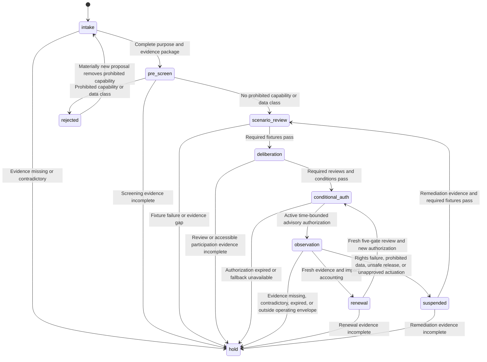

# Community Governance Protocol State Machine

## Invariants

The protocol maintains the following transition invariants:

\[
\Box(
\texttt{state}=\texttt{observation}
\Rightarrow
\texttt{rights\_floor}=1
\land
\texttt{advisory\_only}=1
\land
\texttt{authorization\_active}=1
\land
\texttt{all\_required\_reviews}=1
\land
\texttt{required\_fixtures\_pass}=1
\land
\texttt{human\_fallback}=1
)
\]

\[
\Box(
\texttt{rights\_floor}=0
\Rightarrow
\Diamond \texttt{state}=\texttt{suspended}
)
\]

\[
\Box(
\texttt{prohibited\_capability}
\Rightarrow
\neg \Diamond \texttt{state}=\texttt{observation}
)
\]

\[
\Box(
\texttt{authorization\_expired}
\Rightarrow
\neg \texttt{state}=\texttt{observation}
)
\]

\[
\Box(
\texttt{community\_review\_missing}
\Rightarrow
\neg \Diamond \texttt{state}=\texttt{conditional\_auth}
)
\]

## Community representation

The protocol records role-specific review outcomes and aggregate public-feedback summaries. It does not require persistent participant identity, identity verification, devices, location traces, health information, augmentation disclosure, or participation scoring.

A community review is valid when the declared process provides plain-language material, an accessible human contact route, a non-digital comment route, an offline or low-connectivity information route, a documented aggregate concern summary, and a public response explaining the disposition of material concerns.
