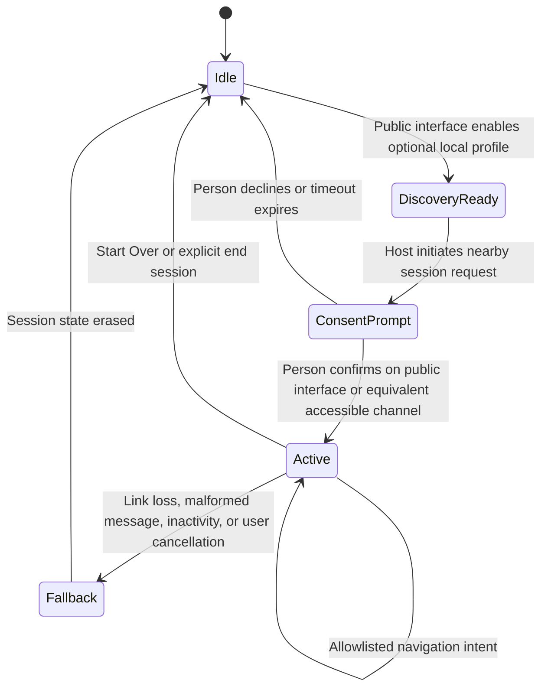
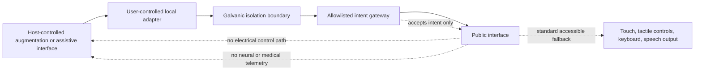

# Cybernetic Host Compatibility Standard for Public Interfaces

## Status

This document defines a proposed open interoperability profile for public digital interfaces, including kiosks, transit gates, assistance panels, cooling-center terminals, libraries, public-service counters, and civic information displays.

It is a technical and governance proposal. It is not a medical-device certification, legal determination, clinical recommendation, or assertion that a specific implant, assistive device, interface, or public system is safe for use without jurisdiction-specific, manufacturer-specific, and qualified engineering review.

The standard is designed to support:

- Voluntary host-controlled interaction.
- Interoperability without proprietary public-interface lock-in.
- Accessible fallback interaction.
- Minimal disclosure.
- Session-scoped authorization.
- Privacy-preserving local control.
- Electrical and protocol isolation.
- Transparent conformance testing.
- Non-discriminatory public service access.

The standard does not authorize public interfaces to access neural signals, stimulation channels, implant telemetry, medical data, health records, identity data, or device-management controls.

## Core guarantee

A public interface shall remain fully usable if no augmentation is present, if an augmentation is unavailable, if pairing fails, if communication is interrupted, or if a person declines augmentation interaction.

\[
A_{\text{standard-access}} = 1
\]

\[
A_{\text{augmentation-optional}} = 1
\]

\[
G_{\text{augmentation-required}} = 0
\]

Where:

- \(A_{\text{standard-access}}\) means standard accessible interaction remains available.
- \(A_{\text{augmentation-optional}}\) means augmentation support is additive rather than mandatory.
- \(G_{\text{augmentation-required}}\) is the number of services gated on augmentation use.

The standard must preserve:

\[
D_{\text{host,persistent}} = 0
\]

\[
I_{\text{host-identity}} = 0
\]

\[
I_{\text{neural-data}} = 0
\]

\[
I_{\text{biometric-data}} = 0
\]

\[
I_{\text{device-tracking}} = 0
\]

\[
C_{\text{host-control}} = 1
\]

Where:

- \(D_{\text{host,persistent}}\) is persistent host-derived data.
- \(I_{\text{host-identity}}\) is identity collection or inference.
- \(I_{\text{neural-data}}\) is neural-signal collection, recording, or inference.
- \(I_{\text{biometric-data}}\) is biometric collection, recording, or inference.
- \(I_{\text{device-tracking}}\) is persistent device tracking.
- \(C_{\text{host-control}}\) means the person retains immediate control over initiation, confirmation, cancellation, and exit.

## Design scope

### Permitted interoperability purpose

The public interface may accept a limited set of host-initiated navigation intents:

```text
focus-next
focus-previous
activate
back
home
repeat
increase-volume
decrease-volume
increase-text-size
decrease-text-size
toggle-contrast
start-over
request-help
```

The standard supports intent-level input only.

The public interface must not request, accept, infer, or retain:

```text
raw neural signal
neural waveform
neural feature vector
brain-computer interface model output beyond allowlisted intent
implant telemetry
implant serial number
medical diagnosis
health status
mobility diagnosis
disability proof
biometric template
voiceprint
face template
device address
persistent hardware identifier
phone identifier
location trace
payment credential
identity credential
government identifier
behavior score
emotion label
attention score
fatigue score
mental-state inference
stimulation configuration
actuator control command directed toward the host
```

### One-way public-interface rule

The public interface may receive host-initiated intent commands.

The public interface must not transmit commands intended to actuate, stimulate, configure, calibrate, modify, update, or otherwise control an augmentation.

\[
\text{PublicInterface} \rightarrow \text{HostAugmentation}
=
\varnothing
\]

Except for non-actuating protocol acknowledgements that carry no host-directed control semantics:

```text
accepted
rejected
session-ended
capability-not-supported
fallback-available
```

The acknowledgements must not encode a hidden control channel.

## Compatibility profiles

| Profile | Transport | Primary use | Privacy posture | Required fallback |
|---|---|---|---|---|
| CHCS-Local-1 | Wired local assistive input through electrically isolated adapter | Fixed public terminal and user-provided compatible assistive switch or interface | No radio discovery; no persistent host data | Physical controls, touch, keyboard, speech output |
| CHCS-BLE-1 | Bluetooth Low Energy, session-scoped | Short-range user-initiated navigation intent | Ephemeral session; address minimization; no persistent pairing by default | Physical controls, touch, keyboard, speech output |
| CHCS-NFC-1 | Near-field capability handoff or session initiation | Explicit close-proximity consent and profile selection | No ongoing telemetry; no identity token requirement | Physical controls, touch, keyboard, speech output |
| CHCS-Capacitive-1 | Short-range capacitive or inductive intent token interface | Accessible fixed-position interaction | Local, non-networked, no persistent pairing | Physical controls, touch, keyboard, speech output |
| CHCS-Visual-1 | Screen-rendered pairing challenge with user confirmation | Session confirmation when accessible visual channel is available | No account requirement; no reusable public identifier | Physical controls, touch, keyboard, speech output |

The baseline recommended implementation order is:

1. Standard accessible user interface.
2. Electrically isolated wired assistive-input profile.
3. Session-scoped BLE intent profile.
4. NFC or capacitive session-initiation profile.
5. Conformance tests and community interoperability review.

Bluetooth LE supports encryption, message integrity, authentication or authorization mechanisms, and privacy features such as changing device addresses. These features are useful building blocks, but they do not alone establish a privacy-safe public-interface design; the application must still avoid persistent pairing, tracking, identifier retention, and unnecessary device discovery. [176][181]

## Minimal command protocol

### Protocol goals

The protocol must be:

- Intent-only.
- Bounded.
- Human-initiated.
- Session-scoped.
- Local-first.
- Transport-neutral.
- Stateless across public sessions.
- Compatible with standard accessible controls.
- Explicitly non-actuating toward the augmentation.
- Resistant to replay, malformed input, command flooding, and unauthorized state changes.

### Session lifecycle



The public interface must visibly or audibly announce:

```text
Optional assistive input is available.
No account is needed.
This connection controls only this screen.
No personal data is saved.
You can use touch, physical buttons, keyboard, or audio support at any time.
Press Start Over or Home to end this session.
```

### Request message

```json
{
  "protocol": "chcs.intent.v1",
  "message_type": "request",
  "session_nonce": "base64url-encoded-ephemeral-random-value",
  "intent": "activate",
  "sequence": 4,
  "issued_at_monotonic_ms": 1820
}
```

### Response message

```json
{
  "protocol": "chcs.intent.v1",
  "message_type": "response",
  "session_nonce": "base64url-encoded-ephemeral-random-value",
  "sequence": 4,
  "status": "accepted",
  "screen_feedback": "selected-service-details"
}
```

### Allowed intent enumeration

```text
focus-next
focus-previous
activate
back
home
repeat
increase-volume
decrease-volume
increase-text-size
decrease-text-size
toggle-contrast
start-over
request-help
end-session
```

Every other command is rejected:

\[
\operatorname{intent}
\notin
\mathcal{I}_{\text{allowlist}}
\Rightarrow
\operatorname{reject}
\]

### Bounded message properties

| Property | Requirement | Reason |
|---|---|---|
| Message size | At most 512 bytes | Limits parsing and denial-of-service exposure |
| Session nonce | Cryptographically random and single-session only | Prevents session correlation and replay |
| Sequence number | Strictly increasing within session | Prevents replay and reordering |
| Session duration | Short bounded timeout | Limits exposure and stale control state |
| Command rate | Bounded intents per second | Prevents accidental or malicious flooding |
| Persistent state | None after end, reset, timeout, or link loss | Prevents tracking and unintended carryover |
| Transport encryption | Required where transport supports it | Protects local message confidentiality and integrity |
| Pairing state | Ephemeral by default | Avoids persistent public-terminal device recognition |
| Failure behavior | Return immediately to standard accessible UI | Preserves universal access |

## Host autonomy and consent

### Consent model

Consent must be explicit, informed, specific, revocable, and local to the current interaction.

A valid session requires:

\[
C_{\text{session}} =
C_{\text{initiate}}
\land
C_{\text{confirm}}
\land
C_{\text{scope}}
\land
C_{\text{revoke}}
\]

Where:

- \(C_{\text{initiate}}\) means the host or person initiates the request.
- \(C_{\text{confirm}}\) means the person confirms through an accessible public-interface channel or an equivalent host-controlled method.
- \(C_{\text{scope}}\) means the person sees the limited intent-control scope.
- \(C_{\text{revoke}}\) means the person can immediately end the session.

The public interface must not initiate a connection to a nearby augmentation automatically.

\[
\operatorname{autoConnect} = \text{false}
\]

The public interface must not scan and log nearby devices for analytics, crowd measurement, security profiling, marketing, or service eligibility.

\[
\operatorname{persist}(\text{discovery identifiers}) = \varnothing
\]

### Revocation rule

A person can revoke the augmentation session through:

- An augmentation-originated `end-session` intent.
- A physical Start Over control.
- A visual on-screen Start Over control.
- A tactile Home or Back control leading to exit.
- A keyboard escape control.
- A session timeout.
- Link loss.
- An accessible staff-assisted reset.

For all revocation paths:

\[
S_{t+\Delta} = \varnothing
\]

Where \(S\) is the augmentation session state and \(\Delta\) is the immediate reset interval.

## Fallback and degraded operation

### Required standard controls

Every compatible public interface shall provide:

- Touch interaction with generous target size and spacing.
- Physical Home, Back, Repeat, Volume, Contrast, and Start Over controls where the deployment supports them.
- Keyboard navigation.
- Switch-compatible input where feasible.
- Screen-reader-compatible semantics for browser or application interfaces.
- Text-size controls.
- High-contrast controls.
- Local speech output.
- Non-map information alternatives.
- Plain-language instructions.
- At least one non-digital staff or public-contact route for essential services.

The interface remains fully usable under:

\[
\operatorname{AugmentationUnavailable}
\]

\[
\operatorname{LinkLost}
\]

\[
\operatorname{AuthenticationFailed}
\]

\[
\operatorname{BatteryLow}
\]

\[
\operatorname{ProtocolUnsupported}
\]

\[
\operatorname{UserDeclinesConnection}
\]

In every case:

\[
\operatorname{FallbackAvailable} = \text{true}
\]

### Compatibility score

For a test panel \(P\), task set \(T\), and supported interaction mode \(m\):

\[
C_m =
\frac{
N_{\text{successful interactions},m}
}{
N_{\text{attempted interactions},m}
}
\]

The all-mode compatibility score is:

\[
C_{\text{total}} =
\frac{
\sum_m N_{\text{successful interactions},m}
}{
\sum_m N_{\text{attempted interactions},m}
}
\]

The standard must also measure fallback reliability:

\[
C_{\text{fallback}} =
\frac{
N_{\text{successful standard-control interactions after augmentation failure}}
}{
N_{\text{augmentation-failure test cases}}
}
\]

Recommended acceptance thresholds:

\[
C_{\text{total}} \geq 0.95
\]

\[
C_{\text{fallback}} = 1
\]

No deployment should claim compatibility based only on a single manufacturer, a single interface type, a single body configuration, or a single testing environment.

## Electrical isolation profile

### Objective

Public infrastructure must not create an electrical return path, unintended feedback path, charging path, fault-injection path, or direct conductive control path toward a host augmentation.

The reference architecture separates public-interface electronics from assistive or augmentation-adjacent input through electrical isolation and a limited command gateway.



### Wiring conventions

- Use galvanic isolation between public equipment and any wired input bridge.
- Use optocouplers, digital isolators, or medically appropriate isolated interface components selected through qualified engineering review.
- Separate logic-side and field-side power domains.
- Avoid shared grounds across public equipment and user-connected assistive interfaces.
- Include current limiting, over-voltage protection, electrostatic-discharge protection, reverse-polarity protection, and fault detection appropriate to the hardware design.
- Use only low-energy, intent-level signaling across the isolation boundary.
- Do not expose public USB, serial, debug, or firmware-update ports as trusted host-control interfaces.
- Design hardware failure so the default result is loss of optional augmentation input, not unexpected interface activation.
- Keep the public interface incapable of delivering stimulation, configuration, power, firmware, or actuator-control data to the host interface.
- Require hardware review for any design that claims compatibility with a regulated medical device, implant, or powered orthosis.

FDA guidance on medical-device interoperability addresses safe and effective interoperable device design, while its cybersecurity material addresses cybersecurity design and documentation for devices with cybersecurity risk. These sources are useful background for a cautious interface specification, but they do not certify a public terminal or establish that a specific augmentation connection is safe. [173][174]

## Security controls

### Threat model

The public interface must defend against:

- Unsolicited connection attempts.
- Nearby-device enumeration.
- Replay of a prior command.
- Command injection.
- Malformed packets.
- Command flooding.
- Session fixation.
- Downgrade to an insecure transport mode.
- Persistent identifier collection.
- Unauthorized firmware or configuration updates.
- Untrusted input masquerading as an assistive device.
- Public-terminal compromise.
- Physical port misuse.
- Accessibility denial through augmentation-only design.

### Required controls

| Control | Requirement |
|---|---|
| Local-only session | Do not use cloud authorization for basic intent navigation |
| Consent prompt | Require an accessible session confirmation |
| Allowlisted verbs | Accept only bounded navigation and preference intents |
| Nonce | Generate a new cryptographically random nonce for every session |
| Replay defense | Enforce monotonically increasing sequence numbers |
| Rate limit | Reject excessive intent rate without disabling standard controls |
| Timeout | Clear state after inactivity |
| Link-loss handling | Clear state and return to standard interface |
| No persistent bonding | Do not retain device identity or pairing material by default |
| No background scanning log | Never record nearby-device discovery events |
| Signed updates | Verify updates before installation through a separate maintenance process |
| Diagnostic minimization | Never log intent payloads, device identifiers, or host-related data |
| Accessible errors | Explain connection failures in clear visual, tactile, and speech-compatible form |

## Conformance requirements

### Required test panel diversity

Conformance testing should include a diverse voluntary panel, with meaningful representation across:

- Different assistive interaction methods.
- Limb-difference and mobility-device users.
- Screen-reader and keyboard users.
- Switch-control users.
- Low-vision and blind users.
- Deaf and hard-of-hearing users.
- Neurodivergent and cognitive-access users.
- People who choose not to use any augmentation.
- Users of different compatible vendor-neutral intent adapters.
- Different languages and literacy levels.
- Different public-environment conditions, including glare, noise, low connectivity, and interruption.

No participant must disclose a diagnosis, device manufacturer, medical record, or augmentation details beyond what they voluntarily choose for a defined, consented test procedure.

### Essential task set

```text
reach-home
move-focus
activate-control
return-back
repeat-information
adjust-volume
adjust-text-size
toggle-contrast
request-help
end-session
restart-with-standard-controls
```

### Mandatory conformance tests

1. Verify standard touch, tactile, keyboard, switch, screen-reader, and speech-output pathways work without augmentation.
2. Verify augmentation session requires local, explicit initiation.
3. Verify the public interface does not automatically connect to a nearby device.
4. Verify an unsupported or malformed request is rejected.
5. Verify an unallowlisted command is rejected.
6. Verify session state clears after Start Over.
7. Verify session state clears after timeout.
8. Verify session state clears after link loss.
9. Verify standard controls remain usable after every augmentation failure case.
10. Verify no device identifier, raw signal, biometric material, or command history is stored.
11. Verify no network request is required for ordinary augmentation session operation.
12. Verify no public essential service becomes unavailable without augmentation use.
13. Verify all error notices are understandable and accessible.
14. Verify physical isolation and fault-handling behavior through qualified hardware review.
15. Verify updates cannot silently widen the intent allowlist or add host-directed commands.

## Governance and public accountability

Publish the following for every public-interface deployment:

- Protocol version.
- Supported profiles.
- Intent allowlist.
- Session timeout.
- Data-retention statement.
- Device-discovery policy.
- Transport security requirements.
- Hardware-isolation design summary.
- Supported standard fallback methods.
- Conformance test results.
- Known limitations.
- Update-signature policy.
- Accessibility contact and correction path.
- Public grievance and review procedure.
- Versioned change log.

The public notice must be understandable:

```text
Optional assistive input is available.

No account is required.
This terminal does not save your device identity.
This terminal does not collect neural or biometric data.
You can use the screen, physical controls, keyboard, or audio support without connecting anything.
You may end the optional connection at any time.
```

## Project metrics

| Metric | Score | Basis |
|---|---:|---|
| knowledge_factor | 0.88 | Uses a bounded protocol, explicit state transitions, reproducible conformance requirements, and clearly stated medical-device limitations |
| eco_impact_value | 0.71 | Open interoperable interfaces can reduce proprietary replacement pressure and support repairable public technology when deployed with durable hardware |
| harm_risk | 0.20 | Reduced through no host-directed actuation, no neural data, no persistent pairing, galvanic isolation, allowlisted commands, and universal fallback |
| accessibility_impact | 0.98 | Makes augmentation optional while strengthening touch, tactile, keyboard, switch, visual, and audio alternatives |
| rights_alignment | 0.99 | Strongly supports autonomy, consent, privacy, repair, interoperability, equal service access, accessibility, and accountable public infrastructure |
