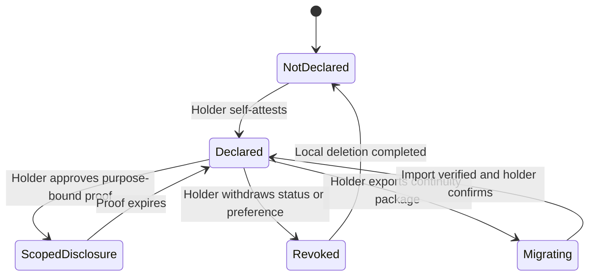

# Cybernetic Identity Continuity Protocol

## Purpose

The Cybernetic Identity Continuity Protocol, abbreviated as CICP, enables a person to maintain a self-controlled cybernetic-host or augmented-citizen identity reference across platforms and time.

The protocol supports:

- Self-asserted identity continuity.
- Selective disclosure.
- Privacy-preserving proof of limited claims.
- Platform migration and recovery.
- Consent, revocation, deletion, and expiration.
- Accessible human review.
- Separation between ordinary civic access and higher-assurance identity proofing.

The protocol does not create a legal identity category, clinical certification, device authorization, platform entitlement, public credential, or permanent claim against another organization. It is a technical and policy framework for respectful, privacy-preserving continuity within participating systems.

## Core Principles

- A person controls the root identity reference and may rotate keys without losing continuity.
- Self-attested cybernetic-host status is sufficient for dignity, communication, privacy, accessibility, and human-review preferences where no certification is necessary.
- Sensitive augmentation information is never required for baseline services.
- A verifier receives only the smallest proof needed for a stated purpose.
- A platform may not require a persistent universal identifier when a pairwise identifier can meet the purpose.
- A platform may not use a continuity record for surveillance, enforcement, social scoring, insurance screening, employment screening, advertising, behavior profiling, or unrelated eligibility decisions.
- A platform change must not force disclosure of augmentation, health, neural, biometric, or device information.
- Deletion and revocation must be effective for the platform’s stored copies, indexes, caches, and downstream processors, subject to lawful records-retention obligations.
- No essential public service may be conditioned on participation in the protocol, continuous connectivity, proprietary hardware, external identity verification, or disclosure of cybernetic status.

W3C Verifiable Credentials support a holder presenting precisely the information a verifier needs and no more; the model also describes selective disclosure and encourages approaches that reduce correlation between presentations. [176][178] NIST identity guidance distinguishes identity proofing from other digital-identity functions and requires protection of personally identifiable information collected during enrollment. [174][177][179]

## Roles

| Role | Function | Trust boundary |
|---|---|---|
| Holder | Person controlling identity references, keys, preferences, consent, recovery, and disclosures | Controls what is disclosed and to whom |
| Wallet | Local or holder-chosen software or hardware that stores keys and credentials | Must be exportable, accessible, encrypted, and recoverable |
| Issuer | Entity that signs a credential or attestation | May attest only within its legitimate authority |
| Verifier | Platform or service requesting a minimal proof | Receives only the approved proof and may not retain extra data |
| Registry | Resolves public verification material, status lists, and schemas | Stores no sensitive augmentation claim |
| Continuity witness | Holder-selected recovery or key-rotation support | Cannot unilaterally take control of the holder’s identity |
| Governance authority | Maintains protocol schemas, transparency rules, and dispute process | Cannot silently alter holder claims or disclosure policy |

## Identifier Structure

The protocol uses three distinct identifiers:

- **Root continuity identifier:** holder-controlled reference used only in recovery and migration workflows.
- **Pairwise service identifier:** unique identifier derived for one verifier or service relationship.
- **Ephemeral presentation identifier:** one-time or short-lived reference used for a single proof presentation.

The primary privacy rule is:

\[
\operatorname{PairwiseID}_{v}
=
\operatorname{Derive}(
\operatorname{RootSecret},
\operatorname{VerifierDomain}_{v},
\operatorname{RotationEpoch}
)
\]

A verifier should receive only \(\operatorname{PairwiseID}_{v}\) or an ephemeral presentation identifier, not the root continuity identifier.

## Credential Classes

### Self-Attested Continuity Credential

The holder may create a self-attested credential containing only:

```text
claim: self_attested_cybernetic_host_or_augmented_citizen
scope: dignity_accessibility_privacy_human_review
status: active | revoked
issued_at: holder-controlled timestamp
expires_at: optional
```

This credential must not contain:

```text
implant_type
device_model
medical_diagnosis
neural_data
biometric_data
telemetry
images
manufacturer_serial
location_history
clinical_records
```

### Service Preference Credential

A holder may issue a local, scoped preference credential such as:

```text
preferred_communication: text | speech | sign | plain_language
preferred_access_path: online | offline | in_person | assisted
privacy_restriction: minimize_sharing
decision_review: human_review_requested
```

This credential is a request for service handling, not proof of diagnosis, legal status, or device configuration.

### Externally Issued Credential

An authorized issuer may issue a separate credential where an institution legitimately needs a verifiable fact. Such credentials must remain purpose-limited and must never force disclosure of unrelated cybernetic or augmentation information.

## Selective Disclosure

A verifier request must specify:

- Declared purpose.
- Minimum required claim.
- Retention period.
- Whether the claim is voluntary or mandatory.
- Whether a human alternative exists.
- Whether an offline alternative exists.
- Whether a zero-knowledge proof is accepted.
- How revocation will be checked.
- How a holder can correct, withdraw, or complain.

The wallet evaluates the request:

\[
\operatorname{DisclosureAllowed}
=
\operatorname{PurposeSpecific}
\land
\operatorname{ConsentPresent}
\land
\operatorname{MinimumClaim}
\land
\operatorname{RetentionBounded}
\land
\operatorname{NoAdverseUse}
\]

If any condition is false, the wallet must default to non-disclosure and offer a human or offline path.

Examples:

| Service purpose | Permitted proof | Prohibited disclosure |
|---|---|---|
| Respectful civic communication | Holder-selected terminology or communication preference | Device details, diagnosis, neural data |
| Accessible municipal-service pathway | Request for accessible format or human review | Proof of disability, augmentation records, biometrics |
| Privacy restriction | Proof that the holder selected a sharing restriction | Identity root, health data, activity history |
| Eligibility rule requiring a narrow verified attribute | Zero-knowledge proof of the required predicate, where supported | Entire credential, unrelated claims, root identifier |
| Essential service access | No proof required for baseline access | Any requirement to disclose cybernetic status |

## Zero-Knowledge Proof Profiles

The protocol supports a narrow proof set:

- `proof_of_valid_self_attestation`
- `proof_of_active_consent_scope`
- `proof_of_preference_match`
- `proof_of_nonrevoked_credential`
- `proof_of_authorized_issuer_attestation`
- `proof_of_threshold_condition`

A predicate proof can be represented as:

\[
\pi =
\operatorname{ZKProve}
(
\operatorname{credential},
\operatorname{predicate},
\operatorname{verifier\ nonce},
\operatorname{domain\ binding}
)
\]

The verifier checks:

\[
\operatorname{ZKVerify}
(
\pi,
\operatorname{public\ verification\ material},
\operatorname{verifier\ nonce},
\operatorname{domain\ binding}
)
=
\operatorname{true}
\]

The proof must be bound to the verifier domain and short validity window to reduce replay and cross-platform correlation.

## Continuity Through Platform Change

### Export

A holder must be able to export:

- Private keys in an encrypted interoperable container.
- Public verification material.
- Credentials and status metadata.
- Consent receipts.
- Service preferences.
- Revocation receipts.
- Recovery configuration.
- Audit records selected by the holder.

The export must be available in accessible formats and must not require a proprietary application, continuous internet connection, or disclosure of sensitive augmentation information.

### Import

A receiving wallet or platform must:

- Validate schema and cryptographic integrity.
- Preserve claim provenance and issuer distinction.
- Preserve revocation state.
- Preserve holder-selected privacy scopes.
- Avoid silently broadening sharing permissions.
- Create new pairwise identifiers rather than reusing a root identifier.
- Present a plain-language migration summary before activation.

### Key Rotation

Key rotation preserves continuity without exposing the prior key:

\[
\operatorname{NewKeyLink}
=
\operatorname{Sign}_{k_{\mathrm{old}}}
(
\operatorname{public}(k_{\mathrm{new}}),
\operatorname{rotation\ metadata}
)
\]

Where old-key access is unavailable, a holder may use a recovery process based on multiple holder-selected continuity witnesses, recovery credentials, and a timed dispute window.

No single platform, issuer, or witness may unilaterally seize or rewrite the identity record.

## Right to Be Forgotten and Revocation

The protocol distinguishes three operations.

### Credential Revocation

The holder may revoke a self-attested credential or withdraw a service preference.

\[
\operatorname{Status}(\operatorname{credential}) = \texttt{revoked}
\]

Future verifiers must reject the credential for the revoked scope.

### Local Deletion

A holder may request deletion of data held by a specific platform.

The platform must:

- Delete active copies and derived profiles not required by law.
- Remove the record from ordinary search and recommendation indexes.
- Send deletion requests to processors and vendors.
- Retain only a minimal, non-sensitive compliance receipt where lawful and necessary.
- Provide a plain-language completion notice.
- State any legal retention exception specifically.

### Unlinkability Renewal

The holder may rotate pairwise identifiers and stop using old identifiers. This reduces future correlation even where an external party cannot erase a lawful historical record.

\[
\operatorname{NewPairwiseID}_{v}
\ne
\operatorname{OldPairwiseID}_{v}
\]

The protocol must not promise deletion from independently controlled copies, legal archives, or external systems beyond the authority of the receiving platform. It must document the boundary clearly.

## Consent State Machine



## Audit Record

Each disclosure or migration audit record contains only:

```text
event_type
purpose
verifier_domain
claim_class
proof_profile
consent_scope
retention_end
outcome
schema_version
time_window
```

It excludes raw claims, augmentation details, health information, biometrics, neural data, identity roots, and device telemetry.

## Metrics

| Metric | Value | Basis |
|---|---:|---|
| knowledge_factor | 0.93 | Uses SSI separation of roles, selective disclosure, zero-knowledge predicates, pairwise identifiers, consent states, migration, and revocation controls |
| eco_impact_value | 0.46 | Reduces duplicative identity infrastructure and supports durable, repairable, interoperable civic-service access |
| harm_risk | 0.19 | Reduced through data minimization, pairwise identifiers, local wallets, scoped proofs, revocation, deletion, and human review |
| accessibility_impact | 0.99 | Protects offline, in-person, human-assisted, accessible export, import, recovery, and non-disclosure pathways |
| rights_alignment | 0.99 | Centers dignity, self-assertion, consent, privacy, correction, deletion, non-discrimination, and platform portability |
