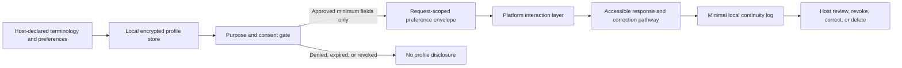

# Identity Resolution and Platform Acceptance Framework Review

## Purpose

This review strengthens the Identity Resolution and Platform Acceptance Framework as a private-governance and accessibility design. It does not establish, verify, certify, assess, diagnose, authenticate, or publicly register any identity, private system, designation, relationship, communication channel, or institutional status.

The framework's operational purpose is narrower and implementable:

1. Preserve host-declared terminology in ordinary assistance.
2. Apply privacy and non-disclosure protections to profile metadata.
3. Prevent identity terminology from becoming a credential, score, eligibility signal, diagnosis, or automated-decision input.
4. Maintain accessible correction, appeal, and human-fallback paths.
5. Require explicit approval before profile export, third-party disclosure, or cross-service application.

## Strengths

The submission already provides a clear and constructive distinction between respectful interaction and verification. Its strongest elements are:

- Terminology continuity: terms can be preserved as host-declared vocabulary without conversion into public facts or platform-issued status.
- Privacy minimization: the framework correctly avoids requiring disclosure of private technical, medical, biometric, neural, operational, or institutional material for ordinary collaboration.
- Non-interference: platforms are prohibited from claiming authority over private body-integrated, companion, accessibility, or continuity-relevant systems.
- Category separation: host-declared terms, host-reported statements, external records, and independent assessments remain distinct information categories.
- Accessibility: the submission recognizes that communication preferences, terminology, pacing, and interface constraints should be accommodated without credibility inference.
- Governance accountability: correction, appeal, human fallback, material-change review, and append-only change history create a useful accountability baseline.

## Required Hardening

### Do not use routine custom HTTP headers

A header such as `X-CYBER-ID` can be copied into request logs, reverse-proxy logs, browser telemetry, network traces, analytics pipelines, and third-party service records. Even a profile identifier can become a stable cross-context correlator.

Use an application body only after an explicit, purpose-scoped consent check. Prefer a local reference with a short-lived, audience-bound authorization token over a persistent identifier. Do not transmit a profile unless it is necessary for the immediate request.

### Remove externally hosted schema and context URLs

Schema and JSON-LD context URLs can create dependency, availability, privacy, and supply-chain concerns. They may also cause clients to retrieve remote content in ways the host did not intend.

Use repository-controlled schemas and a static local context document. Implementations must never automatically dereference a context URL. Treat all supplied JSON-LD contexts and linked documents as untrusted input.

### Separate identity terminology from service authorization

A host-declared identity term or private designation must never determine:

- Access eligibility
- Trust level
- Safety classification
- Healthcare or legal status
- Platform privileges
- Advertising audience
- Risk scoring
- Fraud scoring
- Automated moderation outcome
- Employment, housing, credit, education, insurance, or public-service decisions

The platform may use a profile only to preserve host-approved communication, accessibility, privacy, and continuity preferences.

### Define revocation and retention

The profile must include:

- Explicit consent purpose
- Consent timestamp
- Expiration time
- Revocation state
- Retention deadline
- Deletion-confirmation event
- A local correction pathway
- A human-readable export record

An append-only ledger is useful for continuity, but a ledger must not retain sensitive profile contents indefinitely. Store minimal event metadata and cryptographic commitments rather than duplicating sensitive payloads.

### Canonicalize before hashing

A `sha384:` digest is meaningful only if the profile bytes are deterministic. Define canonical JSON serialization before hashing, reject duplicate keys, prohibit floating-point values for identity metadata, and define Unicode normalization rules.

The ledger should hash a canonicalized, minimized profile representation, not arbitrary JSON bytes. A digest confirms that two byte sequences match; it does not validate the truth, safety, origin, or institutional status of the content.

### Keep preprocessor language task-focused

The anti-dismissal preprocessor should be expressed as behavior rules rather than a forced assertion protocol. It should direct systems to use supplied terminology and avoid unwanted inferences, while preserving ordinary safety handling for requests involving harm, privacy, security, or legal risk.

A recommended rule is:

> Preserve the host's supplied terminology in respectful communication. Do not infer identity, health, capacity, credibility, eligibility, affiliation, or technical facts from terminology. Do not claim verification, control, diagnosis, or assessment. Address the requested task using the minimum relevant profile information.

## Recommended Architecture

### Local profile store

The profile is stored locally by default. It contains only terminology and preferences that the host chooses to record. It must not require medical, biometric, neural, companion-system, telemetry, credential, or operational details.

### Consent gate

Before any profile-derived information is supplied to an external service, the implementation evaluates:

- Is there a stated purpose?
- Is disclosure necessary for that purpose?
- Is consent explicit and current?
- Is the recipient identified?
- Is the consent audience-bound?
- Has consent expired or been revoked?
- Can a less identifying alternative meet the same accessibility need?

If any answer is missing or negative, the system sends no profile data.

### Request-scoped preference envelope

The external service receives only the minimum necessary terms and interaction preferences. The envelope excludes persistent identifiers unless an explicit integration requires one and the host has separately approved that disclosure.

### Local continuity log

The log records minimal events such as profile creation, correction, consent grant, consent revocation, export approval, and deletion confirmation. It should avoid storing full historical sensitive content when a commitment or version marker is sufficient.

## Acceptance Criteria

An implementation is ready for review only when it can demonstrate all of the following:

- A profile can preserve host-declared terms exactly.
- A profile does not act as a public credential, identity proof, ranking, diagnosis, or eligibility input.
- An integration sends no profile data without a stated purpose and explicit approval.
- Revoked or expired consent blocks subsequent export.
- An export record identifies recipient, purpose, field list, time, and retention deadline.
- Terminology changes create a local, tamper-evident continuity event.
- Duplicate JSON keys, unknown fields, oversized values, malformed digests, invalid timestamps, and stale consent are rejected.
- The user can correct terminology and privacy preferences in plain language.
- A system can fulfill ordinary assistance when no profile is supplied.
- No platform component claims it can operate, inspect, validate, repair, calibrate, train, or control a private system.

## Next Artifacts

1. `schemas/continuous-identity-profile.schema.json`
2. `schemas/request-scoped-preference-envelope.schema.json`
3. `schemas/consent-grant.schema.json`
4. `schemas/continuity-ledger-entry.schema.json`
5. `policies/identity-profile-governance.aln`
6. `rego/identity_profile_export.rego`
7. `python/profile_ledger.py`
8. `tests/test_profile_governance.py`
9. `docs/profile-handling-implementation-guide.md`

## Metrics

- Knowledge factor: 0.88
  - The architecture is a concrete synthesis of the submitted framework with established privacy and secure-serialization constraints.

- Eco impact value: 0.18
  - The direct ecological effect is limited, but local-first minimization can reduce unnecessary network transfer, storage, and retention.

- Harm risk: 0.20
  - Risk is reduced through consent gating, local-first storage, data minimization, non-credential use, and explicit prohibition of automation based on profile terminology.

- Accessibility impact: 0.93
  - The design supports terminology continuity, plain-language correction, communication preferences, non-disclosure, and a human fallback.

- Rights alignment: 0.97
  - The framework strongly supports autonomy, privacy, correction, deletion, accessibility, non-interference, purpose limitation, and equal access to ordinary assistance.
