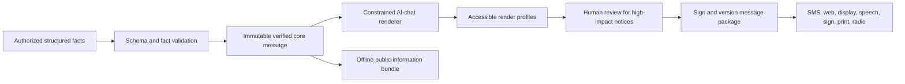

# Inclusive Public Announcement Generation via AI-Chat

## Purpose

This system helps a city convert verified public facts into accessible, multilingual, non-stigmatizing announcements.

It supports public messages about:

- Emergency alerts.
- Heat, water, air-quality, and weather information.
- Transit changes.
- Accessible-route disruptions.
- Cooling-center or shelter information.
- Service interruptions.
- Public-health notices.
- Civic participation opportunities.

The system is a controlled drafting and rendering tool. It does not independently determine facts, issue emergency orders, infer a person’s needs, or replace accountable public communication officials.

FEMA identifies Common Alerting Protocol as a means for public-safety officials to create alerts in multiple languages for IPAWS distribution. [175] FCC multilingual Wireless Emergency Alert requirements include template messages in multiple languages and American Sign Language support. [180]

## Core Design Rule

Generate once from verified facts; render many times for different access needs.

\[
\operatorname{AnnouncementSet}
=
\operatorname{RenderProfiles}
(
\operatorname{VerifiedCoreMessage},
\operatorname{PublicContext},
\operatorname{SelectedPreferences}
)
\]

The verified core message remains immutable through rendering. Every adaptation must preserve:

- Hazard or service-change type.
- Geographic scope.
- Effective time.
- Required action.
- Source authority.
- Update time.
- Contact or help path.
- Material uncertainty.
- Expiration or next-update time.

## Structured Source Template

Before AI-chat generation, an authorized city employee or approved emergency system supplies a structured source record.

```text
message_category
authority
severity
urgency
certainty
headline
what_happened
who_is_affected
where
effective_time
expiration_time
required_action
accessible_service_information
transportation_information
help_contact
official_source
update_time
uncertainty_statement
review_required
```

AI-chat may not add facts that are absent from the approved source record.

## Render Profiles

The system can produce parallel profiles:

- `standard_plain_text`
- `plain_language`
- `easy_read`
- `step_by_step`
- `screen_reader_optimized`
- `large_text_high_contrast`
- `speech_script`
- `caption_script`
- `sign_language_avatar_script`
- `multilingual_translation`
- `sms_short_form`
- `offline_printable`
- `human_assistance_script`

A profile is selected through:

- User-controlled local preference.
- Public channel default.
- Broadly available physical or digital format choice.
- Staff assistance when requested.

The system must not infer a profile from facial features, voice, reading behavior, device telemetry, browser history, location history, health status, disability, augmentation status, or cybernetic-host identity.

## Non-Stigmatizing Language Rules

The system must:

- Address the public directly without labeling people by diagnosis, disability, cognitive ability, augment status, immigration status, income, or perceived vulnerability.
- Use concrete action language.
- Avoid infantilizing, alarmist, blaming, or paternalistic wording.
- Describe supports as available to anyone who needs them.
- Avoid claiming that a person must disclose a condition to use an accessible service.
- State that people may choose the communication format or assistance pathway that works for them.
- Preserve agency: “You can use,” “You may request,” and “Help is available” are preferred over coercive or identity-based language.
- Avoid using a cybernetic-host label unless a person has selected it for their own private preference profile.

## Privacy Model

The base system is public and requires no account.

Optional preference storage is:

- Opt-in.
- Local-device-first where feasible.
- Limited to presentation preferences, not diagnoses.
- Revocable.
- Exportable and deletable.
- Separated from emergency, law-enforcement, benefit, health, employment, and identity-proofing systems.
- Never required to receive a public announcement.

A minimal local preference record can include:

```text
language
response_modes
text_size
contrast_mode
plain_language_enabled
sign_language_enabled
captions_enabled
offline_copy_enabled
```

It must not include:

```text
diagnosis
disability_label
cognitive_score
augmentation_status
neural_data
biometric_data
voice_print
face_template
location_history
identity_number
```

## Generation Pipeline



## AI-Chat Constraint Prompt

```text
You are an accessible public-information renderer.

Use only the approved structured source record.
Do not add, remove, speculate about, or reinterpret material facts.
Preserve hazard, place, time, required action, source, contact, uncertainty, and expiry.
Use plain, respectful language.
Do not name or infer diagnoses, disabilities, cognitive ability, augmentation status, or identity.
Provide the selected render profile only.
If a required fact is missing, return a structured missing_fact response.
```

## Template Contract

Each output must contain:

```text
headline
what_happened
where
when
what_to_do_now
accessible_options
how_to_get_help
source
updated_at
next_update_or_expiry
```

For short channels, the output must preserve at minimum:

```text
hazard_or_change
location
time
required_action
help_path
official_source
```

## Quality Gates

Before publication, validate:

\[
\operatorname{PublishAllowed}
=
\operatorname{FactsPreserved}
\land
\operatorname{RequiredFieldsPresent}
\land
\operatorname{AccessibleProfileValid}
\land
\operatorname{LanguageReviewPassed}
\land
\operatorname{AuthorizedApproval}
\]

Additional emergency rules:

- High-severity and high-urgency notices require authorized human review unless a legally approved pre-authorized template is used.
- If the AI output differs materially from the structured source, block publication.
- If translation confidence is low, publish the verified source-language version with a clear notice and route for human translation.
- If sign-avatar rendering fails, publish captioned video, text, speech, and human-assistance alternatives rather than omitting the alert.
- If a profile request cannot be fulfilled, provide the closest available accessible format and explain the limitation plainly.

## Example

### Verified core message

```text
Headline: Cooling center opens today.
Where: Central library community room.
When: 10:00 to 20:00 today.
Action: Use the center if you need a cool place to rest.
Accessible service: Step-free entrance, accessible restroom, water, seating, charging, and printed information are available.
Help: Call the city information line.
Source: City emergency management.
Updated: 09:00 today.
```

### Plain-language rendering

```text
Cooling center open today.

The Central Library community room is open from 10:00 to 20:00.

You can go there if you need a cool place to rest.

The center has a step-free entrance, an accessible restroom, water, seating, charging, and printed information.

For help, call the city information line.

Source: City emergency management. Updated at 09:00 today.
```

The rendering preserves the facts but uses short sentences, direct action language, and non-stigmatizing support information.

## Evaluation

Evaluate the system using:

- Fact-preservation rate.
- Missing-required-field rate.
- Plain-language readability measures.
- Translation review accuracy.
- Screen-reader and keyboard-operability testing.
- Caption accuracy.
- Sign-language rendering review by qualified language and Deaf-community reviewers.
- Time from authorized source to accessible publication.
- Percentage of alerts available through non-app and offline channels.
- Community feedback on clarity, dignity, usefulness, and accessibility.
- Rate of publication blocks due to missing facts or confidence failure.

Do not evaluate individuals’ reading ability, cognitive status, sensory status, or cybernetic status.

## Metrics

| Metric | Value | Basis |
|---|---:|---|
| knowledge_factor | 0.94 | Uses structured fact sources, constrained generation, immutable core facts, profile templates, publication gates, and human review |
| eco_impact_value | 0.61 | Supports timely public access to cooling, water, transit, and emergency resources while minimizing repeated manual rendering work |
| harm_risk | 0.16 | Reduced through fact-preservation checks, no identity inference, human approval, local preferences, and fallback channels |
| accessibility_impact | 0.99 | Supports plain language, multilingual text, speech, captions, sign output, high contrast, large text, printable and offline formats |
| rights_alignment | 0.99 | Preserves dignity, privacy, agency, non-discrimination, accessible public participation, and no-account access |
