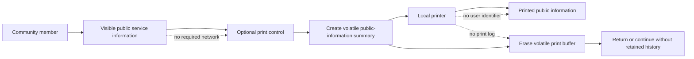
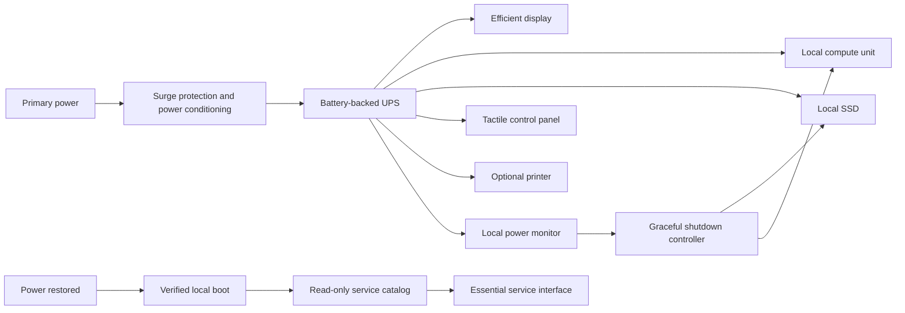

# Privacy-Preserving Public Assistance Kiosk: Upgrade Paths and Community Stewardship

## Scope

This document defines upgrade paths for an offline public-assistance kiosk that provides water, cooling, transit, sanitation, shelter, health, emergency-reference, and accessibility information.

Every upgrade preserves these non-negotiable service conditions:

- No identity, account, wealth, device, or eligibility gate for essential information.
- No requirement to disclose location, disability, health status, augmentation status, voice, or device information.
- No persistent storage of public-user search terms, printer selections, accessibility preferences, interaction sequences, voice data, or browsing history.
- No dependence on the network for core service discovery.
- No less-accessible fallback during power, printer, sensor, update, or network failures.
- No environmental measurement that profiles, ranks, targets, or excludes people.

The kiosk is an information and navigation aid. It does not determine benefits eligibility, approve or deny services, make person-level predictions, perform surveillance, or replace community governance.

## Upgrade-path model

Each upgrade is evaluated across five dimensions:

\[
U_i =
\left(
B_i,
P_i,
A_i,
E_i,
M_i
\right)
\]

Where:

- \(B_i\) is public-benefit value.
- \(P_i\) is privacy preservation.
- \(A_i\) is accessibility contribution.
- \(E_i\) is ecological contribution.
- \(M_i\) is maintainability and repairability.

All values are normalized to the closed interval:

\[
0 \leq B_i, P_i, A_i, E_i, M_i \leq 1
\]

An upgrade should be admitted only when it preserves the essential-service and no-person-data invariants:

\[
A_{\text{offline}} \geq 0.99
\]

\[
D_{\text{person,persistent}} = 0
\]

\[
G_{\text{essential-service}} = 0
\]

Where \(G_{\text{essential-service}}\) is the count of identity, wealth, device, network, or consent gates required to access essential public information.

A practical rights-centered upgrade score is:

\[
R_i =
0.30P_i +
0.25A_i +
0.20B_i +
0.15M_i +
0.10E_i
\]

An upgrade is eligible for pilot deployment only when:

\[
P_i \geq 0.90
\]

\[
A_i \geq 0.85
\]

\[
R_i \geq 0.85
\]

This makes privacy and accessibility hard constraints rather than values that can be traded away for convenience or efficiency.

## Upgrade path: local printable route summaries

### Purpose

A local print option gives people a portable copy of currently visible public information, such as a water location, cooling site, transit route summary, accessible entrance note, hours, contact details, or a simple local map.

The print option is voluntary. It must not require a phone number, email address, payment, account, identity record, QR code scan, or online connection.

The kiosk prints only the public service record currently visible to the person. It must not print an interaction history, search history, user profile, inferred need category, or individualized tracking marker.

### Privacy-preserving print flow



The print job contains only the currently visible public information and a source/freshness disclosure, for example:

```text
Cooling location: Community Library
Address: Public address
Hours: Public operating hours
Accessibility: Public accessibility information
Last locally verified: Date
Source: Public-service publisher
This kiosk does not save your search.
```

### Print content rules

The print renderer must include:

- Service name.
- Public address and cross streets.
- Public hours.
- Public accessibility notes.
- Public transit or walking directions where available locally.
- Source name.
- Local verification date.
- Package version.
- A plain-language uncertainty statement where information may change.

The print renderer must exclude:

- Search words typed by the person.
- Any internal request identifier.
- Browser session state.
- Device identifier.
- Time correlated with a person’s use unless the date is necessary for content freshness.
- Page-level analytics markers.
- QR codes that encode an interaction-specific identifier.
- Cookies, browser identifiers, tracking parameters, referral headers, or external URLs containing person-specific tokens.

### Print privacy invariant

Let \(J\) be a local print request. Let \(C(J)\) be the rendered contents and \(I(J)\) be the information retained after printing.

The print operation is privacy-preserving when:

\[
C(J) \subseteq \text{VisiblePublicInformation}
\]

\[
I(J) = \varnothing
\]

The kiosk should not keep print history. If hardware exposes unavoidable device-level aggregate counters, keep those counts separate from the public application, aggregate them over long intervals, and do not associate them with a service type, time of use, or individual interaction.

### Paper-efficiency model

Let:

- \(P\) be sheets consumed.
- \(R\) be sheets recovered for recycling.
- \(W\) be the number of public-information requests served.
- \(D\) be the number of successful digital-only completions.
- \(Q\) be the number of successful printed completions.

A paper-intensity measure is:

\[
I_{\text{paper}} =
\frac{P}{D + Q}
\]

A print diversion rate is:

\[
R_{\text{diversion}} =
\frac{R}{P}
\]

A print-need fulfillment measure is:

\[
F_{\text{print}} =
\frac{Q}{Q + U}
\]

Where \(U\) is the number of requests in which printing was unavailable despite the person selecting it.

The ecological objective is not to minimize printing at the expense of public access. Instead:

\[
\min I_{\text{paper}}
\quad \text{subject to} \quad
F_{\text{print}} \geq 0.95
\]

The printer should default to a compact, readable route summary. It should offer a larger-print format without treating higher paper use as an accessibility failure.

### Recommended paper practice

- Use responsibly sourced recycled-content paper, selected through a documented local procurement process.
- Use duplex printing when the resulting document remains legible and easy to handle.
- Do not force duplex printing for very short or large-print summaries.
- Use grayscale-first layouts with high-contrast typography rather than color-coded maps that lose meaning in monochrome.
- Avoid printing automatically.
- Use clear “Print this information” language rather than urgency-inducing or coercive prompts.
- Provide a visible indication when paper is low without blocking screen access.
- Keep a local public-facing fallback: “Printer unavailable. You can read this information on screen or ask a community service desk for assistance.”

## Upgrade path: tactile companion panel

### Purpose

A tactile companion panel enables independent use by people who cannot reliably use a touchscreen because of low vision, blindness, tremor, limited reach, gloves, temporary injury, cognitive load, environmental glare, assistive-device use, or a preference for predictable physical interaction.

The panel is not an “accessible mode” separate from the application. It is a first-class interaction path with controls that map to actions available to every kiosk user.

### Required controls

The physical panel provides:

- Home.
- Back.
- Repeat.
- Volume down.
- Volume up.
- Contrast.
- Start Over.

The following stable order is recommended from left to right:

```text
Home | Back | Repeat | Volume − | Volume + | Contrast | Start Over
```

The arrangement should remain consistent across deployments, maintenance replacements, software versions, and language selections.

### Tactile conventions

| Control | Tactile convention | Audio/visual confirmation | Rights purpose |
|---|---|---|---|
| Home | Raised house-like shape or consistent concave landmark | “Home” | Restores orientation without assistance |
| Back | Raised left-pointing arrow shape | “Back” | Supports error recovery |
| Repeat | Raised circular-arrow shape | Repeats current text or instruction | Supports memory and comprehension continuity |
| Volume down | Small raised minus form | “Volume lower” | Enables private, self-directed access |
| Volume up | Small raised plus form | “Volume higher” | Enables audio access in noisy settings |
| Contrast | Raised half-light/half-dark form | “High contrast on” or “Standard contrast on” | Supports low vision and glare resilience |
| Start Over | Distinctive larger recessed or guarded control | “This screen has been cleared” | Protects privacy and gives an immediate reset path |

Do not use tactile symbols alone. Pair each physical control with:

- A durable high-contrast text label.
- A tactile landmark.
- A software-accessible name.
- A visible focus state when the physical control has focus.
- A concise audio confirmation when speech output is active.
- A repeatable action that does not require reading a screen.

### Physical-control formula

Let \(a_c\) be the activation accuracy for control \(c\), measured during inclusive usability testing. Let \(t_c\) be the time required to identify and activate the control. Let \(e_c\) be accidental activations.

A usable tactile control satisfies:

\[
a_c \geq 0.95
\]

\[
t_c \leq 5 \text{ seconds}
\]

\[
\frac{e_c}{n_c} \leq 0.02
\]

Where \(n_c\) is total intentional attempts to use the control.

The measurements must be aggregated and de-identified. Do not retain participant-level performance records in the deployed kiosk.

### Touchscreen alignment

The companion panel and touchscreen should use shared semantic labels. A person who learns “Start Over” from a physical button should encounter the same label in the same meaningful location on screen.

WCAG 2.2’s target-size criteria support sufficient spacing and target dimensions for people who may have difficulty with precise activation; the enhanced target-size condition describes 44 by 44 CSS pixels in common cases. [85][88]

### Upgrade options

- Add a 3.5 mm or USB audio-output interface where appropriate.
- Add a compatible switch-access port for an external adaptive switch.
- Add a tactile orientation stripe leading to the physical panel.
- Add a privacy-positioned headphone interface with an indicator that does not collect device information.
- Add vibration or haptic confirmation only if it is independently usable and does not replace sound or visible feedback.
- Add a physical screen-curtain control only if it does not remove visual access from other users and can be independently reversed.

## Upgrade path: power resilience and energy accountability

### Purpose

Power resilience ensures that a brief outage or unstable grid event does not erase public access, corrupt local content, or cause the kiosk to restart into an inaccessible or unsafe state.

Energy accountability measures resource use at the device level without identifying or tracking people.

### Power-resilience architecture



### Graceful shutdown requirements

When battery reserve reaches the operational threshold:

1. Stop optional functions first, such as printing or nonessential visual transitions.
2. Preserve the core display of already-open essential information as long as safely possible.
3. Complete or cancel a print job without retaining content.
4. Clear volatile session state.
5. Close local database handles.
6. Flush only necessary system state.
7. Shut down in a verified, non-corrupting order.
8. On restart, enter the local offline kiosk application without requiring a network or administrator login for public access.

The local service catalog must remain read-only during public operation. A power event therefore cannot turn a partially completed public interaction into a persistent user record.

### Power-resilience formulas

Let:

- \(P_b\) be base kiosk power draw.
- \(P_p\) be optional printer power draw.
- \(P_o\) be other optional peripheral power draw.
- \(C_{\text{UPS}}\) be usable battery capacity in watt-hours.
- \(\eta\) be end-to-end UPS efficiency.
- \(T_{\text{reserve}}\) be desired minimum support time in hours.

Required usable battery capacity is:

\[
C_{\text{required}} \geq
\frac{
(P_b + P_p + P_o) \cdot T_{\text{reserve}}
}{
\eta
}
\]

When print capability is not needed during an outage, use a separate essential-services power budget:

\[
C_{\text{essential}} \geq
\frac{
P_b \cdot T_{\text{reserve}}
}{
\eta
}
\]

For example, a kiosk with \(P_b = 70\) watts, a six-hour essential-service reserve, and \(\eta = 0.85\) requires:

\[
C_{\text{essential}} \geq
\frac{70 \cdot 6}{0.85}
\approx 494.12 \text{ Wh}
\]

Actual battery sizing should include degradation margin, temperature effects, conversion losses, and site-specific load tests.

### Energy per successful assistance outcome

Do not measure energy per identified person or retain user-session traces. Use only aggregate, privacy-preserving counts over a fixed reporting interval.

Let:

- \(E_k\) be measured kiosk electricity use over an interval.
- \(N_s\) be the aggregate count of completed local public-information outcomes in the same interval.
- \(N_f\) be aggregate failures affecting essential access.

Then:

\[
E_{\text{successful-assistance}} =
\frac{E_k}{N_s}
\]

A reliability-adjusted form is:

\[
E_{\text{effective}} =
\frac{E_k}{N_s}
\left(
1 + \frac{N_f}{\max(N_s, 1)}
\right)
\]

This metric should be used only for maintenance and ecological design decisions. It must not be used to reduce service availability for people who require more time, more audio repetition, large text, printing, translation, or assistance.

### Privacy-preserving measurement rule

The device may maintain a coarse aggregate counter only if all conditions hold:

\[
\operatorname{Granularity} \geq \text{daily aggregate}
\]

\[
\operatorname{IdentityLinkage} = 0
\]

\[
\operatorname{SearchContentRetention} = 0
\]

\[
\operatorname{AccessibilityModePenalty} = 0
\]

The safest baseline is to record total device energy at the electrical panel and conduct periodic manual, non-identifying service-availability audits rather than instrumenting individual public interactions.

### Recommended hardware profile

- High-efficiency, repairable display with adjustable brightness and no mandatory cloud management.
- Local solid-state storage with a conservative write profile.
- Fanless or low-maintenance compute unit where site temperature permits.
- Battery-backed uninterruptible power supply sized for the essential-service reserve.
- Replaceable surge protection and accessible maintenance ports.
- Separate power control for the optional printer.
- Static, local map rendering rather than remote graphics or streaming.
- Brightness schedules based on ambient conditions only when sensing does not identify people or require cameras.
- Physical power-status indication that maintenance staff can interpret without connecting to an online portal.

NIST’s platform-firmware resiliency guidance addresses protection and recovery of platform firmware and critical data after potentially destructive events; its protect-detect-recover framing is useful for a kiosk’s verified boot, update rollback, and local recovery design. [82]

## Upgrade path: community update kit

### Purpose

The community update kit makes service, map, translation, accessibility, and public-information updates reproducible and inspectable. It enables civic reviewers to see what data is present, where it came from, when it was verified, what transformations occurred, and whether a signed package matches the reviewed content.

The kit does not require a network connection at kiosk runtime. It is used by authorized maintainers and community reviewers before a package is deployed.

### Update-kit contents

```text
community-update-kit/
├── README.md
├── sources/
│   ├── service-directory-source-notes.md
│   ├── translation-review-notes.md
│   └── map-source-notes.md
├── schemas/
│   ├── service-catalog.schema.json
│   └── content-manifest.schema.json
├── transforms/
│   ├── normalize-services.ts
│   ├── validate-services.ts
│   └── build-search-index.ts
├── review/
│   ├── accessibility-review-checklist.md
│   ├── community-review-template.md
│   └── change-summary-template.md
├── manifests/
│   └── kiosk-content-manifest.json
├── signatures/
│   └── kiosk-content-manifest.sig
├── sbom/
│   └── kiosk-content-sbom.json
└── tests/
    ├── validation-fixtures/
    └── reproducibility-tests/
```

### Reproducibility condition

Let \(X\) be approved source inputs, \(T\) be deterministic transformation code, and \(B\) be the build environment specification.

A reproducible content package satisfies:

\[
\operatorname{Build}(X, T, B) = P
\]

\[
\operatorname{SHA256}(P) = h_P
\]

A later independent rebuild is acceptable when:

\[
\operatorname{SHA256}
\left(
\operatorname{Build}(X, T, B)
\right)
=
h_P
\]

If byte-for-byte reproducibility cannot be achieved because of timestamps or packaging metadata, the kit must document the nondeterministic fields and separately hash the canonical service catalog, translations, and map payloads.

### Signed-manifest condition

Let \(M\) be the canonical manifest, \(\sigma\) its signature, and \(K\) an authorized publisher public key.

\[
\operatorname{Verify}(M, \sigma, K) = \text{true}
\]

Each referenced content payload \(c_i\) is accepted only when:

\[
\operatorname{SHA256}(c_i) = M.\operatorname{hash}(c_i)
\]

The kiosk activates a package only after validating:

- Manifest structure.
- Signature.
- Signer authorization.
- Hash of every payload.
- Schema validity.
- Required language resources.
- Required accessibility labels.
- Source and verification metadata.
- Regression-test results.
- Compatibility with local software version.
- Ability to roll back to the prior verified package.

NIST’s Secure Software Development Framework provides a relevant secure-development baseline, and NIST’s supply-chain guidance recommends accessible, digitally signed software-bill-of-materials repositories for producers. [97][101]

### Community review model

Reviewers should include:

- Community members who use public water, cooling, transit, sanitation, shelter, and health services.
- Disability and assistive-technology advocates.
- Multilingual community reviewers.
- Local service-provider representatives.
- Privacy and security reviewers.
- Maintenance and repair personnel.
- Environmental-justice and neighborhood organizations.

Review is not a vote on whether people deserve assistance. Review verifies that public information is accurate, accessible, non-stigmatizing, locally understandable, source-attributed, and technically deployable.

### Required change record

Every update should include:

```text
Package version:
Prepared date:
Service area:
Sources added:
Sources removed:
Services added:
Services changed:
Services removed:
Translations changed:
Accessibility content changed:
Map coverage changed:
Verification date:
Known uncertainty:
Community reviewers:
Accessibility review result:
Schema validation result:
Signature verification result:
Rollback package:
```

No person using the kiosk appears in the update record.

## Upgrade path: no-location default

### Purpose

The kiosk must not ask “Where are you?” as a prerequisite for public information. Location collection can be intrusive, inaccurate, inaccessible, risky for people seeking safety, and unnecessary when the kiosk itself already serves a known public place.

The no-location default uses categorized public directories, locally displayed service lists, and static-area maps.

### Default discovery modes

- Browse by public need: water, cooling, transit, emergency, sanitation, shelter, health.
- Browse by neighborhood or service district selected by the person, without retaining the selection.
- Browse an alphabetical service directory.
- Browse accessibility-feature listings.
- Browse local map layers already installed on the device.
- View “services near this kiosk” using a static, maintenance-configured location marker.
- Print public directions for a visible service record.
- Repeat current information through local speech output.

### Static marker model

Let \(L_k\) be the fixed kiosk installation coordinate, configured during maintenance. Let \(S_i\) be a public service coordinate.

The local system may calculate:

\[
d_i =
\operatorname{distance}(L_k, S_i)
\]

This is a route-planning aid for a fixed public terminal, not a measurement of a person’s location.

The privacy condition is:

\[
L_{\text{person}} \notin \text{system state}
\]

\[
L_{\text{device}} \notin \text{system state}
\]

\[
L_k \in \text{maintenance configuration only}
\]

### No-location user experience

Use language such as:

```text
Services near this kiosk
Choose a service category
Browse locations in this area
Show all cooling locations
Show accessible transit information
```

Avoid language such as:

```text
Share your location
Turn on location services
We need your location to continue
Allow precise location
Connect your phone
```

If a person voluntarily chooses a named neighborhood from a local list, the selection exists only in memory for the current screen flow. It must disappear at reset.

## Upgrade path: visible privacy receipt

### Purpose

A visible privacy receipt is a persistent, non-identifying public statement that explains how the kiosk protects a person’s privacy before they interact with it.

It is a communication artifact, not a transaction receipt. It must not imply that the kiosk has recorded a person’s interaction.

### Home-screen text

Use concise, truthful, plain-language statements:

```text
No account required.
Nothing you search for is saved.
This kiosk works without internet access.
You can use touch, physical buttons, keyboard, or audio support.
Press Start Over at any time to clear this screen.
```

The text should be visible without opening a privacy policy. Offer a “How privacy works here” page that explains:

- No account or identity check.
- No saved searches.
- No mandatory location sharing.
- No advertising or usage analytics.
- No microphone recording by default.
- No camera-based interaction tracking.
- Local-only service information.
- An immediate Start Over control.
- The difference between public information printing and private user data.

### Privacy-understanding measure

Let \(n\) be the number of voluntary, de-identified usability-test participants. Let \(u\) be the number who can correctly explain, after interacting with the home screen, that searches are not saved and no account is needed.

\[
C_{\text{privacy-understanding}} =
\frac{u}{n}
\]

A practical target is:

\[
C_{\text{privacy-understanding}} \geq 0.85
\]

Use community review and accessibility testing to improve clarity. Do not collect this measure in the deployed kiosk.

### Public-information print distinction

The print control should make the distinction explicit:

```text
Print this public information.
Your search is not printed or saved.
```

Do not create a “receipt” containing what a person searched for, where they navigated, or a timestamp that could reveal their use of a sensitive service.

## Upgrade path: repair and maintenance access

### Purpose

A public kiosk is trustworthy only when it can be repaired, inspected, and safely maintained without opaque vendor dependence. Repairability supports continuity of essential service, lowers material waste, allows local capacity building, and makes accessibility faults observable and correctable.

### Repairability requirements

- Use replaceable storage, power supply, printer consumables, tactile controls, display components where feasible, and standard fasteners.
- Provide a local maintenance manual and offline diagnostic guide.
- Document the bill of materials, supported part families, expected service life, and replacement procedure.
- Keep public and maintenance interfaces separate.
- Ensure maintenance mode cannot expose public-user data because public-user data is not collected.
- Require signed software and content updates.
- Retain a prior verified package for rollback.
- Include an offline accessibility regression checklist with every release.
- Make tactile labels and physical-panel parts replaceable without changing their conventional placement.
- Provide a serviceable local SSD replacement and verified recovery-media procedure.
- Document secure erase and re-provisioning procedures for failed storage, even though ordinary operation does not retain personal data.

### Maintainability metric

Let:

- \(N_r\) be repairable component classes.
- \(N_t\) be total critical component classes.
- \(t_d\) be mean diagnosis time.
- \(t_r\) be mean repair time.
- \(A_p\) be availability after repair.

A repairability index can be represented as:

\[
R_{\text{repair}} =
0.50\frac{N_r}{N_t}
+
0.25\left(1 - \min\left(\frac{t_d}{t_{d,\max}}, 1\right)\right)
+
0.25\left(1 - \min\left(\frac{t_r}{t_{r,\max}}, 1\right)\right)
\]

A repair event is successful only if:

\[
A_p \geq 0.99
\]

and the restored kiosk passes offline, privacy, security, and accessibility checks.

### Accessibility regression gate

Every software or hardware change passes only when all essential tasks remain possible through:

- Touch input.
- Keyboard input.
- Physical tactile controls.
- Screen-reader-compatible semantics where a browser UI is used.
- Text enlargement.
- High contrast.
- No-audio use.
- Audio-output-supported use.
- Non-map browsing.
- Local language selection.
- Immediate session reset.

Define the essential-task set:

\[
E =
\{
\text{home},
\text{browse},
\text{search},
\text{service details},
\text{directions list},
\text{language},
\text{text scale},
\text{contrast},
\text{repeat},
\text{reset}
\}
\]

For every interaction modality \(m\):

\[
\forall e \in E,\quad
\operatorname{usable}(e,m) = \text{true}
\]

A deployment fails the regression gate if any essential task becomes unavailable in a supported modality.

## Citizen-science extension

### Purpose

The kiosk can support voluntary, community-governed citizen science about public infrastructure and environmental conditions without converting public assistance into a surveillance system.

Citizen-science participation must be strictly separate from essential-service access.

A person may use every kiosk service without seeing, answering, or participating in a survey, observation, feedback form, or measurement workflow.

### Appropriate community observations

Potential projects include:

- Whether a public water fixture is visibly operating.
- Whether a cooling location’s public hours sign is current.
- Whether an accessible entrance appears blocked.
- Whether transit signage is damaged or unreadable.
- Whether shade, seating, lighting, or accessible route conditions are present.
- Whether public printed materials are available in declared languages.
- Whether a public area has heat, flood, litter, or shade conditions that merit municipal attention.
- Whether the kiosk itself remains readable, reachable, and operational.

These observations should not collect:

- Faces.
- Audio recordings.
- License plates.
- Individual routes.
- Personal health information.
- Identity documents.
- Augmentation details.
- Home addresses.
- Contact information unless a separately governed, voluntary follow-up pathway exists.
- Precise location traces generated from a person’s device.

### Citizen-science data model

A privacy-preserving observation has the form:

\[
O =
(
\text{topic},
\text{coarse public place},
\text{observation},
\text{time bin},
\text{method},
\text{confidence},
\text{review status}
)
\]

The observation must not include a participant identity by default.

A protected observation record may look like:

```json
{
  "topic": "cooling-site-public-hours-signage",
  "coarsePublicPlace": "community-service-location",
  "observation": "public-hours-signage-present",
  "timeBin": "2026-09-01",
  "method": "voluntary-human-observation",
  "confidence": "self-reported",
  "reviewStatus": "pending-community-review"
}
```

The public kiosk must present citizen science as optional and clearly distinct:

```text
Optional community observation
This does not affect access to services.
Do not include names, photos of people, or private information.
```

### Data-quality tiers

Use data-quality tiers rather than pretending all observations have equal reliability:

| Tier | Evidence type | Permitted use |
|---|---|---|
| Community signal | Voluntary structured observation with no personal data | Identifies possible maintenance or verification need |
| Reviewed community record | Observation reviewed against public source or repeat observation | Supports public-service follow-up prioritization |
| Verified service record | Confirmed by authorized service provider or documented field verification | Eligible for kiosk service-catalog update |
| Research-grade environmental record | Calibrated protocol, documented method, quality assurance plan | Eligible for environmental analysis within stated limits |

EPA describes participatory science as public engagement in scientific knowledge building and provides quality-assurance materials for developing quality plans, templates, and examples. [96][98][99]

### Citizen-science quality formula

Let:

- \(C\) be protocol completeness.
- \(V\) be verification strength.
- \(M\) be metadata completeness.
- \(U\) be uncertainty disclosure quality.
- \(P\) be privacy preservation.

Each factor lies between zero and one.

\[
Q_{\text{observation}} =
0.20C +
0.25V +
0.20M +
0.15U +
0.20P
\]

No observation should update the public service directory automatically. The update rule is:

\[
Q_{\text{observation}} \geq \tau
\]

\[
\land
\operatorname{community\_review} = \text{approved}
\]

\[
\land
\operatorname{service\_verification} = \text{approved}
\]

Where \(\tau\) is a community-governed threshold appropriate to the observation type.

### Environmental-justice guardrail

Do not use citizen-science observations to label neighborhoods or people as risky, noncompliant, undesirable, lower priority, or less deserving of services.

Use the information to identify infrastructure needs, missing access, unequal burdens, maintenance gaps, and opportunities for community-directed improvement.

The governing rule is:

\[
\text{Environmental evidence}
\Rightarrow
\text{support and repair planning}
\]

\[
\text{Environmental evidence}
\not\Rightarrow
\text{surveillance, exclusion, penalty, or reduced service access}
\]

## Research directions

### Local public-information packaging

Research and prototype:

- Deterministic SQLite database generation from source data.
- Deterministic static-map generation for service areas.
- Reproducible translation bundle packaging.
- Local signed manifest verification.
- SBOM generation for kiosk software and content packages.
- Offline rollback and recovery procedures.
- Community-readable package-diff reports.

Study question:

\[
\text{Can independent community reviewers reproduce a package hash from published inputs and transformations?}
\]

Evaluation:

\[
\operatorname{ReproducibilityRate} =
\frac{
\text{independent rebuilds matching canonical hash}
}{
\text{independent rebuild attempts}
}
\]

### Inclusive physical interaction

Research and prototype:

- Tactile panel spacing and landmark patterns.
- Raised-icon comprehension across language and vision differences.
- Durable, repairable button assemblies.
- Switch-access interoperability.
- Speech-output clarity in noisy outdoor or public environments.
- Privacy-preserving headphone support.
- Large-print and low-literacy route-summary formats.

Study question:

\[
\text{Can every essential task be completed independently through at least two interaction pathways?}
\]

Evaluation:

\[
M_{\text{equivalent-access}} =
\frac{
\left|\{e \in E : \operatorname{modalities}(e) \geq 2\}\right|
}{
|E|
}
\]

Target:

\[
M_{\text{equivalent-access}} = 1
\]

### Heat, water, and transit resilience

Research and prototype:

- Cooling-center information that explains heat risk without requiring health disclosure.
- Water-access listings with accessibility and availability uncertainty.
- Transit guidance that remains useful during connectivity outages.
- Low-power display modes for heat emergency conditions.
- Local outage banners that do not claim live status unless supported by verified local data.
- Static evacuation and shaded-route information.
- Community-reviewed shelter, restroom, and hydration mapping.

Study question:

\[
\text{Does offline public information reduce the time needed to find essential services during infrastructure disruption?}
\]

Measure only through voluntary, de-identified, ethically reviewed studies rather than kiosk surveillance.

### Ecological lifecycle and repair

Research and prototype:

- Repairability scoring for kiosk components.
- Energy measurement at appliance level without user-level telemetry.
- Recycled-paper sourcing and print-waste reduction without reducing accessibility.
- Durable enclosure materials suitable for local climate.
- End-of-life recovery plans for displays, batteries, printers, and SSDs.
- Maintenance workflows that preserve privacy and do not require cloud vendor dependence.

Study question:

\[
\text{Which hardware configuration minimizes lifecycle impact while preserving offline availability and accessibility?}
\]

A multi-objective selection function is:

\[
\min
\left(
E_{\text{lifecycle}},
W_{\text{material}},
T_{\text{repair}},
H_{\text{access-loss}}
\right)
\]

Subject to:

\[
A_{\text{offline}} \geq 0.99
\]

\[
D_{\text{person,persistent}} = 0
\]

\[
M_{\text{equivalent-access}} = 1
\]

## Recommended implementation order

1. Establish local-only service discovery, signed content packages, and immutable read-only catalog access.
2. Add Start Over, language, text scale, contrast, and repeat controls before adding optional features.
3. Implement tactile Home, Back, Repeat, Volume, Contrast, and Start Over controls with stable placement.
4. Add power conditioning, battery-backed graceful shutdown, local recovery media, and offline boot validation.
5. Add privacy-preserving route-summary printing with no retained print history.
6. Publish the community update kit, source notes, signed manifests, reproducibility tests, and accessible change summaries.
7. Add citizen-science tools only as a visibly optional, separately governed feature.
8. Measure energy, repairability, content freshness, offline availability, and accessibility through aggregate or manual methods that do not identify kiosk users.

## Metrics

| Metric | Score | Basis |
|---|---:|---|
| knowledge_factor | 0.92 | Source-attributed content, reproducible transformations, signed manifests, review records, and explicit uncertainty |
| eco_impact_value | 0.82 | Durable repairable design, power-resilience planning, aggregate energy measurement, efficient local operation, recycled-paper procurement |
| harm_risk | 0.15 | Essential services remain anonymous; no person-level telemetry, no required location, no print history, no automatic citizen-science impact on service access |
| accessibility_impact | 0.97 | Tactile controls, predictable placement, text and contrast controls, repeat function, non-map access, optional print, and multimodal equivalence |
| rights_alignment | 0.98 | Protects dignity, non-discrimination, privacy, local autonomy, assistive access, repair, accountable governance, and essential-service independence |
