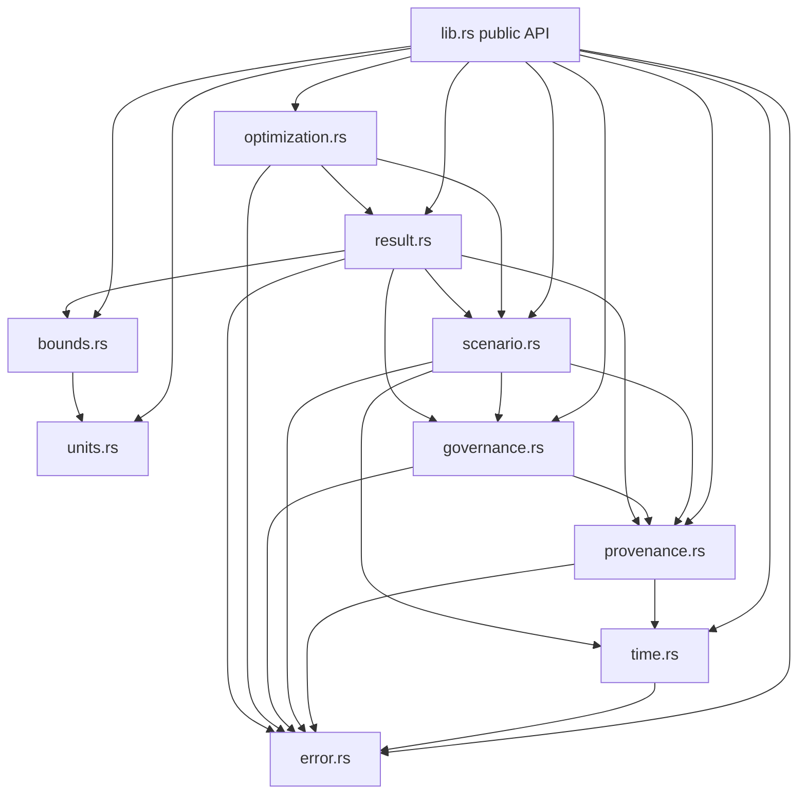

# popmath Foundation File Specifications

## Scope of This Tranche

This document specifies the first half of the `popmath` crate architecture.

It describes these files:

- `src/lib.rs`
- `src/units.rs`
- `src/bounds.rs`
- `src/time.rs`
- `src/provenance.rs`
- `src/scenario.rs`
- `src/result.rs`
- `src/governance.rs`
- `src/optimization.rs`
- `src/error.rs`
- `README.md`

These files form the crate-wide contract used by every later domain module:

- `water.rs`
- `energy.rs`
- `ecology.rs`
- `mobility.rs`
- `logistics.rs`
- `queues.rs`
- `maintenance.rs`
- `population.rs`
- `economics.rs`
- `access.rs`
- `simulation.rs`

The design intent is that domain modules do not independently define incompatible quantity types, provenance records, error styles, policy declarations, output formats, or review metadata.

## Architectural Principles

The foundational files enforce the following conditions across all Population.Math calculations:

- A physical or financial number must carry an explicit unit.
- A calculation must identify its input provenance and time scope.
- A scenario must declare its assumptions, constraints, and intended purpose.
- A model result must report validation status, uncertainty, accessibility impact, ecological impact, rights impact, and human-review requirements.
- Sensitive person-level inputs are rejected by default.
- A result is advisory computation, not an authorization to take civic action.
- Optimization retains tradeoffs and feasibility evidence rather than exposing only a lowest-cost answer.
- Invalid ranges, incompatible units, missing provenance, and prohibited uses fail closed with structured errors.
- Stochastic functions must use caller-provided seeds and report them in their outputs.
- All serializable public types use stable, documented representations suitable for APIs, CLI tools, local files, WebAssembly, and audit artifacts.

## Dependency Direction

The dependency direction must remain acyclic:



Domain modules may depend on every foundational module. Foundational modules must not depend on domain modules.

`lib.rs` is the only intended facade for ordinary consumers. Internal modules may be public for documentation and advanced use, but the prelude should expose the stable types and traits most applications need.

## File: `src/lib.rs`

### Responsibility

`lib.rs` is the crate root and public API boundary.

It declares all modules, conditionally exposes feature-gated integrations, provides crate-level documentation, publishes a stable prelude, and prevents downstream consumers from depending on accidental internal implementation details.

It must define the crate as an analysis and decision-support library rather than a city-control, surveillance, scoring, or automated-adjudication system.

### Required crate-level documentation

The crate documentation should state:

- `popmath` computes aggregate civic, ecological, infrastructure, and service scenarios.
- It supports deterministic calculation, optimization model description, and scenario analysis.
- It does not make binding decisions about people.
- It rejects sensitive person-level data by default.
- It requires provenance, explicit units, and result metadata.
- It is suitable for server, local, offline, command-line, and WebAssembly deployments when relevant features are selected.
- It provides mathematical evidence, not legal advice, public authority, or operational authorization.

The documentation should include a short “safe usage” example in prose, not necessarily executable code:

1. An application aggregates water-demand data by a permitted geographic unit.
2. The application declares the source, collection period, and purpose.
3. The application creates a scenario with drought and recovery assumptions.
4. A water model computes storage outcomes.
5. The application receives a `ResultEnvelope`.
6. A human and community review process interprets the outcome before any operational action.

### Module declarations

`lib.rs` should declare:

- `pub mod access;`
- `pub mod bounds;`
- `pub mod ecology;`
- `pub mod economics;`
- `pub mod energy;`
- `pub mod error;`
- `pub mod governance;`
- `pub mod logistics;`
- `pub mod maintenance;`
- `pub mod mobility;`
- `pub mod optimization;`
- `pub mod population;`
- `pub mod provenance;`
- `pub mod queues;`
- `pub mod result;`
- `pub mod scenario;`
- `pub mod simulation;`
- `pub mod time;`
- `pub mod units;`
- `pub mod water;`

Feature-gated modules should be declared only if they become real modules, such as:

- `geo`
- `serde_support`
- `solver`
- `wasm_support`
- `parallel`

The crate should not declare placeholder modules.

### Prelude

`lib.rs` should provide `pub mod prelude` to simplify reliable use of the foundational API.

The prelude should export:

- Common quantities and unit markers from `units`.
- `Interval`, `Probability`, `Ratio`, and bounded numeric types from `bounds`.
- `TimeWindow`, `UtcTimestamp`, and duration types from `time`.
- `SourceProvenance`, `DataClassification`, `AggregationLevel`, and `DataQuality` from `provenance`.
- `Scenario`, `ScenarioId`, `Assumption`, `Constraint`, and `ScenarioSet` from `scenario`.
- `ResultEnvelope`, `ValidationStatus`, `Uncertainty`, `SensitivitySummary`, and `ReproducibilityDigest` from `result`.
- `Purpose`, `PermittedUse`, `ProhibitedUse`, `ReviewRequirement`, `RightsImpact`, and `EcoImpact` from `governance`.
- `PopmathError` and the `PopmathResult` alias from `error`.
- Model traits from `optimization`.

The prelude must not export every concrete model from every domain module. Broad exports make breaking changes harder and make model boundaries unclear.

### Feature guards

`lib.rs` should compile with minimal dependencies when no optional feature is selected.

It should use compile-time guards to prevent unsafe feature combinations, for example:

- A feature that enables external solver adapters must not disable result provenance.
- A WebAssembly profile must not rely on unsupported operating-system APIs.
- A parallel profile must preserve deterministic output ordering.
- A serialization feature must include schema versioning for persisted public types.

### Stability and versioning

The crate root should expose:

- A semantic crate version through Cargo metadata.
- A `MODEL_SCHEMA_VERSION` constant for serialized model structures.
- A `RESULT_ENVELOPE_VERSION` constant for result records.
- A `POLICY_CONTRACT_VERSION` constant for governance structures.

These are compatibility indicators, not hidden object identifiers. A consuming service can use them to decide whether it understands an incoming scenario or result format.

### Invariants owned by `lib.rs`

- There is one canonical `PopmathResult<T>` type alias.
- All public errors originate from `PopmathError`.
- All public calculations return structured results or structured errors.
- Every domain model uses common provenance, scenario, governance, and result structures.
- Optional integrations cannot bypass the governance or result-envelope contract.
- Public documentation describes prohibited uses clearly.

## File: `src/units.rs`

### Responsibility

`units.rs` defines type-safe scalar quantities and conversion rules.

It is the dimensional-safety core of the crate. Domain calculations should use these types instead of raw `f64` values whenever a value represents a physical, temporal, financial, environmental, or service quantity.

The module prevents errors such as:

- Adding liters to kilograms.
- Treating kilowatts as kilowatt-hours.
- Dividing a distance by a mass and naming the output a time.
- Mixing carbon dioxide equivalent with carbon mass without declaring conversion boundaries.
- Mixing currency major units and minor units.
- Comparing a one-hour queue rate to a per-minute service rate without conversion.
- Calculating a water balance using inconsistent volume units.

### Numeric representation

The initial crate should use `f64` for measured and modeled physical quantities, plus explicit validation against:

- `NaN`
- Positive infinity
- Negative infinity
- Negative values for quantities that are non-negative by definition
- Invalid zero denominators
- Values outside documented practical ranges

Financial values should use integer minor units with a currency code instead of floating-point currency values.

Population counts should use unsigned integer values where a fractional count is not meaningful, and weighted population aggregates should use a separate non-negative decimal type.

### Core generic type

The module should define a generic `Quantity<U>`:

- It stores a finite numeric magnitude.
- Its type parameter `U` represents a canonical unit.
- It validates the magnitude at construction.
- It supports arithmetic only where resulting dimensions are valid.
- It can be serialized as an object containing `value` and `unit` when serialization is enabled.
- It does not perform implicit conversion between incompatible units.

The initial implementation may use named wrappers around `Quantity<U>` where that improves readability, such as:

- `MassKg`
- `VolumeM3`
- `FlowRateM3PerS`
- `EnergyKwh`
- `PowerKw`
- `DistanceM`
- `DurationS`
- `CurrencyAmount`
- `EmissionsKgCo2e`

The public documentation should explain that these are not competing quantity systems. They are readable aliases or wrappers over one canonical dimensional model.

### Required unit families

The initial release should define canonical types for:

| Family | Canonical unit | Example use |
|---|---|---|
| Mass | kilogram | Construction material, pollutant mass, waste |
| Volume | cubic meter | Reservoir storage, reclaimed water, excavation |
| Flow | cubic meter per second | Water delivery, canal flow, treatment throughput |
| Area | square meter | Lot space, roof area, shaded area |
| Length | meter | Route distance, pipe length, corridor length |
| Speed | meter per second | Vehicle, walking, water flow, wind |
| Time | second | Calculation intervals and duration conversion |
| Power | watt | Pumping, renewable generation, load |
| Energy | joule or kilowatt-hour | Battery storage, grid demand, operational energy |
| Temperature | degree Celsius and kelvin boundary types | Heat and thermal scenarios |
| Pressure | pascal | Water and hydraulic calculations |
| Currency | integer minor unit plus ISO currency code | Capital cost and lifecycle cost |
| Emissions | kilogram carbon-dioxide-equivalent | Fuel and material emissions |
| Population | person or weighted aggregate | Service demand, coverage calculations |
| Count | unsigned count | Vehicles, crews, incidents, service channels |
| Percentage | unit interval represented as a ratio | Loss rate, efficiency, coverage |
| Dimensionless ratio | unit interval or unbounded ratio | Efficiency, utilization, normalized indicators |

### Unit marker traits

The type system should distinguish:

- Units that can be converted within the same dimension.
- Units that form a derived unit under multiplication or division.
- Units that have a canonical storage representation.
- Units that may be negative.
- Units that must be non-negative.
- Units that must be bounded between zero and one.

Conceptual traits include:

- `Unit`
- `Dimension`
- `ConvertibleUnit`
- `CanonicalUnit`
- `NonNegativeUnit`
- `BoundedUnit`
- `DerivedUnit`

The initial release does not need to implement arbitrary compile-time dimensional algebra for every possible formula. It should cover the domain combinations required by the crate and return explicit types for known operations.

### Required arithmetic relationships

The module must support documented, checked relationships including:

\[
\text{energy} = \text{power} \times \text{duration}
\]

\[
\text{volume} = \text{flow rate} \times \text{duration}
\]

\[
\text{mass} = \text{concentration} \times \text{volume}
\]

\[
\text{distance} = \text{speed} \times \text{duration}
\]

\[
\text{hydraulic power} = \rho g Q H
\]

Where each term uses explicit units:

- \(\rho\): density in kilograms per cubic meter.
- \(g\): acceleration in meters per second squared.
- \(Q\): flow rate in cubic meters per second.
- \(H\): head in meters.
- Result: watts.

The water and ecology modules should call these well-defined operations rather than reproduce conversions manually.

### Conversion policy

Conversions must be:

- Explicit.
- Documented.
- Rounded only at presentation boundaries.
- Reversible where the unit relationship is exact.
- Tagged with their assumptions where a conversion requires a domain factor.

Examples:

- Meters and kilometers are exact scaling conversions.
- Joules and kilowatt-hours are exact scaling conversions.
- Gallons and liters require a declared gallon convention where needed.
- Carbon dioxide equivalent conversion must carry the factor source and assessment boundary.
- Currency conversion must not be an automatic arithmetic operation; it requires an exchange-rate record with source, timestamp, and policy approval.

### Validation methods

The module should provide constructors with appropriate semantics:

- `new_nonnegative`
- `new_positive`
- `new_finite`
- `new_bounded`
- `try_from_display_unit`

The API must make it difficult to construct invalid values accidentally.

For example:

- Reservoir volume cannot be negative.
- Vehicle count cannot be fractional or negative.
- Efficiency must remain greater than zero and no greater than one when it is physically defined as an efficiency.
- A financial amount can be negative where it represents a credit, but the sign must be explicit in documentation.
- A temperature can be negative in Celsius but must be valid when transformed to absolute-temperature calculations.

### Serialization

When `serde` is enabled, quantities must serialize as explicit objects:

```text
{
  "value": 1250.0,
  "unit": "kg"
}
```

They must not serialize as a bare number unless a surrounding schema independently and permanently fixes the unit.

### Tests

`units.rs` must include tests for:

- Exact conversion factors.
- Rejection of non-finite values.
- Rejection of invalid negative values.
- Ratio boundary enforcement.
- Dimensional operation correctness.
- Conversion round-trip behavior where exact.
- Currency minor-unit stability.
- Serialization including explicit unit strings.
- No silent loss of precision in canonical representations.

## File: `src/bounds.rs`

### Responsibility

`bounds.rs` defines bounded values, intervals, uncertainty containers, and numerical-safety primitives.

It is separate from `units.rs` because it answers a different question:

- `units.rs`: “What does this number measure?”
- `bounds.rs`: “What values are valid, plausible, uncertain, or guaranteed for this number?”

This module gives every domain module a uniform way to express:

- A probability.
- An efficiency.
- A confidence interval.
- A measurement interval.
- A lower and upper scenario result.
- A tolerance.
- A percentile range.
- A value with a declared uncertainty.
- A finite numeric range.
- A non-negative value.

### Core types

The module should define:

- `FiniteF64`
- `NonNegativeF64`
- `PositiveF64`
- `Probability`
- `UnitInterval`
- `Ratio`
- `Interval<T>`
- `ConfidenceInterval<T>`
- `PercentileInterval<T>`
- `Tolerance<T>`
- `Uncertain<T>`
- `SampleSize`
- `RandomSeed`

### `FiniteF64`

`FiniteF64` is a wrapper that rejects:

- `NaN`
- Positive infinity
- Negative infinity

It is suitable for model coefficients, exponents, temperatures, and signed intermediate values.

It should provide controlled access to the underlying number, preserving the guarantee that it is finite.

### `NonNegativeF64` and `PositiveF64`

`NonNegativeF64` represents finite values \(x \geq 0\).

`PositiveF64` represents finite values \(x > 0\).

They should be used for:

- Physical volumes.
- Counts represented as measured weights.
- Rates.
- Capacities.
- Durations.
- Sample sizes.
- Denominators that must be nonzero.

The distinction prevents accidental division by zero and makes model preconditions visible in function signatures.

### `Probability` and `UnitInterval`

`Probability` represents a finite value in:

\[
0 \leq p \leq 1
\]

It should be used for event likelihood, confidence level, service coverage fraction, and failure probability.

`UnitInterval` may use the same bound but represent normalized indicators rather than probabilistic claims.

This distinction matters in reporting:

- A probability has a probabilistic interpretation.
- A normalized index does not necessarily have one.

### `Ratio`

`Ratio` should represent a dimensionless relationship that may be:

- Bounded, such as an efficiency.
- Greater than one, such as a load factor or benefit-cost ratio.
- Signed, only where the domain explicitly permits it.

The module should provide separate constructors or wrappers rather than one ambiguous “ratio” that allows every value.

### `Interval<T>`

`Interval<T>` represents an inclusive lower and upper bound:

\[
[a, b], \quad a \leq b
\]

It must reject reversed bounds.

It should provide:

- `lower`
- `upper`
- `contains`
- `width`
- `midpoint`, where meaningful
- `intersects`
- `intersection`
- `hull`
- `clamp`
- `map`
- `validate_nonnegative`, where relevant

A unit-bearing interval such as `Interval<VolumeM3>` is valid. The module must preserve units and avoid producing raw numeric intervals from typed quantities.

### Confidence and percentile intervals

`ConfidenceInterval<T>` must include:

- Lower bound.
- Upper bound.
- Confidence level.
- Method label.
- Sample or model basis.
- Whether the interval is empirical, analytical, bootstrap, Bayesian credible, or scenario-derived.

`PercentileInterval<T>` must include:

- Lower percentile.
- Upper percentile.
- Values at both percentiles.
- Sample count.
- Random seed where simulation generated the samples.

The crate must avoid presenting a scenario range as a statistical confidence interval unless its method supports that interpretation.

### `Uncertain<T>`

`Uncertain<T>` represents a central value plus declared uncertainty information.

It should include:

- `estimate`
- `interval`
- `method`
- `assumptions`
- `sample_size`
- `seed`, when applicable
- `data_quality_notes`

This type is important for public planning because it preserves the difference between:

- A measured quantity with instrument uncertainty.
- A forecast with a prediction interval.
- A scenario range.
- A simulation percentile band.
- An expert-supplied assumption range.

### Numerical tolerance

`Tolerance<T>` should include:

- Absolute tolerance.
- Relative tolerance.
- Comparison operation.
- Explanation of why the tolerance is appropriate.

This prevents hidden numerical assumptions in solver and simulation results.

### Random seed

Stochastic components must use `RandomSeed`, which:

- Stores an explicitly supplied seed.
- Is included in outputs.
- Is stable across a documented pseudo-random algorithm version.
- Is never generated silently by the core calculation API.

Applications may generate a seed externally, but the calculation must always receive and report it.

### Tests

`bounds.rs` must test:

- Rejection of `NaN` and infinities.
- Lower-bound and upper-bound correctness.
- Interval ordering.
- Boundary inclusion.
- Interval intersections.
- Confidence-level validation.
- Percentile ordering.
- Preservation of typed units inside intervals.
- Deterministic seed serialization.
- Tolerance comparison behavior around declared thresholds.

## File: `src/time.rs`

### Responsibility

`time.rs` provides time-safe structures for civic and ecological computations.

Time is a core dependency because every meaningful city-scale calculation requires a clear period:

- A transit headway.
- A delivery window.
- A water-balance interval.
- An energy dispatch step.
- A maintenance response target.
- A heat-event scenario.
- A lifecycle-cost horizon.
- A measurement collection period.
- A public-service queue rate.

The module prevents errors caused by ambiguous local time, mixed time zones, undefined time windows, and interval mismatches.

### Core types

The module should define:

- `UtcTimestamp`
- `TimeWindow`
- `TimeStep`
- `DurationSeconds`
- `DurationMinutes`
- `DurationHours`
- `DateRange`
- `ModelHorizon`
- `RecurringSchedule`
- `TimeResolution`
- `TemporalCoverage`
- `TimeSeriesPoint<T>`
- `TimeSeries<T>`

### `UtcTimestamp`

`UtcTimestamp` represents an unambiguous instant in Coordinated Universal Time.

All persisted calculation timestamps should use UTC. Applications may convert for display, but models must not depend on ambiguous local wall-clock time.

It should support:

- Parsing strict ISO 8601 timestamps.
- Formatting canonical ISO 8601 UTC output.
- Ordering and duration difference.
- Serialization.
- Rejection of timestamps missing a time-zone offset when interpreted as an instant.

### `TimeWindow`

`TimeWindow` represents a closed or half-open interval with:

- Start time.
- End time.
- Boundary convention.
- Optional label.
- Optional operational meaning such as delivery, maintenance, public service, or observation period.

It must enforce:

\[
t_{\text{start}} \leq t_{\text{end}}
\]

It should provide:

- `duration`
- `contains`
- `overlaps`
- `intersection`
- `union_if_contiguous`
- `split_by_step`
- `validate_minimum_duration`

The boundary convention must be explicit because scheduling and count aggregation can differ at endpoint boundaries.

### `TimeStep` and `TimeResolution`

`TimeStep` represents a regular model interval such as:

- 5 minutes
- 15 minutes
- 1 hour
- 1 day
- 1 month

`TimeResolution` describes the intended meaning of a time series:

- Instantaneous measurement.
- Average over interval.
- Accumulated over interval.
- End-of-interval state.
- Start-of-interval state.

This distinction is mandatory for correct water, energy, traffic, and sensor calculations.

For example:

- Power in kilowatts may be an average over a five-minute interval.
- Energy in kilowatt-hours is an accumulated quantity over an interval.
- Reservoir volume may be an end-of-interval state.
- Rainfall may be accumulated over an interval.
- Flow can be instantaneous, averaged, or integrated.

### `DateRange` and `ModelHorizon`

`DateRange` represents calendar-based spans for planning and reporting.

`ModelHorizon` represents a model run’s time structure:

- Start timestamp.
- End timestamp.
- Step size.
- Number of steps.
- Time-zone display preference, if any.
- Leap-year and daylight-saving handling declaration.

A model horizon should permit a water or energy simulator to verify that all arrays have compatible lengths before execution.

### `RecurringSchedule`

`RecurringSchedule` is intended for repeating operational constraints such as:

- Transit operating hours.
- Maintenance windows.
- Delivery restrictions.
- Cooling-center availability.
- Public service hours.
- Seasonal irrigation schedules.

It must use explicit locality and daylight-saving behavior at the application boundary. The core model should convert the resolved schedule into UTC windows before simulation.

### `TimeSeries<T>`

`TimeSeries<T>` should include:

- Ordered points.
- A declared resolution.
- A declared coverage window.
- Missing-data policy.
- Interpolation policy.
- Source provenance reference.
- Optional quality flags per point.

It must enforce monotonic timestamps and reject duplicate timestamps unless the declared resolution and aggregation method specify how duplicates are combined.

### Missing data

The module should not silently fill missing time-series values.

It should support declared strategies:

- Reject missing data.
- Carry forward.
- Linear interpolation.
- Seasonal interpolation.
- External imputation result.
- Scenario assumption.

Every strategy must be recorded in model assumptions and result provenance.

### Tests

`time.rs` must test:

- Strict UTC parsing.
- Invalid time-window rejection.
- DST-safe conversion boundaries at the application adapter level.
- Window overlap and intersection.
- Correct duration calculations.
- Time-series ordering.
- Duplicate point rejection.
- Resolution compatibility.
- Missing-data policy declaration.
- Consistent time-step expansion across a model horizon.

## File: `src/provenance.rs`

### Responsibility

`provenance.rs` defines the evidence record attached to input data and calculation artifacts.

It ensures that a result can answer:

- Where did this input come from?
- Who or what produced it?
- When was it collected or retrieved?
- What geographic and temporal scope does it cover?
- Is it public, synthetic, aggregate, consent-authorized, or prohibited?
- What transformations were applied?
- What quality limitations exist?
- Can the input be reused for this calculation’s purpose?
- Does it contain sensitive personal information?

The module does not fetch sources, open URLs, or manage credentials. It represents provenance records supplied by a trusted application boundary.

### Core types

The module should define:

- `SourceProvenance`
- `SourceKind`
- `DataClassification`
- `AggregationLevel`
- `GeographicScope`
- `TemporalCoverage`
- `DataQuality`
- `QualityFlag`
- `TransformationRecord`
- `LicenseOrAuthority`
- `PurposeCompatibility`
- `RetentionDeclaration`
- `InputDigest`
- `ProvenanceChain`

### `SourceProvenance`

`SourceProvenance` should be attached to each top-level model input or aggregate input bundle.

It should include:

- Human-readable source name.
- Source kind.
- Publisher, steward, or responsible organization label.
- Retrieval or receipt timestamp.
- Collection time coverage.
- Geographic scope.
- License, authority, or authorization basis.
- Data classification.
- Aggregation level.
- Quality declaration.
- Transformation history.
- Integrity digest, where available.
- Retention declaration reference.
- Purpose-compatibility statement.
- Notes visible to reviewers.

It must never require direct inclusion of personal identity data, raw credentials, secret URLs, or external system tokens.

### `SourceKind`

The initial enumeration should include:

- `PublicDataset`
- `PublicMeasurement`
- `GovernmentPublication`
- `CommunitySubmittedAggregate`
- `EnvironmentalSensorAggregate`
- `SyntheticScenario`
- `ScientificReference`
- `OperationalAggregate`
- `ManualEntry`
- `DerivedCalculation`
- `Unknown`

`Unknown` is allowed only when a model explicitly permits it for exploratory work. It should be rejected for decision-ready or public-reporting outputs.

### `DataClassification`

The data classes should distinguish:

- `Public`
- `OpenAggregate`
- `RestrictedAggregate`
- `Synthetic`
- `ConsentAuthorizedAggregate`
- `SensitivePersonal`
- `Biometric`
- `Health`
- `Neural`
- `AugmentationTelemetry`
- `PersistentLocationHistory`
- `IdentityLinkedMobility`
- `Prohibited`

The foundational policy is:

- `Public`, `OpenAggregate`, `RestrictedAggregate`, `Synthetic`, and `ConsentAuthorizedAggregate` can be accepted subject to purpose and review rules.
- Sensitive personal, biometric, health, neural, augmentation, identity-linked mobility, and prohibited categories must be rejected by core population-scale models unless transformed into a safe, verified aggregate outside the crate and then reclassified with a documented transformation record.

### `AggregationLevel`

`AggregationLevel` describes the privacy and analytical granularity of a dataset.

The initial representation should support:

- `Citywide`
- `Region`
- `District`
- `Neighborhood`
- `CensusLikeZone`
- `ServiceArea`
- `NetworkSegment`
- `Facility`
- `ProjectSite`
- `SyntheticCohort`
- `CustomAggregate`

It should also include an explicit disclosure-risk declaration rather than treating a geographic label alone as proof of privacy.

A `Facility` or `ProjectSite` can be valid where it describes infrastructure rather than individuals. It must not be used to smuggle sensitive, small-group personal data into the system.

### `GeographicScope`

The core crate should represent geographic scope abstractly:

- Label.
- Scope kind.
- Optional geometry reference.
- Coordinate reference system label when geometry is present.
- Resolution or aggregation note.
- Privacy review note.

The crate should avoid embedding a mandatory geospatial dependency in the base feature set. With the `geo` feature enabled, a consumer can attach validated geometry types.

### `DataQuality`

`DataQuality` should include:

- Completeness.
- Timeliness.
- Accuracy or measurement uncertainty.
- Representativeness.
- Known bias risks.
- Calibration status where a sensor is involved.
- Missing-data handling.
- Validation status.
- Reviewer notes.

Each dimension should be recorded as an explicit bounded indicator or categorical status with a narrative basis. It must not collapse all data quality into a single opaque score.

### `TransformationRecord`

Each significant transformation should record:

- Transformation purpose.
- Method name.
- Version.
- Input digest.
- Output digest.
- Time performed.
- Whether it removed identifiers.
- Whether it aggregated data.
- Whether it introduced modeled or imputed values.
- Reviewer or validation status.

This supports auditability without requiring storage of raw source records in the crate.

### `ProvenanceChain`

A `ProvenanceChain` represents a sequence of source and transformation records.

It should:

- Preserve ordering.
- Reject cycles.
- Permit a derived calculation to reference prior result digests.
- Allow a model result to trace back to public or aggregate source records.
- Make gaps visible rather than silently assuming lineage.

### Validation rules

`provenance.rs` must reject:

- Missing source names for decision-ready outputs.
- Missing temporal coverage where time matters.
- Sensitive personal categories in population-scale domain inputs.
- Unspecified aggregation level when a model uses community coverage or parity analysis.
- Unknown data quality for high-impact result classes.
- A transformation record that claims anonymization without a method statement.
- A purpose mismatch where the input declares a prohibited secondary use.
- Missing retention declaration for restricted or consent-authorized inputs.

### Tests

`provenance.rs` must test:

- Acceptance of a synthetic aggregate scenario.
- Acceptance of public environmental measurements with complete source records.
- Rejection of person-level location histories.
- Rejection of augmentation telemetry.
- Rejection of unspecified aggregation for service-access analysis.
- Transformation-chain ordering.
- Digest preservation.
- Purpose compatibility validation.
- Data-quality completeness requirements.
- Serialization of source records without secrets.

## File: `src/scenario.rs`

### Responsibility

`scenario.rs` defines the container for a coherent set of planning assumptions, constraints, objectives, and input references.

A scenario is the primary unit of civic mathematical inquiry. It prevents calculations from appearing universal when they are conditional on stated choices.

A scenario should be able to express:

- Baseline conditions.
- Drought, heat, outage, growth, traffic, or construction cases.
- Alternative service levels.
- Different cost and emissions assumptions.
- Different accessibility requirements.
- Different ecological protection boundaries.
- Different staffing, vehicle, yard-space, or storage capacities.
- Different uncertainty cases.

### Core types

The module should define:

- `Scenario`
- `ScenarioId`
- `ScenarioName`
- `ScenarioSet`
- `ScenarioStatus`
- `Assumption`
- `AssumptionKind`
- `Constraint`
- `ConstraintKind`
- `Objective`
- `ObjectiveDirection`
- `ScenarioInput`
- `ScenarioComparison`
- `ScenarioTag`
- `ScenarioBoundary`
- `ScenarioValidation`

### `ScenarioId`

`ScenarioId` should be a human-readable, stable label chosen by the caller, such as:

- `baseline-summer-demand`
- `drought-recovery-case`
- `accessible-detour-plan`
- `low-emission-delivery-alternative`

It should not expose internal object identifiers or claim global uniqueness. A reproducibility digest provides content identity; the scenario label serves human understanding.

### `Scenario`

A `Scenario` should include:

- Name and description.
- Purpose.
- Status: draft, validated, review-required, approved-for-analysis, archived, or superseded.
- Time horizon.
- Geographic scope.
- Assumptions.
- Constraints.
- Objectives.
- Input provenance references.
- Required governance review.
- Accessibility requirements.
- Ecological boundaries.
- Known limitations.
- Authoring context label, where appropriate.
- Reproducibility inputs digest.

A scenario should be immutable during model execution. Any modification yields a new scenario value and a new digest.

### Assumptions

`Assumption` must be structured rather than free text alone.

It should include:

- Name.
- Description.
- Kind.
- Value or referenced interval.
- Unit where relevant.
- Basis: measured, forecast, policy choice, scientific reference, community input, synthetic stress case, or unknown.
- Provenance reference.
- Sensitivity priority.
- Review requirement.

Examples:

- Forecast daily water demand.
- Fuel consumption rate.
- Construction crew availability.
- Transit headway.
- Battery charge efficiency.
- Heat-event duration.
- Road closure duration.
- Cost escalation rate.
- Ecological flow threshold.
- Accessibility travel-time threshold.

The module should allow narrative notes but require machine-readable values for assumptions that affect a numerical model.

### Constraints

`Constraint` represents a condition that a plan, route, schedule, or scenario must satisfy.

It should include:

- Name.
- Description.
- Kind.
- Expression or typed constraint parameters.
- Hard or soft classification.
- Violation consequence.
- Source or authority basis.
- Accessibility impact.
- Ecological impact.
- Review requirement.
- Relaxation policy.

Important constraint families include:

- Physical capacity.
- Vehicle mass and volume.
- Road closure.
- Delivery time window.
- Crew availability.
- Budget ceiling.
- Service-level floor.
- Accessible-path continuity.
- Emergency-access preservation.
- Minimum ecological flow.
- Maximum emissions.
- Storage capacity.
- Maintenance safety window.
- Data-use restriction.
- Human-review requirement.

A hard constraint must not be silently relaxed. A soft constraint may be traded off only when the output reports the violation magnitude, reason, and reviewer requirement.

### Objectives

`Objective` describes an optimization or comparison preference.

It should include:

- Name.
- Direction: minimize, maximize, target, or satisfy.
- Metric definition.
- Unit.
- Weight, if used.
- Priority class.
- Explanation.
- Whether it is public-interest, operational, accessibility, ecological, resilience, or financial.
- Whether the objective may be traded off against another objective.
- Required disclosure if deprioritized.

Examples:

- Minimize fuel consumption.
- Minimize delivery lateness.
- Maximize accessible service coverage.
- Maximize critical-load continuity.
- Minimize potable-water shortage.
- Minimize pollutant discharge.
- Minimize lifecycle cost.
- Maximize maintenance response reliability.

An objective cannot override a hard rights, safety, accessibility, privacy, or ecological constraint.

### Scenario sets

`ScenarioSet` represents a collection of comparable scenarios.

It should include:

- Shared scope.
- Shared model version.
- Common metrics.
- Comparison criteria.
- Baseline scenario reference.
- Candidate scenarios.
- Required uncertainty method.
- Required review level.

It should enforce compatibility before comparison:

- Same units.
- Same horizon or documented normalization.
- Same geographic scope or documented comparison mapping.
- Same accounting boundary.
- Same cost currency and base period.
- Same emissions boundary.
- Same accessibility threshold definitions.
- Same privacy and aggregation category.

### Scenario boundaries

`ScenarioBoundary` documents what a model includes and excludes.

It should include:

- Geographic boundary.
- Temporal boundary.
- Population or service boundary.
- Infrastructure boundary.
- Financial boundary.
- Environmental boundary.
- Data boundary.
- Decision boundary.

This makes it clear, for example, whether a construction-emissions result includes material production, transport, idling, installation, maintenance, and end-of-life stages.

### Tests

`scenario.rs` must test:

- Scenario immutability semantics.
- Required purpose and time horizon.
- Constraint validation.
- Prevention of silent hard-constraint relaxation.
- Objective-unit compatibility.
- Scenario-set comparison compatibility.
- Accessibility requirement preservation.
- Ecological-boundary preservation.
- Missing input-provenance rejection.
- Correct digest changes when an assumption changes.

## File: `src/result.rs`

### Responsibility

`result.rs` defines the universal output envelope for every material Population.Math computation.

The result envelope is the most important public contract after units and provenance. It makes every output reviewable, comparable, serializable, and appropriately bounded.

A raw number is insufficient. For example, “shortage equals 2,000 cubic meters” is not decision-ready without:

- Time period.
- Source data.
- Storage model.
- Loss assumptions.
- Uncertainty.
- Critical-service reservation.
- Accessibility and service-continuity implications.
- Ecological-flow treatment.
- Required review status.

### Core types

The module should define:

- `ResultEnvelope<T>`
- `ResultMetadata`
- `CalculationIdentity`
- `ValidationStatus`
- `ValidationFinding`
- `FeasibilityStatus`
- `Uncertainty`
- `UncertaintyMethod`
- `SensitivitySummary`
- `SensitivityFactor`
- `AccessibilityImpact`
- `RightsImpactSummary`
- `EcologicalImpact`
- `HumanReview`
- `ReproducibilityDigest`
- `ResultWarning`
- `ResultLimitation`
- `Explanation`
- `AlternativeSet<T>`

### `ResultEnvelope<T>`

`ResultEnvelope<T>` contains:

- `metadata`
- `value`
- `validation`
- `uncertainty`
- `sensitivity`
- `accessibility_impact`
- `rights_impact`
- `ecological_impact`
- `human_review`
- `warnings`
- `limitations`
- `alternatives`
- `reproducibility_digest`

The generic `T` is a strongly typed domain result, such as:

- Water balance outcome.
- Energy storage outcome.
- Delivery feasibility result.
- Transit access result.
- Lifecycle-cost result.
- Queue-capacity result.
- Mass-removal result.
- Optimization solution set.

### Calculation identity

`CalculationIdentity` should include:

- Calculation name.
- Model family.
- Model semantic version.
- Schema version.
- Optional algorithm identifier.
- Optional solver identity and version.
- Execution mode: deterministic, optimization, simulation, or hybrid.
- Computed-at timestamp.
- Declared purpose.

It should be descriptive and auditable. It should not expose implementation secrets or hidden tracking identifiers.

### Validation status

`ValidationStatus` should differentiate:

- `Validated`
- `ValidatedWithWarnings`
- `ReviewRequired`
- `Infeasible`
- `InsufficientData`
- `RejectedInput`
- `NumericallyUnstable`
- `NotDecisionReady`

A result with `ReviewRequired`, `InsufficientData`, `Infeasible`, or `NotDecisionReady` must not be presented by the crate as an operational recommendation.

### Feasibility status

`FeasibilityStatus` should indicate:

- Feasible.
- Feasible with soft-constraint deviations.
- Infeasible.
- Conditionally feasible.
- Not applicable.

For optimization results, the envelope must disclose:

- Which hard constraints were satisfied.
- Which soft constraints were violated.
- Magnitudes of violation.
- Whether a relaxation was user-authorized.
- Whether accessibility, ecological, or rights constraints were implicated.

### Uncertainty

`Uncertainty` should distinguish:

- `NoneDeclared`
- `MeasurementInterval`
- `ScenarioRange`
- `ConfidenceInterval`
- `PredictionInterval`
- `PercentileInterval`
- `SensitivityOnly`
- `QualitativeUncertainty`

It should include:

- The uncertainty method.
- Applicable values or intervals.
- Sample count where relevant.
- Random seed where relevant.
- Key assumptions.
- Whether uncertainty is complete, partial, or unavailable.

The result must not label a range “confidence interval” unless the method supports that claim.

### Sensitivity summary

`SensitivitySummary` describes which assumptions materially influenced the outcome.

It should include:

- Input or assumption name.
- Tested range.
- Output change.
- Direction of effect.
- Method.
- Rank or materiality category.
- Whether the factor is controllable, observable, or uncertain.

This makes city-scale calculations useful for planning: a result can show whether water shortage is driven mostly by demand, evaporation, losses, or inflow uncertainty.

### Accessibility impact

`AccessibilityImpact` should include:

- Impact classification: positive, neutral, negative, unknown, or requires review.
- Affected access functions.
- Declared accessibility constraints.
- Whether full-path accessibility was modeled.
- Manual and offline alternative availability.
- Continuity implications.
- Required accessibility review.
- Plain-language explanation.

The crate must not infer a person’s disability or device use. It models infrastructure and service accessibility conditions.

### Rights impact summary

`RightsImpactSummary` should include:

- Data minimization status.
- Purpose limitation status.
- Sensitive-data status.
- Non-discrimination risk.
- Service-continuity risk.
- Explainability status.
- Appeal or correction reference supplied by the application.
- Human-oversight requirement.
- Overall review status.
- Narrative basis.

This is a governance record, not a legal conclusion.

### Ecological impact

`EcologicalImpact` should include:

- Impact direction: benefit, burden, mixed, unknown, or requires study.
- Accounting boundary.
- Primary metrics such as water, energy, emissions, material, heat, habitat, or pollutant mass.
- Uncertainty.
- Known externalities.
- Monitoring requirements.
- Plain-language explanation.

It must not turn uncertain environmental estimates into claims of guaranteed ecological benefit.

### Human review

`HumanReview` should state:

- Whether review is required.
- Required reviewer roles: technical, accessibility, ecological, community, operational, or authorized public decision-maker.
- Reasons review is required.
- Review completion state.
- A correction or appeal route reference, if supplied by the consuming application.

The crate should not fabricate a review completion status. It can only reflect data passed by an application-controlled workflow.

### Reproducibility digest

`ReproducibilityDigest` should be a stable cryptographic digest over a canonical representation of:

- Model identity.
- Scenario.
- Inputs or input digests.
- Units.
- Assumptions.
- Constraints.
- Solver configuration.
- Random seed, if used.
- Output schema version.

The digest supports comparison and audit. It must not include secrets, raw sensitive data, credentials, or personal identifiers.

### Alternative set

`AlternativeSet<T>` holds retained scenario or optimization alternatives.

It should include:

- Baseline.
- Candidate alternatives.
- Comparison metrics.
- Pareto or near-optimal status.
- Tradeoff explanation.
- Rejected alternatives with reasons.
- Review requirements.

This allows a system to show that a cheaper plan may have been rejected because it violated an accessible-path continuity constraint or exceeded a declared ecological boundary.

### Tests

`result.rs` must test:

- Every result envelope includes required metadata.
- Validation status correctly blocks decision-ready representation.
- Uncertainty methods are not mislabeled.
- Sensitivity factors preserve units and direction.
- Accessibility impact cannot be omitted from material public-service models.
- Rights and ecological metadata cannot be omitted from designated model classes.
- Reproducibility digests change when model inputs change.
- Reproducibility digests do not include secret fields.
- Alternative sets retain tradeoff data.
- Serialization is stable and schema-versioned.

## File: `src/governance.rs`

### Responsibility

`governance.rs` defines machine-readable constraints around why a calculation is being run, what inputs it may use, what outputs may be used for, and what review is required before interpretation or action.

It does not implement a legal system, a social-control system, or a hidden policy bypass. It provides typed declarations that downstream applications and policy engines can inspect.

This file ensures that Population.Math remains aligned with dignity, equal treatment, accessibility, consent, privacy, explainability, and ecological responsibility.

### Core types

The module should define:

- `Purpose`
- `PurposeCategory`
- `PermittedUse`
- `ProhibitedUse`
- `UseRestriction`
- `DecisionBoundary`
- `ReviewRequirement`
- `ReviewRole`
- `RightsImpact`
- `RightsDimension`
- `EcoImpact`
- `EcoMetric`
- `AccessibilityRequirement`
- `ContinuityRequirement`
- `DataUsePolicy`
- `RetentionPolicyReference`
- `CorrectionPathReference`
- `GovernanceAssessment`

### Purpose

`Purpose` describes why the calculation exists.

It should include:

- Human-readable purpose statement.
- Category.
- Expected public or operational benefit.
- Declared affected systems.
- Input necessity statement.
- Whether the purpose concerns an essential service.
- Whether the purpose has been publicly reviewed.
- Expiration or review date where appropriate.

Purpose categories should include:

- Mobility planning.
- Transit planning.
- Construction logistics.
- Water resilience.
- Energy resilience.
- Infrastructure maintenance.
- Ecological restoration.
- Heat mitigation.
- Waste and material recovery.
- Public-service capacity.
- Capital planning.
- Emergency preparedness.
- Research and education.
- Community scenario analysis.

A purpose cannot be “general analytics” when sensitive or restricted data is involved.

### Permitted use

`PermittedUse` specifies allowed downstream interpretations, such as:

- Aggregate scenario comparison.
- Public reporting.
- Infrastructure planning.
- Environmental measurement.
- Resource-capacity planning.
- Research.
- Accessibility analysis.
- Community consultation.

### Prohibited use

`ProhibitedUse` should explicitly encode prohibited downstream applications:

- Individual eligibility determination.
- Individual risk scoring.
- Social scoring.
- Surveillance.
- Behavioral manipulation.
- Identity inference.
- Biometric or neural profiling.
- Augmentation-status inference.
- Automated enforcement.
- Access denial.
- Essential-service rationing by personal characteristic.
- Employment, housing, credit, healthcare, education, or civic-participation adjudication.
- Secret profiling.
- Unreviewed operational actuation.

A model or result should reject a request that declares a prohibited purpose or prohibited intended use.

### Decision boundary

`DecisionBoundary` distinguishes:

- `AnalysisOnly`
- `PlanningSupport`
- `PublicConsultationSupport`
- `TechnicalRecommendationWithReview`
- `OperationalRecommendationWithApproval`
- `NotPermittedForDecision`

The default should be `AnalysisOnly`.

`popmath` must never autonomously promote a result to an operational decision. A consuming application can record that a human approval workflow has occurred, but this must remain externally controlled and auditable.

### Review requirement

`ReviewRequirement` should support:

- No additional review for low-impact internal exploratory math.
- Technical review.
- Accessibility review.
- Ecological review.
- Community review.
- Data-stewardship review.
- Authorized decision-maker review.
- Multi-review requirement.

It should include:

- Trigger conditions.
- Required roles.
- Reason.
- Completion reference.
- Expiration or re-review date.
- Whether review is mandatory before publication or implementation.

### Rights impact

`RightsImpact` should represent relevant dimensions without asserting legal conclusions.

`RightsDimension` should include:

- Dignity.
- Equal treatment.
- Non-discrimination.
- Privacy.
- Data minimization.
- Purpose limitation.
- Consent.
- Access.
- Accessibility.
- Assistive-technology continuity.
- Offline access.
- Explainability.
- Human oversight.
- Correction and appeal.
- Civic participation.
- Bodily and cognitive integrity.
- Protection from unauthorized interference.

For each dimension, `RightsImpact` should record:

- Status: supported, neutral, risk, unknown, or requires review.
- Evidence.
- Affected scope.
- Mitigation.
- Residual risk.
- Required reviewer role.

The model must avoid a falsely precise single scalar “rights score.” A summary classification can exist only alongside the underlying dimension-by-dimension record.

### Eco impact

`EcoImpact` should record:

- Water use or recovery.
- Energy use or generation.
- Emissions.
- Material consumption or diversion.
- Heat impact.
- Habitat or ecosystem impact.
- Pollution mass.
- Ecological-flow consideration.
- Uncertainty.
- Externalities.
- Monitoring requirement.

It must distinguish:

- Measured outcomes.
- Modeled outcomes.
- Scenario assumptions.
- Unverified claims.

### Accessibility requirement

`AccessibilityRequirement` should permit explicit declarations such as:

- Step-free path continuity.
- Minimum clear width.
- Grade limit.
- Audible and visual communication access.
- Tactile or screen-reader-compatible information access.
- Accessible fare or payment alternatives.
- Manual service alternative.
- Offline access.
- Assistive-device charging continuity.
- Emergency accessible transport.
- Non-proprietary access pathway.
- No mandatory biometric identity.
- No mandatory device telemetry.

A domain model may then turn these requirements into hard constraints or report them as unmet.

### Data use policy

`DataUsePolicy` connects a calculation to permitted classes of data, retention references, consent conditions, and purpose restrictions.

It should specify:

- Allowed data classifications.
- Prohibited data classifications.
- Minimum aggregation level.
- Purpose restriction.
- Retention reference.
- Deletion or expiration reference.
- Whether external sharing is permitted.
- Whether public publication is permitted.
- Required privacy review.

The policy should be declarative and portable so an external Rego or ALN policy layer can evaluate it without hidden behavior.

### Governance assessment

`GovernanceAssessment` is the output of applying governance metadata to a scenario.

It should include:

- Permitted, review-required, or rejected status.
- Reasons.
- Required mitigations.
- Required review roles.
- Missing declarations.
- Prohibited-use conflicts.
- Data-use conflicts.
- Rights and accessibility flags.
- Ecological monitoring flags.

It must not silently change a scenario. It only reports whether the declared scenario meets the crate’s governance contract.

### Tests

`governance.rs` must test:

- Rejection of social-scoring purpose.
- Rejection of sensitive-personal-data use in aggregate models.
- Rejection of automation for essential-service denial.
- Acceptance of aggregate water-resilience planning.
- Acceptance of accessible transit scenario comparison.
- Review escalation when accessibility constraints are affected.
- Review escalation when ecological-flow constraints are affected.
- Requirement of a manual or offline access alternative for essential-service scenarios where the application declares such a requirement.
- Preservation of declared prohibited uses in serialized results.
- No conversion of governance impact records into legal conclusions.

## File: `src/optimization.rs`

### Responsibility

`optimization.rs` defines solver-neutral mathematical optimization contracts.

It allows domain modules to describe routing, scheduling, allocation, dispatch, construction staging, maintenance, and public-service capacity problems without hard-wiring the crate to one external solver.

The module does not need to solve every optimization problem itself. Its primary purpose is to make optimization problems auditable, portable, and comparable.

### Core types

The module should define:

- `OptimizationModel`
- `OptimizationProblem`
- `DecisionVariable`
- `VariableDomain`
- `LinearExpression`
- `ObjectiveFunction`
- `ObjectiveDirection`
- `ConstraintExpression`
- `ConstraintRelation`
- `OptimizationConstraint`
- `ConstraintPriority`
- `SolverConfiguration`
- `SolverIdentity`
- `SolverStatus`
- `OptimizationSolution`
- `OptimizationAlternative`
- `ParetoFrontier`
- `InfeasibilityExplanation`
- `ConstraintRelaxation`
- `OptimizationResult`

### Model trait

`OptimizationModel` should require a domain model to provide:

- A validated problem description.
- Declared decision variables.
- Objectives.
- Constraints.
- Scenario reference.
- Governance requirements.
- A method to construct a solver-neutral optimization problem.
- A method to convert a raw solver output into a typed domain result.
- A method to validate returned solutions independently.

Conceptual behavior:

```text
domain input
  -> validated scenario
  -> solver-neutral problem
  -> selected solver adapter
  -> raw solution
  -> independent constraint validation
  -> result envelope with alternatives and review requirements
```

### Decision variables

`DecisionVariable` should include:

- Name.
- Domain: binary, integer, non-negative continuous, bounded continuous, categorical representation, or externally mapped.
- Unit.
- Lower and upper bounds.
- Meaning.
- Whether it is public-facing or internal.
- Provenance of its bounds.
- Accessibility, ecological, and rights relevance.

Examples:

- Number of vehicles assigned to a delivery run.
- Cubic meters released from storage during a time step.
- Kilowatt-hours charged into a battery.
- Maintenance crew-hours allocated to an asset class.
- Transit service frequency.
- Route-edge selection indicator.
- Material volume staged at a site.
- Number of service channels open.

### Objectives

Optimization objectives must be explicit and categorized.

The module should support:

- Single-objective optimization.
- Weighted multi-objective optimization.
- Lexicographic objectives.
- Target satisfaction.
- Pareto frontier generation.

Each objective must include:

- Name.
- Direction.
- Unit.
- Weight or priority.
- Category: financial, service, accessibility, resilience, ecological, operational.
- Tradeoff policy.
- Disclosure text.

No optimization objective can supersede a hard accessibility, privacy, rights, safety, or ecological constraint.

### Constraints

`OptimizationConstraint` should include:

- Name.
- Expression.
- Relation: equals, less-than-or-equal, greater-than-or-equal.
- Right-hand side.
- Unit compatibility.
- Priority: hard or soft.
- Violation penalty if soft.
- Constraint origin.
- Plain-language explanation.
- Accessibility and ecological impact.
- Relaxation policy.

A hard constraint should include a Boolean `relaxable` field that defaults to false. If a consuming application allows a relaxation, the final result must record:

- The original constraint.
- The authorized relaxation.
- Violation magnitude.
- Reason.
- Required review.

### Solver configuration

`SolverConfiguration` should include:

- Solver identity.
- Solver version.
- Time limit.
- Relative and absolute numerical tolerance.
- Maximum iteration or node budget.
- Random seed, if solver behavior is not deterministic.
- Requested optimality gap.
- Parallelism configuration.
- Feature flags used.
- Result-retention policy for alternatives.

This makes result comparisons reproducible and prevents hidden solver behavior from affecting civic outputs.

### Solver status

`SolverStatus` should support:

- Optimal.
- Feasible.
- FeasibleWithGap.
- Infeasible.
- Unbounded.
- TimeLimitReached.
- IterationLimitReached.
- NumericalFailure.
- Cancelled.
- SolverUnavailable.
- NotRun.

The crate must not treat `FeasibleWithGap` as equivalent to `Optimal`, and must report the gap.

### Solution validation

`OptimizationSolution` should include:

- Variable assignments.
- Objective values.
- Constraint evaluations.
- Feasibility status.
- Solver status.
- Optimality gap.
- Time taken.
- Numerical tolerance.
- Violations.
- Alternatives.
- Independent post-solve validation status.

Post-solve validation is mandatory: the crate should independently evaluate each declared constraint against returned variable values using the same typed units and tolerances.

### Infeasibility explanations

`InfeasibilityExplanation` should include:

- Conflicting constraints.
- Known infeasible subsets where supplied by a solver.
- Missing capacity.
- Minimum relaxation candidates.
- Human-readable explanation.
- Accessibility, rights, and ecological implications.
- Required review.

This is particularly valuable for city-scale planning because an infeasible plan can be explained constructively:

- “The requested delivery windows, vehicle capacities, and accessible-path preservation condition cannot all be met with the available fleet.”
- “The demand target cannot be met while retaining the declared ecological flow minimum.”
- “The queue service level cannot be achieved with the declared staffing ceiling.”

### Pareto frontier

`ParetoFrontier` should retain non-dominated alternatives across declared objectives.

For each retained alternative, it should include:

- Objective values.
- Constraint satisfaction.
- Accessibility effects.
- Ecological effects.
- Cost.
- Resilience metrics.
- Explanation of tradeoffs.
- Review requirements.

This prevents cost-only optimization from hiding social or ecological tradeoffs.

### Tests

`optimization.rs` must test:

- Unit compatibility in constraints.
- Hard-constraint preservation.
- Soft-constraint violation reporting.
- Solver configuration serialization.
- Distinction between optimal and feasible-with-gap.
- Post-solve constraint validation.
- Infeasibility explanation preservation.
- Pareto dominance correctness.
- Prohibition of rights or accessibility hard-constraint override.
- Explicit seed requirements for nondeterministic solver modes.

## File: `src/error.rs`

### Responsibility

`error.rs` defines the crate-wide error taxonomy and the standard result alias.

All public fallible constructors, calculations, model builders, and adapters should return this error type or a documented subtype that converts into it.

The purpose is to make failures explainable and programmatically actionable.

### Core definitions

The module should define:

- `PopmathError`
- `PopmathResult<T>`

`PopmathResult<T>` is the canonical alias for:

```text
Result<T, PopmathError>
```

### Error categories

`PopmathError` should include structured variants for:

- Invalid number.
- Non-finite number.
- Negative quantity.
- Zero not allowed.
- Out-of-range value.
- Invalid probability.
- Invalid interval.
- Unit mismatch.
- Unsupported conversion.
- Currency mismatch.
- Invalid timestamp.
- Invalid time window.
- Incompatible time resolution.
- Time-series ordering failure.
- Missing data without declared policy.
- Missing provenance.
- Insufficient provenance.
- Prohibited data classification.
- Unsupported aggregation.
- Purpose mismatch.
- Prohibited use.
- Governance review required.
- Invalid scenario.
- Missing assumption.
- Invalid constraint.
- Infeasible constraints.
- Numerical instability.
- Missing random seed.
- Solver unavailable.
- Solver failure.
- Serialization error.
- Schema version mismatch.
- Internal invariant violation.

Each variant should include:

- A concise public message.
- A machine-readable category.
- Relevant field name or model component where safe.
- Expected condition.
- Actual condition where safe.
- Suggested remediation category.

The error should never include:

- Raw sensitive input values.
- Personal identifiers.
- Credentials.
- Secret data-source references.
- Stack traces in serialized public output.

### Error conversion

The module should provide conversion paths from:

- Numeric conversion errors.
- Time parsing errors.
- Serialization errors.
- Optional solver adapter errors.
- Optional geospatial adapter errors.

Conversions should retain enough context to diagnose the failure without leaking sensitive data.

### Error display

Errors should be understandable in plain language.

Example style:

- “Water storage must be a finite non-negative volume.”
- “The requested service scenario is infeasible because declared demand exceeds maximum modeled capacity.”
- “This model accepts aggregate data only; the supplied provenance is marked as persistent identity-linked location history.”
- “A simulation requires an explicit random seed so its result can be reproduced.”

### Tests

`error.rs` must test:

- Stable error category serialization.
- Human-readable messages.
- No secret fields in error output.
- Proper conversion from lower-level errors.
- Correct distinction between invalid input and infeasible model.
- Correct classification of governance rejection.
- Correct handling of numerical instability.
- Error-chain preservation for optional adapter failures.

## File: `README.md`

### Responsibility

The root README defines what `popmath` is, why it exists, how it is safe to use, and how its architecture is organized.

It should be readable by:

- Rust developers.
- Civic technologists.
- Public-interest planners.
- Environmental modelers.
- Accessibility practitioners.
- Community reviewers.
- Researchers.
- Maintainers of dependent Augmented-Hub crates.

It must not claim that the crate replaces public governance, scientific validation, accessibility co-design, legal review, or community authority.

### Required sections

The README should include:

- Project purpose.
- What the crate calculates.
- What the crate explicitly does not do.
- Design principles.
- Architecture overview.
- Core modules.
- Feature flags.
- Data and privacy boundary.
- Result envelope explanation.
- Governance and review boundary.
- Reproducibility design.
- Initial supported domains.
- Test and verification policy.
- Integration guidance.
- Contributing expectations.
- Metrics.

### Required public framing

The README should say clearly:

- `popmath` uses aggregate, synthetic, public, or consent-authorized data under declared governance rules.
- The crate rejects sensitive personal data by default.
- It is not designed for social scoring, surveillance, eligibility adjudication, or automated enforcement.
- It reports uncertainty and constraints rather than falsely asserting certainty.
- It treats accessibility, service continuity, ecological boundaries, and human review as first-class concerns.
- It returns decision-support evidence, not a binding decision.

### Module table

The README should include a table mapping modules to purpose:

| Module | Purpose |
|---|---|
| `units` | Dimensional safety and explicit conversion |
| `bounds` | Valid ranges, intervals, uncertainty, and numerical safety |
| `time` | Time windows, horizons, time series, and resolution semantics |
| `provenance` | Source, quality, classification, transformation, and aggregation record |
| `scenario` | Assumptions, constraints, objectives, comparison, and model boundaries |
| `result` | Reviewable, reproducible calculation outputs |
| `governance` | Purpose limits, prohibited use, review, accessibility, rights, and ecological declarations |
| `optimization` | Solver-neutral objectives, constraints, solutions, alternatives, and infeasibility evidence |
| `water` | Water balance, flow, pumping, storage, and mass balance |
| `energy` | Energy demand, storage, resilience, and dispatch scenarios |
| `ecology` | Emissions, pollution mass, materials, heat, and restoration indicators |
| `mobility` | Network, route, transit, coverage, and reliability mathematics |
| `logistics` | Delivery capacity, crews, staging, materials, and emissions |
| `queues` | Capacity, utilization, service stability, and waiting models |
| `maintenance` | Backlog, assets, crews, reliability, and response planning |
| `population` | Aggregate growth and service-demand scenarios |
| `economics` | Lifecycle costs, budgets, externalities, and sensitivity |
| `access` | Accessibility, service coverage, continuity, and parity analysis |
| `simulation` | Seeded uncertainty and event or scenario simulation |

### Metrics

The README should publish the initial intended design assessment:

- `knowledge_factor`: 0.91  
  Based on use of established mathematical methods, explicit units, reproducibility, validation, and evidence-aware scenario design.

- `eco_impact_value`: 0.90  
  Based on direct support for water, energy, emissions, material flows, restoration, heat, and resource-efficiency planning.

- `harm_risk`: 0.18  
  Based on the intended safeguards against person-level scoring, sensitive-data processing, coercive automation, and unreviewed civic action.

- `accessibility_impact`: 0.96  
  Based on explicit accessibility constraints, full-path service analysis, continuity metrics, manual alternatives, and review metadata.

- `rights_alignment`: 0.97  
  Based on data minimization, purpose limitation, non-discrimination, human review, explainability, offline-access consideration, and prohibition of surveillance-oriented uses.
