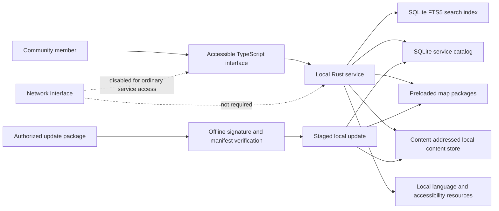

# Privacy-Preserving Public Assistance Kiosk

## Purpose

The Privacy-Preserving Public Assistance Kiosk provides local information about essential public services, including potable-water access, cooling locations, transit routes, accessible facilities, emergency guidance, and community assistance resources.

The kiosk must remain useful during network disruption, power transition, service outages, and periods in which a person cannot or does not wish to identify themselves. It must not condition information access on wealth, identity documents, account registration, device ownership, telemetry, network connectivity, or consent to unrelated processing.

## Core guarantees

| Guarantee | Requirement | Verification approach |
|---|---|---|
| Essential-service independence | Water, cooling, transit, and emergency-reference content remains accessible without a network | Disconnect all network interfaces during acceptance testing |
| Zero persistent person data | No user-entered, derived, biometric, voice, device, network, or session-identifying data is stored | Database schema review, storage inspection, process audit |
| Local-first operation | Service catalog, maps, translations, accessibility settings, and search indexes ship with the kiosk | Verify all route and search functions in offline mode |
| Accessible equivalence | Touch, keyboard, physical controls, screen-reader-compatible structure, visual presentation, and privacy-safe speech output provide equivalent service access | Accessibility testing with diverse users and assistive technologies |
| Transparent currency | Every content item displays a source, publication or verification date, and local package version | Verify metadata rendering for all service records |
| Fail-safe privacy | Network failure, input failure, speech-recognition failure, or update failure must never make essential information less available or begin collection | Fault-injection testing and network-blocked operation |
| Human review path | The kiosk offers a non-digital contact method or locally displayed community-service escalation route | Manual user-flow review |

## Threat model

### Protected user interests

The kiosk protects:

- Anonymous access to essential-service information
- Freedom from mandatory identity proofing or account creation
- Freedom from behavioral, biometric, voiceprint, gaze, gesture, or mobility profiling
- Freedom from location tracking, device-address collection, and cross-kiosk correlation
- Accessible access for people using mobility devices, screen readers, switch controls, hearing devices, low vision tools, alternative communication methods, or non-dominant languages
- Access during internet outages and degraded infrastructure conditions
- Access to understandable, source-attributed, current-enough public information

### Explicit non-goals

The kiosk does not:

- Determine eligibility for benefits
- Submit applications on behalf of a person
- Authenticate a user
- Store a phone number, email address, identity document, biometric measurement, or voice recording
- Track repeated usage
- Require a mobile device, QR code, payment method, government account, or proprietary assistive technology
- Make automated recommendations about a person
- Advertise, profile, score, rank, or target people
- Secretly transmit diagnostics or usage data

## Offline architecture



### Components

| Component | Technology | Responsibility | Privacy rule |
|---|---|---|---|
| Presentation interface | TypeScript, HTML, CSS | Accessible browse, search, map, language, text-size, contrast, speech-output controls | Keep settings in memory only; reset after inactivity |
| Local service API | Rust | Validates local queries, reads verified content, enforces response boundaries | Bind only to loopback or local IPC; never expose a public network endpoint |
| Service catalog | SQLite | Stores structured records for water, cooling, transit, accessible facilities, and help resources | Contains service information only; contains no user rows or event logs |
| Full-text search | SQLite FTS5 | Finds plain-language service content offline | Search terms remain in process memory and are never persisted |
| Static maps | PMTiles or packaged MBTiles | Renders local map data and points of service without map requests | Do not use third-party tiles, map SDK telemetry, or geolocation APIs |
| Content-addressed store | SHA-256 addressed immutable files | Stores translated documents, map packages, icons, audio prompts, and service data packages | Hashes prove package integrity; they do not represent people or user activity |
| Update verifier | Rust | Verifies signed package manifest before activation | Reject unsigned, expired, malformed, or incomplete packages |
| Physical controls | Kiosk hardware interface | Supports tactile navigation, privacy mode, volume, contrast, and session reset | Controls do not generate a persistent interaction history |

## Storage methods

### Recommended local storage layers

1. **Signed static application bundle**
   - Package the TypeScript application, fonts, icons, localized strings, offline help pages, and service-worker cache manifest with the device image.
   - A service worker may cache application assets for browser-based deployment. Service workers can intercept requests and serve cached resources, supporting an offline-first experience. [52][53]
   - Do not use a network-first retrieval strategy for essential content.

2. **SQLite service catalog**
   - Use SQLite for compact, transactional local service data.
   - Keep the database read-only during ordinary public use.
   - Store service names, categories, addresses, cross-streets, hours, accessibility information, verification dates, route information, languages, and public contact methods.
   - Use FTS5 for local full-text search. SQLite documents FTS5 as a virtual-table module for full-text search, including `MATCH` queries. [51]

3. **Preloaded static map package**
   - Use vector tiles in PMTiles or raster/vector tiles in MBTiles.
   - Precompute a limited local service area and zoom range appropriate to the deployment zone.
   - Render maps locally with a library configured never to fetch remote tiles.
   - Provide a list and directions mode because maps alone do not provide equivalent access for every user.

4. **Content-addressed package store**
   - Address each immutable package by a cryptographic digest:
     \[
     h = \operatorname{SHA256}(\text{canonical\_package\_bytes})
     \]
   - A signed manifest maps logical names such as `water-services-en` or `transit-maps` to hashes, versions, validity windows, and content sources.
   - Store packages under a local layout such as:
     \[
     \texttt{content/sha256/ab/cdef...}
     \]
   - Treat content hashes as integrity references, not user identifiers.

5. **Volatile session state**
   - Store only in process memory:
     - Active screen
     - Chosen language
     - Text scale
     - Contrast mode
     - Speech-output enablement
     - Current local search text
   - Erase the state on explicit reset, browser restart, application restart, crash recovery, and an inactivity timeout.

### Storage decision

| Data category | Storage rule | Retention |
|---|---|---|
| Essential-service listings | Local SQLite catalog | Until replaced by verified package |
| Static maps | Local package store | Until replaced by verified package |
| Translated guidance | Local package store | Until replaced by verified package |
| Accessibility preferences | Process memory only | Current session only |
| Search terms | Process memory only | Current session only |
| Voice audio | Do not retain | No storage |
| Speech transcript | Do not retain | No storage |
| Camera input | Do not collect | No storage |
| Microphone audio | Prefer no input capture; if enabled, use volatile on-device recognition only | No storage |
| IP address, MAC address, browser fingerprint | Do not collect or log | No storage |
| Analytics events | Do not collect | No storage |
| Error logs | Operationally minimized and scrubbed of user content; ideally disabled for public UI | Short bounded maintenance window only if indispensable |
| Update audit record | Device-level package integrity record only; no user data | Defined maintenance retention period |

## Data model

```sql
PRAGMA foreign_keys = ON;
PRAGMA journal_mode = WAL;
PRAGMA trusted_schema = OFF;
PRAGMA query_only = ON;

CREATE TABLE service (
  slug TEXT PRIMARY KEY
    CHECK (slug GLOB '[a-z0-9][a-z0-9-]*'),
  category TEXT NOT NULL
    CHECK (category IN ('water', 'cooling', 'transit', 'emergency', 'health', 'shelter', 'sanitation')),
  name TEXT NOT NULL CHECK (length(name) BETWEEN 1 AND 240),
  description TEXT NOT NULL CHECK (length(description) BETWEEN 1 AND 4000),
  address TEXT NOT NULL CHECK (length(address) BETWEEN 1 AND 480),
  cross_street TEXT,
  latitude REAL NOT NULL CHECK (latitude BETWEEN -90.0 AND 90.0),
  longitude REAL NOT NULL CHECK (longitude BETWEEN -180.0 AND 180.0),
  hours_text TEXT NOT NULL CHECK (length(hours_text) BETWEEN 1 AND 1200),
  access_notes TEXT NOT NULL CHECK (length(access_notes) BETWEEN 1 AND 2400),
  phone_public TEXT,
  url_public TEXT,
  languages_json TEXT NOT NULL,
  verified_at TEXT NOT NULL,
  source_name TEXT NOT NULL,
  source_url TEXT,
  package_version TEXT NOT NULL,
  is_active INTEGER NOT NULL CHECK (is_active IN (0, 1))
) STRICT;

CREATE VIRTUAL TABLE service_search USING fts5(
  name,
  description,
  address,
  cross_street,
  access_notes,
  content='service',
  content_rowid='rowid',
  tokenize='unicode61 remove_diacritics 2'
);

CREATE TRIGGER service_after_insert
AFTER INSERT ON service BEGIN
  INSERT INTO service_search(rowid, name, description, address, cross_street, access_notes)
  VALUES (new.rowid, new.name, new.description, new.address, new.cross_street, new.access_notes);
END;

CREATE TRIGGER service_after_delete
AFTER DELETE ON service BEGIN
  INSERT INTO service_search(service_search, rowid, name, description, address, cross_street, access_notes)
  VALUES ('delete', old.rowid, old.name, old.description, old.address, old.cross_street, old.access_notes);
END;

CREATE TRIGGER service_after_update
AFTER UPDATE ON service BEGIN
  INSERT INTO service_search(service_search, rowid, name, description, address, cross_street, access_notes)
  VALUES ('delete', old.rowid, old.name, old.description, old.address, old.cross_street, old.access_notes);

  INSERT INTO service_search(rowid, name, description, address, cross_street, access_notes)
  VALUES (new.rowid, new.name, new.description, new.address, new.cross_street, new.access_notes);
END;

CREATE TABLE content_manifest (
  logical_name TEXT PRIMARY KEY,
  sha256 TEXT NOT NULL CHECK (sha256 GLOB '[0-9a-f]*' AND length(sha256) = 64),
  version TEXT NOT NULL,
  verified_at TEXT NOT NULL,
  valid_from TEXT NOT NULL,
  valid_until TEXT,
  source_name TEXT NOT NULL,
  source_url TEXT,
  signature_algorithm TEXT NOT NULL,
  signer_key_id TEXT NOT NULL
) STRICT;
```

### Prohibited schema fields

The local catalog must not include fields such as:

```text
person_id
device_id
session_id
ip_address
mac_address
voiceprint
face_template
camera_frame
microphone_recording
search_history
clickstream
precise_user_location
advertising_identifier
income
citizenship_status
benefit_eligibility
risk_score
behavior_score
```

## Availability model

Define network-independent availability as:

\[
A_{\text{offline}} =
\frac{T_{\text{essential functions usable with no network}}}
{T_{\text{total observed operation time}}}
\]

The target is:

\[
A_{\text{offline}} \geq 0.99
\]

Measure essential functions as a weighted service set:

\[
E = \{
\text{browse},
\text{search},
\text{service details},
\text{map display},
\text{directions list},
\text{language selection},
\text{text resizing},
\text{contrast adjustment},
\text{speech output},
\text{session reset}
\}
\]

A stricter availability measure is:

\[
A_{\text{essential}} =
\frac{
\sum_{e \in E} w_e \cdot T_{e,\text{offline-usable}}
}{
\sum_{e \in E} w_e \cdot T_{\text{observed}}
}
\]

Where \(w_e\) represents the public-safety importance of function \(e\). Water, cooling, emergency guidance, and accessible route information should receive the highest weights.

A deployment passes when both conditions hold:

\[
A_{\text{offline}} \geq 0.99
\]

\[
A_{\text{essential}} \geq 0.99
\]

## Privacy metrics

### Persistent-data minimization

Let \(D_p\) be all persistent data written during ordinary public operation, and let \(D_{\text{person}}\) be persistent data that can identify, distinguish, infer facts about, or correlate a community member.

\[
D_{\text{person}} = 0
\]

A stronger operational condition is:

\[
\forall e \in \text{public interactions},\quad
\operatorname{persist}(e) = \varnothing
\]

This means a normal browse, search, accessibility adjustment, map action, language choice, or audio-output action must not result in a database write, network request, diagnostic event, or retained log entry.

### Session-clearing guarantee

Let \(S_t\) be volatile session state at time \(t\). For an inactivity timeout \(\Delta\), reset event \(r\), or application restart event \(q\):

\[
S_{t+\Delta} = \varnothing
\]

\[
S_{r} = \varnothing
\]

\[
S_{q} = \varnothing
\]

### Content freshness

For every service record \(i\):

\[
F_i = t_{\text{now}} - t_{\text{verified},i}
\]

The interface must display \(F_i\) in understandable form, for example:

```text
Last verified: 12 days ago
Package version: 2026.08
Source: City public-service directory
```

The kiosk should never imply real-time status unless it has a verified, current, locally available source package. When information may have changed, it should say:

```text
Hours and availability can change. This kiosk shows the latest locally verified update.
```

## Accessible interaction design

### Equal interaction paths

Every essential task must be usable through more than one interaction mode:

| Task | Primary access | Equivalent alternatives |
|---|---|---|
| Start | Large touch button | Physical button, keyboard, switch interface |
| Find service | Category tiles and search | Alphabetical browse, “show nearby listed services” without user location, staff-readable directory |
| Read details | Screen text | Screen reader semantics, local text-to-speech, high-contrast view, print-size summary if hardware supports it |
| Navigate map | Touch pan and zoom | Results list, address and cross-street text, route summary, compass-independent instructions |
| Change language | Language selector | Persistent top-level language control on every screen |
| Get help | Clearly labeled help control | Consistent physical help button, displayed contact route, visual and audible prompts |
| End session | Visible reset control | Physical reset button and automatic inactivity reset |

### Touch interface requirements

- Use a calm, uncluttered layout with one primary decision per screen.
- Provide touch targets larger than the minimum baseline where kiosk hardware permits; a practical kiosk target is at least 44 by 44 CSS pixels, with generous separation.
- WCAG 2.2 specifies a 24 by 24 CSS pixel minimum target-size condition in many cases and calls for visible focus treatment; it also emphasizes consistent help placement. [69]
- Make keyboard focus clearly visible. W3C describes a sufficient focus indicator as at least a two-CSS-pixel perimeter with at least 3:1 contrast between focused and unfocused states. [66]
- Do not rely on color, drag gestures, pinch gestures, hover behavior, timed tasks, or fine motor accuracy as the only means of use.
- Present a fixed “Start over” control in the same visual and physical location on every screen.
- Offer text size presets, including a large-text setting, and reflow content rather than clipping it. W3C accessibility guidance notes that text-resize and text-spacing changes should not cause information loss. [72]

### Speech and audio requirements

- Prefer **speech output** as the baseline audio accommodation: it gives people audio access without recording their speech.
- If speech input is added, make it strictly optional and local:
  - Display a clear “Use voice on this kiosk only” notice before activation.
  - Process audio on-device.
  - Keep audio buffers and transcripts in memory only.
  - Do not send audio to a cloud speech service.
  - Do not create voiceprints, speaker identifiers, transcripts, recordings, or quality-improvement datasets.
  - Provide an equally capable touch, keyboard, tactile, and switch-control alternative.
- Use short, plain-language spoken prompts.
- Provide independent volume control, headphone support where appropriate, captions for instructional media, and visual equivalents for every audio instruction.
- Do not autoplay audio in a way that can expose a user’s request to nearby people; require explicit activation and provide a private-output option where feasible.

### Cognitive and language access

- Use direct action labels: “Find drinking water,” “Find a cool place,” “Find a bus stop,” and “Emergency help.”
- Avoid bureaucratic labels, acronyms, and eligibility language in essential information flows.
- Use a predictable screen order and a persistent return-to-home route.
- Write service descriptions in plain language and include translations reviewed by community-language stakeholders.
- Offer visual symbols with text labels; symbols must not replace text.
- Explain uncertainty plainly:
  - “This location was last verified on…”
  - “Call ahead if you can.”
  - “This kiosk cannot confirm live capacity.”

## Content-package convention

### Canonical manifest

```json
{
  "format": "augmented-hub.kiosk-content-manifest.v1",
  "packageVersion": "2026.09.01",
  "createdAt": "2026-09-01T00:00:00Z",
  "serviceArea": "local-deployment-area",
  "contents": [
    {
      "logicalName": "service-catalog",
      "sha256": "4f9f93f271ed3d94fcb5bff9e520e01e2e6d765c2985ab5bf0b3610c21f3d94f",
      "mediaType": "application/vnd.sqlite3",
      "verifiedAt": "2026-09-01T00:00:00Z",
      "sourceName": "Authorized public-service publisher",
      "sourceUrl": "https://example.invalid/public-service-directory"
    },
    {
      "logicalName": "base-map",
      "sha256": "ce57892d628efc4f60bfecb7df0e09db252cad5a557ad7af2d74aa3db00b8d81",
      "mediaType": "application/vnd.pmtiles",
      "verifiedAt": "2026-09-01T00:00:00Z",
      "sourceName": "Authorized public map publisher",
      "sourceUrl": "https://example.invalid/public-map"
    }
  ],
  "signature": {
    "algorithm": "ed25519",
    "signerKeyId": "authorized-kiosk-content-publisher",
    "value": "base64-encoded-signature"
  }
}
```

The example URLs are placeholders and must be replaced only with verified public publishers during deployment. The runtime must not fetch them during normal kiosk use.

### Package activation rules

A kiosk activates a content package only when:

\[
\operatorname{VerifySignature}(M, \sigma, K_{\text{trusted}}) = \text{true}
\]

\[
\forall c \in M.\text{contents},\quad
\operatorname{SHA256}(\operatorname{bytes}(c)) = c.\text{sha256}
\]

\[
t_{\text{now}} \geq M.\text{validFrom}
\]

\[
M.\text{validUntil} = \varnothing
\quad \lor \quad
t_{\text{now}} \leq M.\text{validUntil}
\]

If a new package fails verification, retain the prior verified package. A failed update must not remove essential service information.

## Operational safeguards

### Network policy

- Configure ordinary kiosk service to operate with network interfaces disabled, firewalled, or physically segmented.
- Permit a maintenance network only through an explicit, time-limited, authorized maintenance procedure.
- Do not allow the public browser session to reach the internet, local administrative services, router interfaces, or device-management endpoints.
- Block telemetry SDKs, third-party fonts, remote analytics, remote map tiles, remote speech services, and update checks from the public runtime.
- Enforce a restrictive Content Security Policy.
- Bind the Rust API to loopback only, or use local IPC where the deployment platform supports it.

### Update policy

- Use a removable, authorized update medium or a separately approved maintenance channel.
- Require signed manifests and content hashes.
- Stage, verify, atomically activate, and retain a rollback-capable prior package.
- Record only device-level update integrity facts, such as package version, hash, signature-verification outcome, and maintenance timestamp.
- Do not record who used the kiosk before, during, or after an update.

### Physical privacy

- Position the display to reduce shoulder surfing when site conditions permit.
- Provide a one-tap privacy reset and automatic reset after a short, clearly displayed idle period.
- Avoid cameras entirely unless a separate, lawful, community-governed security system exists outside the kiosk application; it must not be linked to kiosk interactions.
- Do not install microphones by default.
- Use visible physical indicators for active audio output or optional microphone use.
- Place printed or visual privacy statements at the kiosk:
  - “No account required.”
  - “No personal information is collected.”
  - “Your search is not saved.”
  - “This kiosk works without internet access.”
  - “Press Start Over to clear this screen now.”

## Acceptance tests

### Offline functionality

1. Boot the kiosk with all external networking disabled.
2. Browse water, cooling, transit, emergency, and accessible-facility categories.
3. Perform searches in every supported language.
4. Open service details and display local maps.
5. Change text size, contrast, language, and speech-output settings.
6. Confirm that all required features work without DNS, internet, Wi-Fi, cellular, or local network connectivity.
7. Measure \(A_{\text{offline}}\) and \(A_{\text{essential}}\) across representative operating hours.

### Zero-persistent-data test

1. Create a known baseline checksum of all writable application directories and database files.
2. Use the kiosk for a representative session:
   - Search terms
   - Category navigation
   - Language changes
   - Text resizing
   - Map interactions
   - Speech output
   - Session reset
3. Compare writable state after the test.
4. Confirm no user-derived content, search text, session state, or network event was written.
5. Inspect browser storage, SQLite write-ahead logs, operating-system logs, crash reports, and kiosk management agents.

### Accessibility test

1. Complete each essential task by touch only.
2. Complete each essential task by keyboard only.
3. Complete each essential task with screen-reader output.
4. Complete each essential task at enlarged text and high contrast.
5. Complete each essential task without audio.
6. Complete each essential task without reading a map.
7. Complete each essential task with assistive switch or alternative input where available.
8. Verify that focus is visible, targets are sufficiently large and separated, help placement is consistent, and reset is always available.

## Governance and review

A community-governed review group should include people who rely on public cooling, transit, water access, disability advocates, multilingual community members, public-service staff, privacy practitioners, and local maintenance personnel.

Review questions:

- Does the service catalog accurately represent accessible and non-accessible options?
- Are essential services displayed without eligibility assumptions?
- Is language direct, non-stigmatizing, and understandable?
- Does a network outage leave all core functions available?
- Can a person use the kiosk without revealing identity, location, voice, or device information?
- Does an update preserve accessibility and local-language content?
- Are ecological claims, power-use claims, and service-availability claims measured and stated with uncertainty?

## Metrics

| Metric | Target | Basis |
|---|---:|---|
| knowledge_factor | 0.90 | Uses source-attributed service records, verification dates, package signatures, and visible uncertainty |
| eco_impact_value | 0.72 | Reduces unnecessary paper lookup and network dependency; depends on efficient hardware, repairability, and responsible power design |
| harm_risk | 0.16 | Low when network is disabled, no personal data is stored, updates are signed, and accessibility alternatives are tested |
| accessibility_impact | 0.94 | Supports multiple equivalent input/output routes, local language options, visible focus, text scaling, contrast, and reset controls |
| rights_alignment | 0.97 | Preserves essential-service independence, non-discrimination, privacy, autonomy, accessibility, offline access, and accountable updates |
