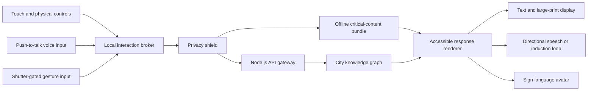

# Public Assistance Panel: Offline, Multimodal, Privacy-Shielded Architecture

## Purpose

The public assistance panel is an accessible civic-information interface for locations such as transit stops, cooling centers, libraries, public buildings, parks, and neighborhood service hubs.

It supports:

- Touch interaction.
- Physical controls.
- Voice input.
- Gesture input.
- Text responses.
- Speech responses.
- Sign-language avatar responses.
- Offline access to critical civic information.
- City knowledge-graph routing when an approved network connection is available.

The panel is an information and navigation service. It is not an identity-verification terminal, access-control device, surveillance system, behavioral-monitoring system, law-enforcement interface, or substitute for emergency services.

## Accessibility Principles

Every panel function must be available through more than one input and output pathway.

| User need or preference | Input alternatives | Output alternatives |
|---|---|---|
| Touch interaction | Large touch targets, physical buttons, keyboard-compatible controls | High-contrast text, large text, speech, sign-language avatar |
| Voice interaction | Push-to-talk button, typed input, gesture selection, physical menu buttons | Text transcript, speech, sign-language avatar |
| Gesture interaction | Touch, physical buttons, voice, keyboard-compatible controls | Confirming text, visual feedback, speech confirmation |
| Hearing access | Touch, gesture, typed input, physical controls | Text, captions, sign-language avatar, visual alerts |
| Vision access | Voice, physical tactile controls, screen-reader-compatible interface | Speech, tactile control feedback, high-contrast display |
| Speech access | Touch, physical buttons, gesture, typed input | Text, captions, avatar, speech output if selected |
| Limited connectivity | All local input options | Offline critical-content pack and local text-to-speech |

W3C accessibility guidance recognizes touch, voice, and gesture as useful modalities, while requiring alternatives for complex gestures and alternatives to speech-dependent functionality. [130][133][137]

## Hardware Wiring Pattern

```text
Listed AC supply
    |
    +--> Lockable electrical enclosure
            |
            +--> Listed UPS with surge protection
            |       |
            |       +--> Industrial edge computer
            |       +--> Display controller
            |       +--> Audio amplifier
            |       +--> Accessibility peripherals
            |
            +--> Isolated low-voltage DC supply
                    |
                    +--> Capacitive touch controller
                    +--> Physical button matrix
                    +--> Push-to-talk button
                    +--> Microphone array with local mute relay
                    +--> Directional speaker or induction-loop interface
                    +--> RGB status indicator
                    +--> Depth or RGB gesture camera
                    +--> Privacy shutter actuator
                    +--> Hardware watchdog
```

## Electrical and Data Separation

- Mains power remains within a lockable, code-compliant enclosure.
- The edge computer, cameras, microphones, touch controller, buttons, and audio peripherals operate only on isolated low-voltage rails.
- USB and network lines use surge protection and, where appropriate, galvanic isolation.
- The push-to-talk button directly controls a hardware mute relay or microphone power-enable line; software alone must not be the only microphone privacy control.
- The camera shutter is physically visible and electrically reports its closed or open state to the edge computer.
- A hardware watchdog restarts only the edge-compute process; it must not silently enable the microphone or camera.
- Network loss must not disable physical controls, display access, speech output, or the offline critical-content pack.
- The knowledge-graph connection is outbound-only from the panel through the API gateway. The city knowledge graph must never initiate arbitrary remote-control sessions into the panel.

## Input Hardware

| Component | Connection | Purpose | Privacy control |
|---|---|---|---|
| Touch display | DisplayPort or HDMI plus USB HID | Direct visual interaction and on-screen keyboard | No touch-identity or pressure-pattern retention |
| Physical button strip | GPIO through opto-isolated input board | Home, help, repeat, volume, language, call-staff, and privacy controls | Works offline; no identity requirement |
| Push-to-talk button | GPIO plus hardware mute relay | Enables short, deliberate voice capture | Microphone physically off when not pressed |
| Microphone array | USB audio or I2S audio codec | Local speech recognition after deliberate activation | Volatile audio only; no recording or cloud streaming |
| Gesture camera | USB or MIPI CSI | Local limited-vocabulary gesture recognition | Visible shutter, narrow field of view, immediate-frame disposal |
| Privacy shutter | GPIO-controlled physical shutter | Blocks camera outside active gesture session | Closed by default; status visible to user |
| Directional speaker | USB or I2S DAC to amplifier | Local speech output with reduced bystander audibility | Volume and repeat controls; optional headphone or induction loop |
| Sign-language avatar display | Edge GPU or integrated graphics | Local rendered signed response clips or avatar output | No user video is retained |
| Emergency call control | Listed emergency intercom interface | Routes urgent request to approved local service | Separate from knowledge-graph content path |

## Local Software Topology

```text
Panel web interface
    |
    +--> Local interaction broker
    |       |
    |       +--> Touch and physical-control adapter
    |       +--> Push-to-talk speech adapter
    |       +--> Gesture adapter
    |       +--> Accessibility preference adapter
    |
    +--> Local intent router
    |       |
    |       +--> Offline critical-content knowledge bundle
    |       +--> Local text-to-speech engine
    |       +--> Local sign-language response library
    |       +--> Optional city API gateway
    |
    +--> Privacy shield and event minimizer
    |
    +--> Accessible response renderer
```

## Offline Critical Content

The panel must maintain a signed, versioned local bundle containing:

- Emergency contact and crisis instructions.
- Heat-alert and cooling-center information.
- Water-safety and public-health notices.
- Transit disruption and accessible-route guidance.
- Shelter, food, sanitation, and charging-location information.
- Accessible municipal-service contacts.
- Facility hours, accessibility features, and offline maps.
- Privacy and data-use notice.
- Instructions for using physical controls, voice, touch, and gesture alternatives.

The offline bundle is updated only through signed content packages. It must display:

- Content version.
- Last successful update time.
- Current offline or online state.
- A clear statement when an answer is from the offline bundle rather than a live city source.

## Privacy Shield

The privacy shield implements the following controls:

- Microphone off by default and enabled only through a deliberate physical push-to-talk action.
- Camera shutter closed by default and opened only for a short local gesture-recognition session.
- No facial recognition, person re-identification, demographic inference, emotion inference, gaze tracking, body-template storage, or cross-session tracking.
- No raw audio, video, images, gesture skeletons, face crops, embeddings, transcripts, or identifiers retained after the active interaction.
- No ad targeting, behavioral profiling, public-safety scoring, or law-enforcement integration.
- Local processing for speech and gesture whenever hardware capacity permits.
- If a network service is used for a noncritical query, provide a clear notice and a local text-only alternative.
- Store only daily aggregate operational counts with small-count suppression, such as offline-answer count, hardware-health fault count, and content-bundle version.
- Do not associate counts with a person, device, session identity, location history, or municipal-service record.
- Segment the panel network from other municipal networks; restrict outbound destinations, require encrypted transport, and use least-privilege credentials.

NIST privacy engineering guidance emphasizes collecting, using, storing, and disclosing only information directly relevant and necessary for an authorized purpose, and retaining it only as long as necessary. [136] NIST’s Privacy Framework likewise supports privacy-risk management and data-minimization practices. [131]

## Knowledge-Graph Routing

The panel routes only a normalized intent, language preference, optional accessibility rendering preference, and coarse civic-topic classification to the city knowledge graph.

Permitted request shape:

```json
{
  "intent": "find_cooling_center",
  "language": "en",
  "response_modes": ["text", "speech", "sign"],
  "offline_available": true,
  "request_class": "public_information"
}
```

Forbidden request fields:

```text
name
face_embedding
voice_embedding
device_identifier
biometric_data
health_data
augmentation_status
exact_location_history
camera_frame
audio_recording
free_text_transcript
```

The city knowledge graph should return structured, source-attributed civic content:

```json
{
  "answer_type": "service_location",
  "title": "Cooling center information",
  "plain_language_text": "The nearest currently listed cooling center is open today.",
  "speech_text": "The nearest currently listed cooling center is open today.",
  "sign_response_key": "cooling_center_open",
  "source_updated_at": "2026-09-01T00:00:00Z",
  "offline_fallback_key": "cooling_center_general"
}
```

The API gateway validates response schemas, strips unexpected fields, applies response-size limits, blocks remote commands, and returns an accessible fallback when the city graph is unavailable.

## Real-Time Interaction Flow



## Safety and Failure States

| Condition | Required behavior |
|---|---|
| Network unavailable | Use offline critical-content bundle and display offline status |
| Microphone fault | Keep microphone disabled; offer touch, physical-button, and gesture alternatives |
| Gesture camera or shutter fault | Keep camera shutter closed; offer touch, physical-button, and voice alternatives |
| City knowledge graph error | Return local civic-directory fallback and a clear “live lookup unavailable” notice |
| Local NLP confidence low | Present an accessible clarification menu; never fabricate a civic answer |
| Privacy-shield self-test fails | Disable microphone and camera capture; retain touch, buttons, text, and offline content |
| Power interruption | UPS preserves safe shutdown and offline operation for the approved reserve interval |
| Emergency request | Show emergency instructions and route through the listed emergency or approved assistance path; do not depend on AI response |

## Metrics

| Metric | Value | Basis |
|---|---:|---|
| knowledge_factor | 0.92 | Local-first architecture, signed offline content, structured graph routing, validated response schema, and explicit failure states |
| eco_impact_value | 0.58 | Supports accessible use of public cooling, transit, water, and civic resources while using edge processing and limited network transfer |
| harm_risk | 0.17 | Controlled through physical microphone mute, shutter-gated camera, data minimization, segmentation, and no identity analytics |
| accessibility_impact | 0.99 | Provides parallel input/output pathways, offline access, tactile controls, speech, text, sign output, and non-speech alternatives |
| rights_alignment | 0.99 | Protects privacy, consent, dignity, accessible civic participation, and equal access without identity certification |
