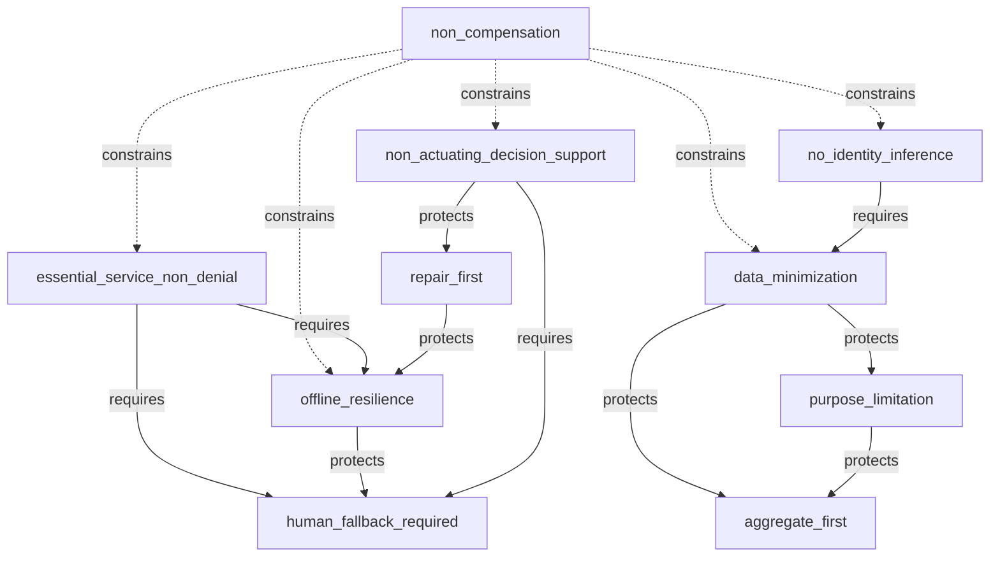

# Rights-Floor Invariant Dependency Graph

## Topological layers

| Layer | Invariants | Governance role |
|---|---|---|
| 1 | `non_compensation` | Prevents optimization logic from overriding rights, access, privacy, or safety constraints |
| 2 | `essential_service_non_denial`, `no_identity_inference`, `non_actuating_decision_support` | Sets the fundamental boundaries for access, privacy, and human operational authority |
| 3 | `data_minimization`, `offline_resilience` | Converts foundational boundaries into enforceable data and availability controls |
| 4 | `human_fallback_required`, `purpose_limitation`, `aggregate_first`, `repair_first` | Delivers operational continuity, release discipline, and maintainability protections |

## Partial-failure rule

A system may provide only safe degraded advisory support when every load-bearing invariant remains true. If any load-bearing invariant fails, the workload must suspend analytic operation and preserve the accessible human-mediated essential-service path.

## Policy-evolution rule

A policy proposal must be rejected when it weakens a load-bearing invariant, removes a required dependency, changes a constraining relationship into an optional relationship, introduces identity inference, requires credentials for essential services, permits direct safety-critical actuation, or allows optimization benefit to compensate for a rights-floor failure.
