# Social Acceptance Measurement Model for Augmented Identities

## Purpose

This research framework measures whether public spaces, public interfaces, civic programs, and community environments are becoming more welcoming, respectful, accessible, and equitable for cybernetic hosts and augmented citizens.

The research objective is not to classify people, identify augmented individuals, validate a person’s identity, test whether an augmentation is “acceptable,” or quantify a community’s worth.

The objective is to evaluate public conditions:

- Whether people can share public space without harassment or exclusion.
- Whether accessible public interfaces work without proprietary lock-in.
- Whether staff and public systems respond respectfully to assistive and augmentation-related needs.
- Whether public services remain available without proof of disability, augmentation, health status, identity, wealth, or device ownership.
- Whether policy, training, signage, infrastructure, and community education improve belonging and participation.
- Whether a person can decline disclosure and still receive equal service.

The framework treats self-asserted identity, disability, augmentation, assistive technology, and human variation as matters of dignity and autonomy.

## Non-negotiable protections

The measurement program must satisfy:

\[
D_{\text{identity}} = 0
\]

\[
D_{\text{biometric}} = 0
\]

\[
D_{\text{augmentation-telemetry}} = 0
\]

\[
D_{\text{device-tracking}} = 0
\]

\[
D_{\text{covert-observation}} = 0
\]

\[
G_{\text{disclosure-required}} = 0
\]

\[
G_{\text{service-access}} = 0
\]

Where:

- \(D_{\text{identity}}\) is retained direct or inferred identity data.
- \(D_{\text{biometric}}\) is retained face, voice, gait, body, or physiological data.
- \(D_{\text{augmentation-telemetry}}\) is retained data from an assistive or cybernetic device.
- \(D_{\text{device-tracking}}\) is retained mobile, radio, network, or hardware identifier data.
- \(D_{\text{covert-observation}}\) is hidden or non-consensual observation.
- \(G_{\text{disclosure-required}}\) is a disclosure condition imposed on participants.
- \(G_{\text{service-access}}\) is a barrier to public services based on disclosure, non-disclosure, or augmentation use.

No research finding may be used to reduce public access, restrict movement, require disclosure, create a registry, establish risk scores, or determine an individual’s eligibility for a public service.

## Measurement principles

### Measure environments, not bodies

The unit of analysis should ordinarily be a public setting, program, service, policy, or community intervention—not a particular person.

Examples of acceptable study units:

- A transit station.
- A library.
- A public assistance kiosk deployment.
- A cooling center.
- A public park.
- A community event.
- A municipal customer-service process.
- A public-interface accessibility upgrade.
- A staff training program.
- A public notice or community education initiative.

Examples of unacceptable study units:

```text
individual augmentation users without explicit consent
identified people in public-space camera footage
nearby Bluetooth or NFC device identities
facial-expression interpretations
voice-tone analyses
gait or mobility classification
body-shape classification
neural or implant telemetry
health-status inference
observed use of assistive equipment tied to a person
```

### Positive-outcome orientation

The research should measure positive public conditions:

- Respectful acknowledgement.
- Willingness to share public space.
- Accessible communication.
- Successful use of public services.
- Belonging and safety.
- Ability to request accommodation without proof burdens.
- Equal treatment by staff and systems.
- Interoperability with assistive interfaces.
- Availability of meaningful non-augmentation fallback controls.
- Community participation and civic voice.

Negative outcomes should be measured only to identify and repair conditions that cause exclusion, harassment, denial of access, stigma, or infrastructure barriers.

## Construct model

Define a public acceptance and belonging construct:

\[
A_{\text{public}} =
w_r R +
w_b B +
w_x X +
w_s S +
w_p P +
w_i I -
w_h H
\]

Where:

- \(R\) is reported respectful treatment.
- \(B\) is reported belonging and comfort sharing public space.
- \(X\) is accessibility and successful service use.
- \(S\) is safety from harassment, exclusion, or coercion.
- \(P\) is participation in civic and community life.
- \(I\) is interoperability and assistive autonomy.
- \(H\) is reported harmful or exclusionary experience.

All components are normalized to \([0,1]\), and weights must be documented and publicly reviewable:

\[
w_r + w_b + w_x + w_s + w_p + w_i + w_h = 1
\]

The model is not a diagnostic score for an individual. It is an aggregate assessment of whether the environment supports equal participation.

## Acceptance index

The prompt formula can be strengthened by separating positive conditions, harmful conditions, and baseline context.

Let:

- \(P\) be the weighted count of positive, voluntary, non-identifying reported interactions or conditions.
- \(N\) be the weighted count of harmful, exclusionary, or negative reported interactions or conditions.
- \(T\) be the total number of valid responses or observations.
- \(B_0\) be a pre-registered baseline reference.
- \(\lambda\) be a harm-sensitivity coefficient.

\[
A =
B_0 +
\frac{
P - \lambda N
}{
\max(T,1)
}
\]

Where:

\[
\lambda \geq 1
\]

A value of \(\lambda > 1\) can reflect the ethical fact that a serious denial of access, harassment event, or forced-disclosure experience should not be obscured by a larger count of minor positive interactions.

A bounded reporting transformation is:

\[
A_{\text{bounded}} =
\frac{
1
}{
1 + e^{-A}
}
\]

This maps the result into \((0,1)\) for dashboard display while retaining the unbounded form for transparent statistical analysis.

### Positive interaction examples

Use only voluntary, non-intrusive, self-report or trained-observer categories:

```text
A person reports staff used respectful language.
A person reports they could use a public interface without disclosing augmentation status.
A person reports they could share space comfortably.
A person reports an accommodation request was met without medical proof.
A person reports a transit gate, kiosk, or assistance panel worked through a preferred access method.
A person reports a fallback interaction method was available and effective.
A person reports feeling able to participate in a public activity.
A trained accessibility auditor verifies that standard and assistive pathways are both available.
```

### Harm and exclusion examples

```text
A person voluntarily reports being denied a public service because of augmentation or assistive use.
A person voluntarily reports pressure to disclose health, identity, or device information.
A person reports harassment, exclusion, or a hostile public-interface response.
An audit finds an interface requires a proprietary augmentation or an identity-linked device.
An audit finds standard accessible controls are unavailable after optional augmentation interaction fails.
An audit finds inaccessible signage, routes, controls, or complaint processes.
```

No study should observe, infer, or label these events through covert recording.

## Ethical signal categories

| Signal type | Suitable method | Data-minimization rule | Not permitted |
|---|---|---|---|
| Willingness to share space | Voluntary anonymous survey item or facilitated community discussion | Retain aggregate response totals only | Camera-based proximity tracking |
| Respectful acknowledgement | Voluntary self-report, structured staff interaction audit, community interview | Do not record names or raw audio by default | Voice-tone analysis, sentiment inference from public speech |
| Public-service usability | Accessibility task completion study with consent | Aggregate task result and barrier category | Tracking a participant’s device or augmentation telemetry |
| Interoperability | Voluntary conformance test of intent-level interfaces | Record protocol capability and outcome, not device identity | Capturing neural, biometric, medical, or proprietary telemetry |
| Safety and belonging | Optional confidential survey with accessible format | Keep response data separate from public service delivery | Requiring augmentation disclosure at entry |
| Public-space accessibility | Structured environmental audit | Publish barrier and remediation status | Recording passersby or counting visible augmentations |
| Civic participation | Anonymous feedback or voluntary workshop attendance count | Aggregate counts and themes | Identity-linked political or social profiling |
| Staff practice | Training completion and scenario-based accessibility audit | Report role-level aggregate outcomes | Ranking or disciplining individual staff from unverified reports |

## Survey design

### Accessible, voluntary participation

Offer every survey in multiple equivalent formats:

- Plain-language digital form.
- Large-print form.
- Screen-reader-compatible form.
- Keyboard and switch-compatible form.
- Tactile or assisted completion where available.
- Telephone or relay-compatible option.
- Community-facilitated interview option.
- Paper form.
- Multilingual versions.
- Optional audio playback.
- “Prefer not to answer” for every sensitive item.
- Anonymous participation path.

Participation must not be required for access to cooling centers, transit, housing assistance, water, public benefits, public facilities, education, employment, or community programs.

Accessible research design includes providing accommodations in recruitment and consent materials, including contact information for accommodation support. [186]

### Recommended survey domains

| Domain | Example voluntary item | Scale |
|---|---|---|
| Respect | “I was treated respectfully in this public space.” | Strongly disagree to strongly agree |
| Belonging | “I felt welcome using this public place or service.” | Strongly disagree to strongly agree |
| Autonomy | “I could use this service without sharing personal information I did not want to share.” | Strongly disagree to strongly agree |
| Accessibility | “I could complete what I came to do using an access method that worked for me.” | Strongly disagree to strongly agree |
| Interoperability | “The public interface offered a usable option for my preferred way of interacting.” | Strongly disagree to strongly agree |
| Fallback | “A standard accessible option worked when my preferred method was unavailable.” | Strongly disagree to strongly agree |
| Safety | “I felt safe from harassment or pressure to disclose personal information.” | Strongly disagree to strongly agree |
| Participation | “I felt able to take part in this community space or activity.” | Strongly disagree to strongly agree |
| Repair | “I knew how to report an accessibility or treatment concern.” | Strongly disagree to strongly agree |
| Open response | “What would make this space more welcoming and usable?” | Optional plain-language response |

### Avoid stigmatizing questions

Avoid questions such as:

```text
What type of augmentation do you have?
Can we verify your device or implant?
What diagnosis do you have?
How severe is your disability?
Are you willing to be photographed for analysis?
Can we record your voice to assess comfort?
May we track how you move through the space?
Did people stare at you because of your augmentation?
```

If a study genuinely requires a characteristic for analytic validity, collect the least-sensitive self-described category, make it optional, describe why it is needed, prohibit reuse, and separate it from public-service records.

## Longitudinal study design

### Community-based participatory design

A longitudinal study should be co-designed with augmented people, disability communities, assistive-technology users, public-space staff, local advocates, researchers, and service providers.

Community-based participatory research is a collaborative approach that equitably involves community members and other stakeholders in the research process, including input on measures and locally specific methods. [188] NIH’s disability-health research strategy likewise emphasizes engagement of disabled people throughout conceptualization, design, data collection, analysis, communication, and dissemination. [189][190]

### Repeated cross-sectional design

The safest default is repeated, anonymous cross-sectional measurement:

\[
t \in
\{
t_0,
t_1,
t_2,
\dots
\}
\]

At each time point, collect a fresh voluntary sample from the public setting rather than tracking the same people.

Benefits:

- Reduces re-identification risk.
- Avoids building person-level augmentation histories.
- Allows anonymous participation.
- Measures whether the setting improves over time.
- Limits pressure to remain in a research cohort.

### Optional consented panel

A longitudinal panel may be appropriate only with explicit, revocable consent and a strong privacy plan.

Let \(p\) be a panel participant and \(t\) be an observation time.

\[
Y_{p,t}
\]

should be stored separately from public-service systems, pseudonymized or protected using a participant-controlled study token, and retained only for the consented research period.

The study must provide:

- Clear withdrawal.
- Data deletion where feasible.
- Accessible participation.
- No effect on service access.
- No transfer of data to employers, landlords, insurers, police, immigration authorities, or unrelated public agencies.
- No publication of small cells that could reveal a participant.

Repeated cross-sectional measurement remains the preferred public-space baseline.

## Difference-in-differences evaluation

### Purpose

Difference-in-differences can estimate whether an intervention—such as accessible staff training, an open compatibility standard, tactile kiosk controls, revised public signage, a community education program, or an accessible grievance path—is associated with an improvement beyond general time trends.

Let:

- \(Y_{g,t}\) be the aggregate acceptance or access outcome for group or site \(g\) at time \(t\).
- \(\operatorname{Treated}_g\) indicate an intervention site.
- \(\operatorname{Post}_t\) indicate a post-intervention period.

Estimate:

\[
Y_{g,t} =
\alpha +
\gamma \operatorname{Treated}_g +
\delta \operatorname{Post}_t +
\theta
\left(
\operatorname{Treated}_g
\cdot
\operatorname{Post}_t
\right)
+
\epsilon_{g,t}
\]

Where:

\[
\theta
\]

is the estimated difference-in-differences effect.

The identifying assumption is that, absent the intervention, treatment and comparison sites would have followed parallel outcome trends. Difference-in-differences research recommends examining event-study plots and pre-intervention trends to assess the plausibility of this assumption. [187]

### Event-study extension

For periods \(k\) before and after the intervention:

\[
Y_{g,t} =
\alpha_g +
\lambda_t +
\sum_{k \neq -1}
\theta_k
\left(
\operatorname{Treated}_g
\cdot
\mathbf{1}[t-T_g=k]
\right)
+
\epsilon_{g,t}
\]

Where:

- \(\alpha_g\) is a site fixed effect.
- \(\lambda_t\) is a period fixed effect.
- \(T_g\) is the intervention time for site \(g\).
- \(\theta_k\) is the estimated relative-time effect.

The pre-intervention coefficients should be examined before making causal claims:

\[
\theta_k \approx 0
\quad
\text{for pre-intervention } k
\]

If pre-trends are meaningfully different, the study should report association rather than causal effect.

### Privacy-preserving DiD unit

Use site-period aggregates:

\[
Y_{\text{site},\text{month}}
\]

rather than person-level traces:

\[
Y_{\text{person},\text{time}}
\]

Examples:

- Aggregate percentage of voluntary respondents reporting usable access.
- Aggregate accessibility audit completion rate.
- Aggregate count of resolved barrier reports.
- Aggregate rate of successful standard-control fallback tasks.
- Aggregate staff training completion rate.
- Aggregate rate of public-interface conformance success.

Do not use a person’s augmentation status, identity, device, or medical record as a required analytical key.

## Statistical safeguards

### Small-cell suppression

If a reporting cell has fewer than a community-governed threshold \(k\), suppress or aggregate it:

\[
n_{\text{cell}} < k
\Rightarrow
\operatorname{publish}(n_{\text{cell}}) = \varnothing
\]

A practical threshold may be selected by governance policy, study population size, and re-identification risk assessment.

### Uncertainty reporting

For any reported proportion \(\hat{p}\), include an interval estimate. A standard approximation is:

\[
\hat{p}
\pm
z_{\alpha/2}
\sqrt{
\frac{
\hat{p}(1-\hat{p})
}{
n
}
}
\]

For small samples, use an appropriate interval method and avoid overinterpreting changes.

### Missingness disclosure

Let:

\[
M =
\frac{
N_{\text{missing}}
}{
N_{\text{invited or eligible}}
}
\]

Missingness must be reported because people who feel less safe or less welcome may be less likely to participate. Do not interpret non-response as acceptance.

### Harm-sensitive reporting

A positive average must not hide serious harm. Report:

- Central tendency.
- Distribution.
- Harm and exclusion reports in aggregate.
- Accessibility barriers.
- Small-cell suppression approach.
- Missingness.
- Confidence intervals.
- Open-response themes reviewed by community governance.
- Corrective actions and completion status.

## Public accountability cycle

```mermaid
flowchart LR
    CoDesign[Community co-design] --> Protocol[Accessible privacy-preserving protocol]
    Protocol --> Collect[Voluntary aggregate survey and audit collection]
    Collect --> Validate[Quality, accessibility, and privacy validation]
    Validate --> Analyze[Aggregate statistical analysis]
    Analyze --> Review[Community interpretation and review]
    Review --> Publish[Accessible aggregate findings]
    Publish --> Repair[Human-approved policy, training, or interface improvements]
    Repair --> Reassess[Repeated measurement and correction review]
    Reassess --> CoDesign
```



Every stage must support accessible participation and a no-account, no-disclosure correction route.

## Recommended interventions to evaluate

| Intervention | Expected positive pathway | Suitable aggregate outcome |
|---|---|---|
| Tactile and standard controls on public kiosks | More independent use across access methods | Task-completion and fallback-success rates |
| Open intent-only compatibility profile | More interoperability without proprietary lock-in | Conformance success by access path |
| Staff dignity and accessibility training | Respectful service and fewer proof burdens | Voluntary respectful-treatment and autonomy ratings |
| Clear no-disclosure public notices | Reduced pressure to disclose personal information | Autonomy and safety ratings |
| Accessible grievance pathway | Faster identification and correction of barriers | Acknowledgement and resolution rates |
| Cooling-center universal entry policy | More equitable heat-safety access | Aggregate wait-time and access-completion measures |
| Public transportation access upgrades | Lower travel burden and higher participation | Aggregate successful-trip or access-route audit results |
| Community education and dialogue | Greater belonging and willingness to share public space | Belonging and respectful-interaction measures |
| Public-interface repairability policy | Faster correction of access failures | Repair-time and accessibility-regression pass rate |

## Research-object roadmap

### Research object: acceptance construct validation

Objective:

- Co-design the acceptance domains with augmented citizens, disability communities, and public-service users.
- Test whether items measure respect, belonging, autonomy, accessibility, safety, participation, and interoperability without requiring disclosure.

Deliverables:

- Plain-language survey.
- Easy-read survey.
- Screen-reader-compatible survey.
- Large-print survey.
- Translation review record.
- Cognitive interview protocol.
- Measurement-invariance assessment plan.
- Public explanation of data use.

Completion conditions:

\[
C_{\text{accessibility}} = 1
\]

\[
C_{\text{voluntary}} = 1
\]

\[
D_{\text{person,persistent}} = 0
\]

for anonymous repeated cross-sectional participation.

### Research object: public-interface dignity audit

Objective:

- Evaluate whether kiosks, transit gates, assistance panels, and cooling-center interfaces are usable without identity, augmentation, device, or network requirements.

Deliverables:

- Task-based audit protocol.
- Standard-control fallback tests.
- Augmentation-optional compatibility tests.
- Accessible error-message checklist.
- Physical-control checklist.
- Privacy and retention checklist.

Completion condition:

\[
C_{\text{fallback}} = 1
\]

Where:

\[
C_{\text{fallback}} =
\frac{
N_{\text{successful standard-control tasks after preferred-method failure}}
}{
N_{\text{preferred-method failure cases}}
}
\]

### Research object: community belonging intervention study

Objective:

- Evaluate community-designed changes such as accessible signage, staff training, open interface support, and public education.

Deliverables:

- Pre-registered hypotheses.
- Site-level repeated cross-sectional survey plan.
- Comparison-site selection rationale.
- Difference-in-differences analysis plan.
- Event-study visualization plan.
- Community interpretation workshop protocol.
- Public aggregate report.

Completion condition:

\[
C_{\text{evidence}} = 1
\]

Where all required fields—method, accessibility, privacy, baseline, comparison, uncertainty, limitations, and review status—are present.

### Research object: restorative response registry

Objective:

- Track system-level barriers and repair outcomes without retaining person identities or narratives beyond their necessary review window.

Deliverables:

- Barrier category taxonomy.
- Anonymous correction intake.
- Aggregate acknowledgement and resolution statistics.
- Non-identifying public remedy log.
- Accessibility regression test records.

Completion condition:

\[
C_{\text{repair}} =
\frac{
N_{\text{barriers resolved or substantively addressed}}
}{
\max(N_{\text{barriers received}}, 1)
}
\]

## Project metrics

| Metric | Score | Basis |
|---|---:|---|
| knowledge_factor | 0.90 | Uses co-design, transparent constructs, site-level aggregates, uncertainty reporting, pre-trend assessment, and public review |
| eco_impact_value | 0.72 | Supports durable accessible public infrastructure, repairable interoperability, and equitable public-service use without unnecessary surveillance systems |
| harm_risk | 0.18 | Reduced through no covert observation, no biometric/device/telemetry collection, no disclosure gate, small-cell safeguards, and human community review |
| accessibility_impact | 0.97 | Requires multiple accessible survey formats, voluntary participation, accommodation pathways, accessible public interfaces, and standard-control fallback |
| rights_alignment | 0.99 | Centers dignity, self-asserted identity, privacy, consent, non-discrimination, accessibility, participation, transparency, and remedy |
