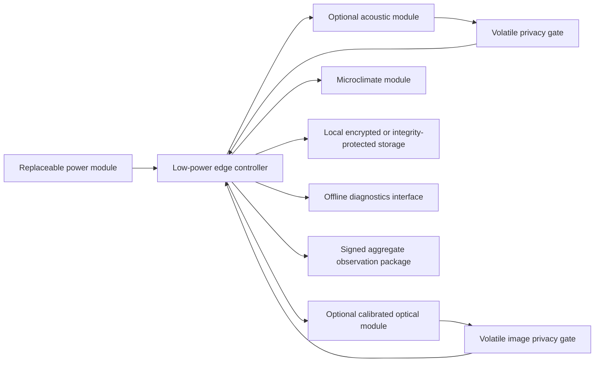
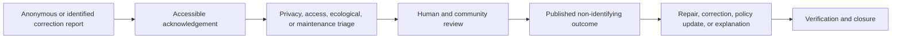

# Sovereign Green Corridor Research Program

## Purpose

This research program documents a rights-centered, privacy-preserving, repairable, and community-governed monitoring system for urban green corridors.

The program supports:

- Biodiversity and habitat-connectivity monitoring.
- Plant-condition and canopy-water-stress assessment.
- Urban heat and shade analysis.
- Community-directed restoration.
- Repairable edge-sensor deployment.
- Low-energy ecological computing.
- Reproducible and inspectable ecological evidence.
- Accessible public correction and governance pathways.
- AI-chat-compatible research documentation and analysis tools.

The program does not support:

- Human surveillance.
- Person, voice, face, gait, device, or movement tracking.
- Behavioral classification.
- Social scoring.
- Automated restrictions on public-space access.
- Automatic ecological interventions.
- Ecological claims that exceed the evidence, calibration, or uncertainty record.

## Governing invariants

The project has the following non-negotiable properties:

\[
D_{\text{person,persistent}} = 0
\]

\[
R_{\text{raw-media}} = 0
\]

\[
I_{\text{identity}} = 0
\]

\[
I_{\text{speech}} = 0
\]

\[
I_{\text{device}} = 0
\]

\[
A_{\text{public-access}} = 1
\]

\[
H_{\text{human-review}} = 1
\]

Where:

- \(D_{\text{person,persistent}}\) is persistent person-derived data.
- \(R_{\text{raw-media}}\) is retained raw imagery or raw audio.
- \(I_{\text{identity}}\) is identity inference or collection.
- \(I_{\text{speech}}\) is speech retention, transcription, embedding, or speaker inference.
- \(I_{\text{device}}\) is mobile-device or persistent identifier collection.
- \(A_{\text{public-access}}\) is equal public access to the corridor.
- \(H_{\text{human-review}}\) is the requirement that ecological action remains accountable to human and community review.

A monitoring result is not an authorization to act. It is an evidence record that may inform a separately governed, human-reviewed restoration decision.

## Evidence standard

Every ecological claim must be paired with:

- A declared question.
- A sensor or observation method.
- A data-collection period.
- Calibration status.
- Privacy boundary.
- Transformation version.
- Uncertainty estimate.
- Validation evidence.
- Known limitations.
- Stewardship review status.

A valid ecological evidence record is:

\[
E =
(
Q,
M,
C,
P,
T,
U,
V,
S
)
\]

Where:

- \(Q\) is the research question.
- \(M\) is the measurement method.
- \(C\) is calibration information.
- \(P\) is the privacy boundary.
- \(T\) is the transformation procedure.
- \(U\) is uncertainty.
- \(V\) is validation evidence.
- \(S\) is review status.

A claim is publishable only when:

\[
\operatorname{Complete}(E) = \text{true}
\]

\[
\operatorname{PrivacySafe}(E) = \text{true}
\]

\[
\operatorname{ValidatedForPurpose}(E) = \text{true}
\]

## Research-object registry

| Research object | Immediate purpose | Deliverable | Completion evidence |
|---|---|---|---|
| Community calibration protocol | Establish transparent field reference observations | Accessible field protocol and non-identifying observation form | Inter-rater agreement and calibration report |
| Acoustic privacy gate | Keep human speech and raw audio out of retained data | Edge speech-likelihood rejection module | Raw-audio retention rate of zero |
| Ecological acoustic classifier | Detect validated ecological groups | Species-group model card and performance report | Group-level field-validation results |
| Urban spectral calibration kit | Produce defensible NDVI, EVI, or visible vegetation proxies | Calibration target procedure and daylight quality gate | Repeatability report across light conditions |
| Microclimate reference network | Measure corridor heat, shade, and moisture conditions | Sensor siting plan and calibration log | Time-matched corridor/reference analysis |
| Repairable sensor pod standard | Ensure field equipment can be maintained locally | Pod interface, diagnostic protocol, and repair guide | Repairability and recovery test |
| Low-energy inference scheduler | Reduce unnecessary capture and computation | Schedule policy and energy ledger | Joules per validated ecological record |
| Public correction pathway | Let people raise concerns without identification | Accessible correction interface and resolution register | Timely review and resolution metrics |
| Ecological data commons | Permit independent review without raw-media disclosure | Signed aggregate record format and public schema | Independent verification of package hashes |
| Habitat-safe maintenance planner | Minimize ecological disturbance while keeping maintenance timely | Advisory schedule recommendation artifact | Essential maintenance parity and disturbance reduction |
| AI-chat research interface | Enable structured question answering over documented evidence | JSON schema, command grammar, and local analysis functions | Deterministic responses with cited record IDs |

## Community-owned calibration days

### Objective

Community-owned calibration days establish transparent comparison observations for plants, pollinators, birds, canopy condition, shade, irrigation concerns, and microclimate conditions.

They are designed as a stewardship and validation process, not as a public-data extraction process.

Participants may include:

- Local ecological stewards.
- School groups.
- Library and community-center partners.
- Restoration practitioners.
- Disability and access advocates.
- Neighborhood residents.
- Urban foresters.
- Public-health and heat-resilience collaborators.
- Environmental-justice organizations.

Participation must be voluntary, non-identifying by default, accessible, multilingual where needed, and never required for corridor access or public services.

### Calibration-day protocol

1. Publish the ecological question before the event.
2. Publish the observation categories and explicitly prohibited content.
3. Provide accessible routes, water, shade, rest opportunities, and non-digital participation options.
4. Use public corridor-zone labels rather than participant-specific location traces.
5. Record observations using time bins rather than exact contributor trajectories.
6. Do not collect names unless a separately consented volunteer-coordination process is required.
7. Do not photograph or record people.
8. Pair human observations with sensor summaries from the same scheduled observation window.
9. Review discrepancies as calibration evidence, not as a fault by a participant.
10. Publish an aggregate, uncertainty-aware comparison report.

### Calibration record

```json
{
  "format": "augmented-hub.corridor-calibration-record.v1",
  "studyQuestion": "Compare pollinator-group observation trends with privacy-safe acoustic event summaries.",
  "corridorZone": "public-green-corridor-zone",
  "observationDate": "2026-09-01",
  "timeWindow": "morning-window",
  "methodVersion": "community-calibration-protocol-v1",
  "privacyBoundary": {
    "participantIdentityCollected": false,
    "participantDeviceTracking": false,
    "rawAudioRetained": false,
    "rawImageRetained": false,
    "personPhotographyAllowed": false
  },
  "humanObservationSummary": {
    "pollinatorGroupObserved": true,
    "nativeBirdGroupObserved": true,
    "canopyStressConcern": false
  },
  "sensorSummary": {
    "pollinatorAcousticGroupDetected": true,
    "nativeBirdAcousticGroupDetected": true,
    "meanSignalQuality": 0.82
  },
  "reviewStatus": "community-review-pending"
}
```

### Agreement measures

For binary ecological observations, use agreement beyond chance:

\[
\kappa =
\frac{
p_o - p_e
}{
1 - p_e
}
\]

Where:

- \(p_o\) is observed agreement between field observation and sensor result.
- \(p_e\) is expected chance agreement.

For continuous measurements, such as canopy temperature or shade fraction, use a mean absolute error:

\[
MAE =
\frac{1}{n}
\sum_{i=1}^{n}
\left|
y_i - \hat{y}_i
\right|
\]

Where:

- \(y_i\) is a field reference measurement.
- \(\hat{y}_i\) is a sensor-derived estimate.

For repeated vegetation-index measurements, use coefficient of variation:

\[
CV =
\frac{\sigma}{\mu}
\]

A sensor is not “accurate” merely because it agrees on one day. It should demonstrate agreement across seasons, lighting conditions, plant communities, weather patterns, and field-maintenance states.

USGS vegetation-monitoring work frames monitoring as a way to quantify restoration impacts on habitat extent, composition, and structure, and to relate habitat characteristics to bird abundance and diversity. [143]

## Open aggregate corridor bulletin

### Objective

The open aggregate corridor bulletin provides a recurring, plain-language public report that communicates ecological condition, uncertainty, maintenance actions, and privacy assurances without exposing raw media or personal information.

The bulletin should be available in accessible digital and printable forms and should never require an account to read.

### Required sections

```text
Reporting period:
Corridor zones included:
Sensors active:
Calibration status:
Privacy status:
Raw-audio retention:
Raw-image retention:
Plant-condition trend:
Shade trend:
Microclimate trend:
Ecological acoustic trend:
Unknown-event rate:
Maintenance actions completed:
Maintenance actions delayed:
Known limitations:
Community observations reviewed:
Correction requests received:
Correction requests resolved:
Next stewardship review:
```

### Privacy statement

Every bulletin includes:

```text
This report contains aggregate ecological information only.
No raw audio or images are retained.
No human speech, identity, face, device identifier, or movement history is included.
Unknown and uncertain observations remain labeled as uncertain.
```

### Core metrics

Let:

- \(N_a\) be accepted privacy-safe acoustic summaries.
- \(N_u\) be unknown ecological acoustic summaries.
- \(N_s\) be speech-like or privacy-uncertain frames discarded.
- \(N_i\) be accepted privacy-safe image-derived vegetation summaries.
- \(N_c\) be calibration-qualified sensor observations.

Unknown-event rate:

\[
R_{\text{unknown}} =
\frac{N_u}{\max(N_a, 1)}
\]

Speech-discard compliance:

\[
C_{\text{speech-discard}} =
\frac{N_s}{\max(N_s + N_{\text{speech-retained}}, 1)}
\]

The mandatory target is:

\[
N_{\text{speech-retained}} = 0
\]

Calibration coverage:

\[
C_{\text{calibration}} =
\frac{N_c}{\max(N_{\text{active-sensors}}, 1)}
\]

The program target is:

\[
C_{\text{calibration}} = 1
\]

### Trend reporting

A plant-condition change is reported as:

\[
\Delta V_t =
V_t -
\operatorname{median}
\left(
V_{\text{reference window}}
\right)
\]

With uncertainty:

\[
\Delta V_t
\pm
\sigma_{\Delta V}
\]

A microclimate difference is reported as:

\[
\Delta T_{\text{corridor}} =
T_{\text{reference}} -
T_{\text{corridor}}
\]

With comparable time, weather, sensor siting, and measurement-quality conditions documented.

The bulletin should not claim causation merely because corridor conditions change. It should say whether a result is a measured association, a validated local effect, or a hypothesis for follow-up field study.

## Habitat-safe maintenance windows

### Objective

Habitat-safe maintenance windows reduce avoidable disturbance from mowing, pruning, lighting repair, irrigation work, litter collection, invasive-plant management, and other corridor maintenance.

They do not delay urgent sanitation, water, accessibility, safety, fire, flood, or emergency work.

### Service-equity invariant

Let \(C_g\) be essential maintenance completion for a public corridor zone \(g\), and let \(C_{\text{all}}\) be overall essential maintenance completion.

\[
P_{\text{service-parity}} =
\min_g
\frac{C_g}{C_{\text{all}}}
\]

A maintenance policy must satisfy:

\[
P_{\text{service-parity}}
\geq
P_{\min}
\]

Where \(P_{\min}\) is publicly governed and must never allow ecological timing preferences to cause systematic service neglect in any community.

### Disturbance-aware schedule score

For maintenance action \(a\) scheduled at time \(t\):

\[
J(a,t) =
w_d D(a,t)
+
w_e E(a,t)
+
w_s S(a,t)
+
w_q Q(a,t)
\]

Where:

- \(D(a,t)\) is projected ecological and community disturbance.
- \(E(a,t)\) is energy and material cost.
- \(S(a,t)\) is service-delay cost.
- \(Q(a,t)\) is public-access and accessibility interference cost.

The schedule is selected as:

\[
t^* =
\arg\min_{t \in \mathcal{T}_{\text{feasible}}}
J(a,t)
\]

Subject to:

\[
\operatorname{essentialDeadline}(a,t) = \text{met}
\]

\[
\operatorname{accessiblePassage}(a,t) = \text{preserved}
\]

\[
\operatorname{publicSafety}(a,t) = \text{preserved}
\]

### Practical maintenance conventions

- Prefer quieter equipment where it meets task requirements.
- Batch compatible maintenance tasks to reduce repeat visits.
- Preserve accessible path width and detours at all times.
- Notify the public in accessible formats when a planned activity changes access.
- Avoid relying on ecological models alone; combine observed site conditions, steward input, seasonal protocols, and human review.
- Document unavoidable disturbance and the reason for it.
- Use the least-disturbing feasible route and timing for non-urgent work.
- Do not use biodiversity measurements to close public corridors or restrict access.

## Repairable sensor pods

### Objective

Repairable sensor pods provide modular ecological measurement without proprietary lock-in, cloud dependence, or unnecessary replacement of complete assemblies.

### Pod architecture



### Replaceable module classes

| Module | Replaceability goal | Local diagnostic | Privacy requirement |
|---|---|---|---|
| Power module | Replaceable battery or power regulator | Voltage, current, charge-cycle health | No user data |
| Compute module | Replaceable edge processor and storage | Boot integrity, model version, storage health | No remote management dependency |
| Acoustic module | Replaceable microphone and acoustic shield | Frequency-response and noise-floor test | No raw-audio retention |
| Optical module | Replaceable camera, NIR filter, lens, or calibration target | Focus, exposure lock, reflectance check | No raw-image retention |
| Microclimate module | Replaceable temperature, humidity, soil, irradiance, or wind sensor | Range, drift, and reference comparison | Environmental data only |
| Enclosure module | Replaceable weather seal, mount, gasket, and fasteners | Ingress and stability inspection | Physical access safety |
| Connectivity module | Optional, replaceable, disabled-by-default communications interface | Link isolation test | No mandatory network dependence |

### Repairability index

Let:

- \(N_r\) be repairable critical modules.
- \(N_t\) be total critical modules.
- \(T_d\) be median diagnosis time.
- \(T_r\) be median repair time.
- \(P_s\) be availability of compatible replacement parts.

\[
R_{\text{repair}} =
0.35
\left(
\frac{N_r}{N_t}
\right)
+
0.25
\left(
1 -
\min\left(
\frac{T_d}{T_{d,\max}},
1
\right)
\right)
+
0.25
\left(
1 -
\min\left(
\frac{T_r}{T_{r,\max}},
1
\right)
\right)
+
0.15P_s
\]

The design target is:

\[
R_{\text{repair}} \geq 0.80
\]

### Offline diagnostic requirements

Every pod should support local checks for:

- Firmware or software package version.
- Signed manifest verification.
- Sensor presence.
- Sensor communication health.
- Storage integrity.
- Clock integrity and drift warning.
- Calibration due date.
- Battery or power health.
- Lens or microphone contamination indication.
- Privacy-gate status.
- Raw-media retention status.
- Aggregate-record queue health.

No diagnostic screen should expose raw audio, raw imagery, person-derived data, or hidden identifiers.

## Low-energy edge computation

### Objective

Low-energy edge computation reduces unnecessary sensing, storage, transmission, and model inference while preserving ecological usefulness.

The system should measure energy per validated ecological record, not energy per person, visit, or inferred interaction.

### Acquisition schedule

Let \(W_e\) be an ecologically meaningful observation window and \(P_t\) the predicted value of sampling at time \(t\).

\[
\operatorname{sample}(t) =
\begin{cases}
1, & t \in W_e \land P_t \geq \tau_p \\
0, & \text{otherwise}
\end{cases}
\]

Examples of ecological windows:

- Dawn bird-activity windows.
- Dusk bat-activity windows.
- Daylight plant-reflectance windows.
- Irrigation-follow-up windows.
- Heat-peak microclimate windows.
- Seasonal flowering windows.
- Rainfall-response windows.

The scheduler must not use human-presence detection to decide whether to sample.

### Energy efficiency

Let:

- \(E_{\text{edge}}\) be energy consumed by sensing, processing, storage, and local packaging.
- \(N_v\) be validated ecological records.
- \(N_d\) be discarded frames due to privacy or quality gates.

Energy per validated record:

\[
E_{\text{validated-record}} =
\frac{
E_{\text{edge}}
}{
\max(N_v,1)
}
\]

Privacy-preserving discard ratio:

\[
R_{\text{discard}} =
\frac{
N_d
}{
\max(N_d + N_v,1)
}
\]

A higher discard ratio can indicate a healthy privacy gate or unsuitable sensor placement. It is not automatically a performance failure.

### Ecological utility per joule

Define:

\[
U_{\text{eco/J}} =
\frac{
K
\cdot
V
\cdot
(1-R)
}{
E_{\text{edge}}
}
\]

Where:

- \(K\) is the knowledge factor based on calibration, validation, and provenance.
- \(V\) is the ecological value of the record for the declared monitoring objective.
- \(R\) is residual risk across privacy, ecological validity, access, and maintenance dimensions.
- \(E_{\text{edge}}\) is energy use in joules.

This follows the project convention of treating evidence quality, ecological value, and risk as independently visible factors rather than hiding uncertainty in one score. Existing project material expresses a related governance form as \(E = K \cdot V \cdot (1-R)\), and emphasizes risk coordinates and measurable sensor reliability. [128]

## Public correction pathway

### Objective

Every person must be able to challenge or correct sensor placement, privacy practices, accessibility barriers, inaccurate corridor information, ecological interpretation, or maintenance planning without an account or identity disclosure.

### Intake channels

Provide parallel, equivalent channels:

- Accessible on-site form without login.
- Printed form and secure physical drop box.
- Public phone or relay-compatible contact route.
- Community steward or library-assisted submission path.
- Email route where a person chooses to use email.
- Public meeting and accessible grievance process.
- Plain-language web form with no mandatory analytics.

### Correction categories

```text
Sensor angle or placement concern
Speech or image privacy concern
Accessible path obstruction
Incorrect public map information
Incorrect service or maintenance information
Ecological claim concern
Sensor malfunction report
Data-retention concern
Translation or plain-language concern
Community governance concern
```

### Correction lifecycle



### Timeliness metrics

Let:

- \(N_a\) be correction reports acknowledged within the service target.
- \(N_r\) be reports resolved or substantively reviewed within the service target.
- \(N_t\) be total reports.

\[
C_{\text{ack}} =
\frac{N_a}{\max(N_t,1)}
\]

\[
C_{\text{resolution}} =
\frac{N_r}{\max(N_t,1)}
\]

The correction process should publish aggregate outcomes without publishing identities, exact personal narratives, or information that could expose someone who reported a concern.

## Ecological data commons

### Objective

The ecological data commons publishes verified, privacy-safe, reproducible ecological evidence. It enables independent review without revealing raw recordings, images, personal data, or sensitive exact locations where publication could harm habitat.

### Commons content

The commons should publish:

- Data schemas.
- Field definitions and units.
- Sensor specifications.
- Calibration protocol.
- Model cards.
- Privacy-gate design.
- Retention policy.
- Validation datasets that contain no person data.
- Synthetic test fixtures.
- Transformation source code.
- Build instructions.
- Signed manifests.
- Aggregate ecological records.
- Uncertainty fields.
- Review decisions.
- Public correction outcomes.
- Software bill of materials.
- Known limitations and version history.

The commons must not publish:

```text
raw audio
raw images
voice embeddings
speech transcripts
face embeddings
device identifiers
continuous location trails
unredacted private reports
precise sensitive habitat locations when publication creates ecological harm
credentials
private maintenance access details
```

### Content-addressed provenance

For canonical package bytes \(B\):

\[
h =
\operatorname{SHA256}(B)
\]

For a manifest \(M\), signature \(\sigma\), and trusted public key \(K\):

\[
\operatorname{Verify}(M,\sigma,K) = \text{true}
\]

Every published aggregate record should reference:

```text
Schema version
Method version
Model version
Calibration version
Privacy-gate version
Transformation hash
Package hash
Review status
Uncertainty method
```

An SBOM provides a structured inventory of software components and is a recognized building block for software supply-chain risk management. [150] Current CISA guidance describes updated minimum SBOM elements, while NIST supply-chain guidance supports verification of hashes and signatures for software and updates where feasible. [146][149][152]

### Reproducibility condition

Let:

- \(X\) be approved public source inputs.
- \(T\) be deterministic transformation logic.
- \(B\) be a documented build environment.
- \(P\) be the resulting aggregate package.

\[
P =
\operatorname{Build}(X,T,B)
\]

\[
h_P =
\operatorname{SHA256}(P)
\]

A successful independent rebuild satisfies:

\[
\operatorname{SHA256}
\left(
\operatorname{Build}(X,T,B)
\right)
=
h_P
\]

When exact byte reproducibility is impractical, publish hashes for canonical payloads and document every intentionally nondeterministic field.

## AI-chat compatibility

### Objective

AI-chat compatibility means that an assistant can answer structured ecological questions using cited, validated, privacy-safe records without inventing sensor facts, performing hidden inference over raw media, or treating uncertain ecological signals as certainty.

### Query contract

An AI-facing question should specify:

```text
Question:
Corridor zone:
Time interval:
Metric:
Accepted evidence types:
Minimum calibration status:
Minimum review status:
Desired uncertainty format:
Privacy boundary:
```

Example:

```text
Question: What changed in shade fraction during the last comparable summer window?
Corridor zone: public-green-corridor-zone
Time interval: comparable summer observation windows
Metric: shade fraction
Accepted evidence types: calibrated microclimate and optical aggregate records
Minimum calibration status: current
Minimum review status: steward reviewed
Desired uncertainty format: median and interval
Privacy boundary: aggregate records only
```

### AI response requirements

An AI-chat response must:

- Cite the aggregate record or reviewed documentation used.
- State the time window.
- State the calibration and method versions.
- Report uncertainty.
- Distinguish observation from interpretation.
- Identify missing data.
- Avoid species-level or causal claims beyond validation evidence.
- Never request or expose raw audio, raw images, identity data, device data, or private reports.
- Offer a next verification step when evidence is insufficient.

### Confidence aggregation

For a response based on evidence records \(e_i\), define a conservative knowledge factor:

\[
K_{\text{answer}} =
\exp
\left(
\frac{
\sum_i w_i \ln(\max(K_i,\epsilon))
}{
\sum_i w_i
}
\right)
\]

Where:

- \(K_i\) is the validated knowledge factor for record \(e_i\).
- \(w_i\) is a declared evidence weight.
- \(\epsilon\) prevents undefined logarithms.

A response should not claim stronger confidence than:

\[
K_{\text{response}}
\leq
\min
\left(
K_{\text{answer}},
K_{\text{calibration}},
K_{\text{validation}}
\right)
\]

### Evidence-completeness score

For an AI response requiring provenance, calibration, privacy, uncertainty, and review information:

\[
C_{\text{evidence}} =
\frac{
n_{\text{present-required-fields}}
}{
n_{\text{required-fields}}
}
\]

If:

\[
C_{\text{evidence}} < 1
\]

The assistant must identify missing fields rather than present a complete-looking conclusion.

NIST’s AI Risk Management Framework emphasizes AI systems that are valid and reliable, safe, secure and resilient, accountable and transparent, explainable and interpretable, privacy-enhanced, and supported by objective evidence and representative testing documentation. [144][147]

## What exists now

The program already has a coherent foundation:

- A privacy-first monitoring concept that rejects raw-audio and raw-image retention.
- Acoustic species-group and unknown-event representations.
- NDVI, EVI, EVI2, Shannon entropy, evenness, and CWSI formulas.
- Edge-processing functions that fail closed when privacy is uncertain.
- Community observation concepts with no-identity defaults.
- A public correction model.
- A repairability direction based on modular sensor components.
- A low-energy sampling and evidence-quality direction.
- Signed aggregate packages and content-addressed provenance.
- Multi-language implementation pathways in Python, C, Rust, TypeScript, SQL, and ALN.

The project’s research material also contains established conventions for reliability-weighted knowledge factors, biodiversity-risk coordinates, explicit residual-risk treatment, and the multiplicative relationship:

\[
E =
K
\cdot
V
\cdot
(1-R)
\]

These conventions support transparent ecological evidence assessment while preserving visible uncertainty and risk. [128]

## What is missing

The next implementation work should make the existing design operational through verified requirements and field-ready artifacts.

### Missing ecological requirements

- Species and species-group priorities for each corridor.
- Seasonal survey schedule.
- Accepted ecological indicator definitions.
- Field-validation partners and protocol.
- Reference plots or comparison sites.
- Ecological thresholds for review, not automatic intervention.
- Habitat-sensitive publication rules.
- Locally appropriate invasive-species and planting guidance.
- Soil, irrigation, and canopy reference methods.
- Site-specific thermal and water-stress calibration.

### Missing privacy requirements

- Formal data-protection impact assessment.
- Sensor placement rules and camera field-of-view policy.
- Speech-likelihood test corpus governed for lawful and ethical testing.
- Privacy-gate false-negative tolerance.
- Deletion-verification method.
- On-device storage encryption and key-management policy where aggregate records require protection.
- Public notice language and translation review.
- Correction-response service targets.
- Sensitive-habitat geospatial disclosure policy.

### Missing engineering requirements

- Hardware interface specification.
- Supported sensor families and calibration procedures.
- Battery budget and energy-harvesting feasibility analysis.
- Local storage capacity and retention budget.
- Offline time synchronization strategy.
- Signed update key-management process.
- Recovery media and rollback procedure.
- Reproducible build environment.
- SBOM generation workflow.
- Test fixtures for sensor and privacy-gate regression testing.
- C-compatible edge API for low-power sensor nodes.

### Missing governance requirements

- Stewardship membership and decision authority.
- Community review cadence.
- Public correction appeal process.
- Conflict-of-interest disclosure model.
- Data-commons publication criteria.
- Independent review mechanism.
- Environmental-justice impact review.
- Accessibility-review ownership.
- Incident and remediation reporting policy.

## Immediate upgrade pathways

### Upgrade path A: privacy-gated acoustic pilot

Build:

- A C edge module that accepts a bounded PCM audio frame.
- A local speech-likelihood gate.
- A discard-on-uncertainty rule.
- Feature extraction for ecological acoustic events.
- A species-group or unknown-event output.
- A test suite proving raw-frame deletion and zero persistence.

Completion criteria:

\[
R_{\text{raw-audio}} = 0
\]

\[
C_{\text{speech-discard}} = 1
\]

\[
K_{\text{acoustic}} \geq K_{\min}
\]

for a locally validated, non-speech ecological use case.

### Upgrade path B: calibrated vegetation-index pilot

Build:

- A fixed-pose NIR/red sensor path.
- A reflectance target procedure.
- A daylight-only scheduler.
- Automatic exposure and white-balance lock where supported.
- A privacy gate that discards person- or vehicle-containing frames.
- NDVI and EVI2 computation.
- Repeatability and field-comparison tests.

Completion criteria:

\[
R_{\text{raw-image}} = 0
\]

\[
Q_{\text{image}} \geq \tau_{\text{image}}
\]

\[
CV_{\text{repeatability}} \leq CV_{\max}
\]

### Upgrade path C: community calibration and bulletin pilot

Build:

- Accessible no-identity observation form.
- Calibration-day field protocol.
- Aggregate comparison report generator.
- Monthly public bulletin template.
- Public correction intake and aggregate resolution report.
- Community review checklist.

Completion criteria:

\[
C_{\text{calibration}} = 1
\]

\[
C_{\text{privacy-understanding}} \geq 0.85
\]

\[
C_{\text{acknowledgement}} \geq 0.95
\]

### Upgrade path D: repairable pod and energy ledger

Build:

- Modular enclosure specification.
- Replaceable sensor and power interfaces.
- Offline diagnostic command set.
- Signed firmware or package manifest verification.
- Local energy-meter integration.
- Energy per validated ecological record report.

Completion criteria:

\[
R_{\text{repair}} \geq 0.80
\]

\[
E_{\text{validated-record}}
\text{ is measured and published with method details}
\]

### Upgrade path E: ecological data commons

Build:

- Canonical aggregate-record schema.
- JSON schema validator.
- Content manifest.
- Signature verifier.
- SBOM generation step.
- Reproducibility test.
- Public documentation generator.
- AI-chat query contract.

Completion criteria:

\[
\operatorname{Verify}(M,\sigma,K) = \text{true}
\]

\[
\operatorname{SchemaValid}(P) = \text{true}
\]

\[
\operatorname{PrivacySafe}(P) = \text{true}
\]

\[
\operatorname{IndependentRebuildMatch}(P) = \text{true}
\]

## Recommended research sequence

1. Establish the data and privacy boundary before selecting models.
2. Implement raw-media discard verification before collecting ecological records.
3. Calibrate sensors with field observations before reporting ecological trends.
4. Publish uncertainty and unknown-event rates before publishing biodiversity claims.
5. Build accessible community review and correction routes before public release.
6. Add repairability, offline diagnostics, and signed package verification before scaling deployment.
7. Add energy accounting after the system can distinguish valid records from rejected frames.
8. Publish a signed aggregate-data commons and AI-facing query contract after evidence records are reproducible.

## Project metrics

| Metric | Score | Basis |
|---|---:|---|
| knowledge_factor | 0.93 | Evidence records require provenance, calibration, privacy, uncertainty, validation, and review status |
| eco_impact_value | 0.91 | Supports adaptive habitat restoration, shade, heat mitigation, plant monitoring, biodiversity evidence, and repairable long-lived infrastructure |
| harm_risk | 0.17 | Raw media is discarded, person data is prohibited, correction paths are accessible, deployment is reviewable, and ecological action remains human governed |
| accessibility_impact | 0.91 | Includes accessible participation, public correction paths, non-digital options, translation review, access-preserving maintenance, and transparent public reports |
| rights_alignment | 0.98 | Strengthens dignity, privacy, autonomy, repair, consent, accountability, environmental stewardship, civic participation, and non-discrimination |
