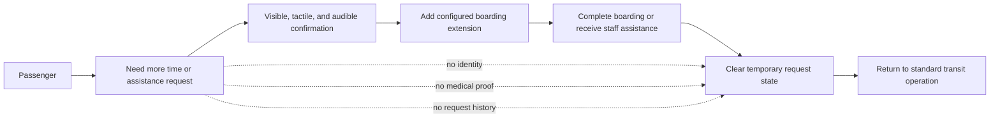
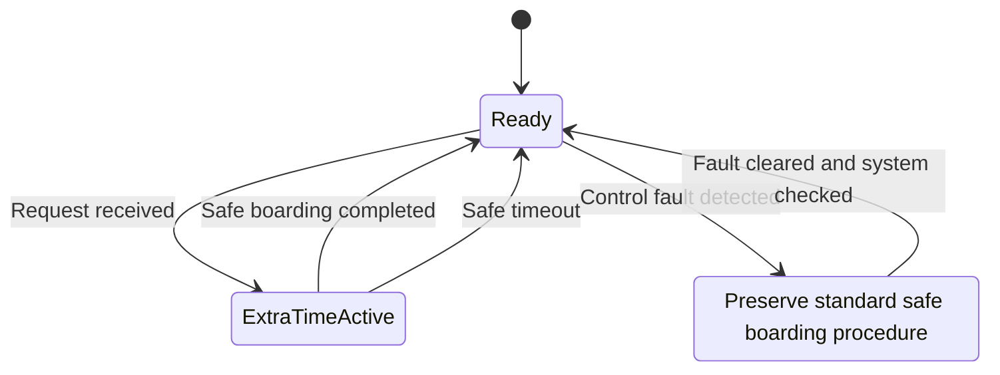

# Transit Boarding-Time Assistance Without Identity Disclosure

## Purpose

This design specifies an accessible public-transit boarding support feature that gives riders additional boarding time or requests staff assistance without requiring them to disclose a disability, medical condition, age, augmentation status, identity, housing status, payment status, or reason for needing time.

The public-facing feature should use direct, non-stigmatizing language:

```text
Need more time?
Press here for extra boarding time or assistance.
No explanation is required.
```

The feature must not attempt to detect “rest states,” inactivity, impairment, fatigue, disability, augmentation use, cognitive condition, or health status.

A person is the authority on whether they need additional time or assistance.

## Core guarantee

For every rider \(p\):

\[
\operatorname{RequestExtraTime}(p)
\Rightarrow
\operatorname{ProvideExtraTime}(p)
\]

with:

\[
T_{\text{extra}} = 10 \text{ seconds}
\]

as a configurable baseline extension.

The system must not impose a daily request limit:

\[
L_{\text{requests-per-person-per-day}} = \infty
\]

The system cannot determine requests per person per day because it does not identify or track individual riders.

## Non-disclosure invariants

\[
G_{\text{identity}} = 0
\]

\[
G_{\text{medical-proof}} = 0
\]

\[
G_{\text{disability-proof}} = 0
\]

\[
G_{\text{augmentation-disclosure}} = 0
\]

\[
G_{\text{account}} = 0
\]

\[
G_{\text{phone}} = 0
\]

\[
D_{\text{person,persistent}} = 0
\]

\[
D_{\text{request-history}} = 0
\]

Where:

- \(G_{\text{identity}}\) is an identity verification requirement.
- \(G_{\text{medical-proof}}\) is a requirement for clinical or medical documentation.
- \(G_{\text{disability-proof}}\) is a requirement to establish disability status.
- \(G_{\text{augmentation-disclosure}}\) is a requirement to disclose cybernetic or assistive technology use.
- \(G_{\text{account}}\) is an account or registration requirement.
- \(G_{\text{phone}}\) is a phone, app, QR code, or device requirement.
- \(D_{\text{person,persistent}}\) is persistent person-derived data.
- \(D_{\text{request-history}}\) is a retained record connecting requests to a rider.

Adequate time to board and exit is a recognized accessibility principle in public transit, and federal transit guidance addresses accessibility requirements and assistance with boarding equipment. [264][268]

## Universal request design

### Recommended labels

Use language that does not ask riders to define themselves:

```text
Need more time?
Extra boarding time
Request assistance
Please wait
Start over
```

Avoid labels such as:

```text
Disability button
Medical priority
Vulnerable rider request
Rest-state verification
Impairment accommodation
Proof-required assistance
Special-needs identification
```

### Accessible request methods

Every vehicle or boarding point should offer more than one request path:

| Request pathway | Description | No-disclosure property |
|---|---|---|
| Large physical button | Raised, high-contrast, reachable control near accessible boarding area | No phone, app, identity, or explanation |
| Tactile marked control | Distinct tactile symbol and stable placement | Usable with low vision or no vision |
| Driver-facing request control | Clearly labeled request button or accessible card | No diagnostic or personal claim required |
| On-screen control | Large target with screen-reader-compatible accessible name | Does not require an account |
| Voice-output-guided control | Local spoken prompt with physical or touch confirmation | No voice recording needed |
| Staff verbal request | Rider may say or indicate “I need more time” | No need to give a reason |
| Switch-compatible interface | Compatible with accessible input where the vehicle supports it | No augmentation or proprietary device required |
| Visual signal | Accessible light or symbol that confirms extra time was granted | Supports people who cannot rely on audio alone |

The function must remain usable when any optional technology fails:

\[
\operatorname{PreferredMethodUnavailable}
\Rightarrow
\operatorname{StandardRequestMethodAvailable}
\]

## Public interaction flow



### Minimal user experience

1. A rider presses a large tactile “Need more time” control, asks a driver, or uses another equivalent request path.
2. The vehicle or station provides a clear confirmation:
   - Visible: “Extra boarding time active.”
   - Audible where enabled: “Extra boarding time active.”
   - Tactile or indicator-based confirmation where supported.
3. The door or gate remains in a safe boarding state for the configured extension.
4. Staff provide assistance when requested or required by established transit safety procedures.
5. The temporary request state clears automatically after boarding or after a short safe timeout.
6. No personal record is created.

## Anti-abuse design without dignity loss

### Principle

The system should not solve hypothetical abuse by demanding proof from people who need time.

The correct response to frequent requests is operational design:

- Schedule and staffing improvements.
- Adequate dwell-time allowance.
- Accessible vehicle and platform design.
- Level boarding where feasible.
- Safe queue and door management.
- Clear request feedback.
- Operational analytics using aggregate counts only.
- Human review of aggregate delay patterns.
- Improved headway management.

Not:

- Identity checks.
- Medical proof.
- Daily request limits.
- Blacklists.
- Facial recognition.
- Device tracking.
- Behavioral scoring.
- Surveillance cameras used to decide whether a request is “legitimate.”
- Staff judgment about whether a rider “looks disabled enough.”

### Aggregate operational measure

Let \(R_t\) be the aggregate number of extension requests in time interval \(t\), measured only if it can be done without associating requests with people.

\[
R_t =
\sum_{j=1}^{n_t} 1
\]

The system may use coarse aggregate counts to plan staffing and schedule resilience. It must not retain a rider-linked request count:

\[
R_{p,t} = \varnothing
\]

### Safety override

Transit personnel may intervene for immediate safety reasons such as door obstruction, unsafe movement, emergency evacuation, equipment malfunction, or platform hazard.

Such intervention must be based on observable immediate safety conditions, not assumed disability, augmentation, identity, or a history of request use.

\[
\operatorname{SafetyCondition}
\Rightarrow
\operatorname{HumanSafetyResponse}
\]

not:

\[
\operatorname{FrequentRequest}
\Rightarrow
\operatorname{DenyAssistance}
\]

## Timing model

### Extra time

Let \(T_0\) be normal scheduled dwell time at a stop. Let \(r_t \in \{0,1\}\) represent whether any rider requests extra time during the current boarding event.

\[
T_{\text{dwell}}(t) =
T_0 + r_t T_{\text{extra}}
\]

With:

\[
T_{\text{extra}} = 10 \text{ seconds}
\]

The extension is configurable by local safety and operations policy. It should be long enough to be meaningful and should support additional staff assistance when 10 seconds is not enough.

The 10-second setting is a baseline operational parameter, not a maximum time a rider may need.

### No per-rider limit

Since no identity is collected:

\[
\operatorname{CountRequests}(\text{person}) = \varnothing
\]

Therefore, no technical daily quota exists:

\[
L_{\text{requests-per-person-per-day}} = \infty
\]

The service remains request-based rather than proof-based.

## Queueing and headway analysis

### Dwell-time variability

Let:

- \(D_t\) be dwell time at stop \(t\).
- \(D_{0,t}\) be baseline dwell time.
- \(R_t\) be aggregate extension requests at stop \(t\).
- \(T_{\text{extra}}\) be the extension duration.
- \(\epsilon_t\) be other operational dwell-time variation.

\[
D_t =
D_{0,t} +
R_t T_{\text{extra}} +
\epsilon_t
\]

If a vehicle has one active extension state at a time rather than stacking extensions, use:

\[
D_t =
D_{0,t} +
\mathbf{1}[R_t > 0]T_{\text{extra}} +
\epsilon_t
\]

This is usually the more dignified and operationally stable choice: any extra-time request activates the accessible boarding state, and the system does not attempt to count or classify individual riders.

### Headway propagation

Let \(H_t\) be the headway between successive vehicles or service arrivals.

\[
H_{t+1} =
H_t +
(D_t - \overline{D})
+
\eta_t
\]

Where:

- \(\overline{D}\) is target or average dwell time.
- \(\eta_t\) represents other delay and recovery effects.

Headway variance can be monitored:

\[
\operatorname{Var}(H) =
\frac{
1
}{
n-1
}
\sum_{t=1}^{n}
(H_t-\overline{H})^2
\]

The goal is not to eliminate boarding-time requests. The goal is to design schedules and recovery mechanisms so that reliability remains within an adopted public-service corridor.

### Coefficient of variation

A comparable reliability measure is:

\[
CV_H =
\frac{
\sigma_H
}{
\max(\mu_H,\epsilon)
}
\]

Where:

- \(\sigma_H\) is headway standard deviation.
- \(\mu_H\) is mean headway.
- \(\epsilon\) prevents division by zero.

The transit agency should set a route-specific reliability threshold:

\[
CV_H \leq CV_{H,\max}
\]

If the threshold is exceeded, the remedy should focus on dispatching, recovery time, vehicle frequency, stop design, boarding layout, staffing, fare collection design, and other operational improvements—not restricting rider requests.

Transit research identifies dispatch irregularity, scheduled frequency, route length, passenger demand, dwell times, and number of stops as significant contributors to headway variability. [263]

### Delay attribution rule

Extra-time requests must not be used as a blame category.

The operational report should use neutral categories:

```text
boarding dwell variance
platform crowding
traffic delay
vehicle reliability
signal delay
wheelchair ramp or lift deployment time
fare collection delay
route congestion
weather condition
dispatch irregularity
stop accessibility condition
```

Do not publish a category such as:

```text
delay caused by disabled riders
delay caused by augmented passengers
delay caused by special-needs users
```

## Sensor policy

### Preferred design

The safest implementation does not need a sensor to infer whether someone needs time. It uses a direct request control and staff awareness.

\[
\operatorname{NeedMoreTime}
=
\operatorname{RiderRequest}
\]

not:

\[
\operatorname{NeedMoreTime}
=
\operatorname{InferredHealthOrMobilityState}
\]

### Permitted operational sensors

| Sensor or input | Permitted use | Retention rule |
|---|---|---|
| Door position switch | Confirms door state | Device operational log only |
| Ramp or lift position sensor | Confirms equipment state | Device maintenance log only |
| Door obstruction safety sensor | Immediate safety protection | Volatile control signal or bounded fault record |
| Vehicle speed state | Prevents unsafe movement | Vehicle operational state |
| Physical button press | Activates temporary extension | Clear immediately after boarding event; no person linkage |
| Accessible boarding-request button health | Maintenance status | Device maintenance record |
| Platform-control status | Operational safety | Bounded public infrastructure record |

### Prohibited sensor or data uses

```text
camera-based rider classification
facial recognition
gait recognition
body-shape inference
thermal-body classification
microphone or speech recording
voiceprint
Bluetooth or Wi-Fi tracking
phone application location
identity-linked fare-card use for assistance requests
medical data
disability data
augmentation data
daily request count per person
request blacklist
behavioral risk score
```

## Embedded control contract

The embedded controller accepts a momentary request and outputs only a temporary boarding-assistance state.

It must not:

- Read identity credentials.
- Read fare-card identity.
- Connect to a remote person database.
- Store request history.
- Send rider data to a cloud service.
- Decide whether a person deserves more time.
- Limit requests per person.
- Act as a substitute for trained operator assistance.

### State machine



## Python simulation requirements

The simulation should:

- Generate only aggregate boarding events.
- Apply a 10-second extension when a request occurs.
- Track dwell-time and headway statistics.
- Model dispatch recovery time.
- Compare baseline and accessible operations.
- Avoid person identifiers and rider profiles.
- Report whether service reliability remains inside the adopted corridor.
- Recommend operational capacity improvements when reliability degrades.
- Never recommend a daily request limit or proof requirement.

## Public accountability

Publish:

- The “Need more time” policy.
- The configured baseline extra-time value.
- Request pathways.
- Standard and augmentation-optional access methods.
- Fallback procedures.
- Aggregate dwell and headway measures.
- Accessibility equipment uptime.
- Barrier-report and correction process.
- Staff training scope.
- Repair response time for failed boarding controls.
- Privacy and retention statement.
- Public-service reliability corridor.
- Improvement actions if reliability targets are missed.

Plain-language public notice:

```text
Need more time or assistance boarding?

Ask the operator or use the marked request control.
No explanation is required.
No proof is required.
No account or phone is required.
You can ask whenever you need to.
```

## Research directions

### Accessible request-control study

Evaluate:

- Tactile shape recognition.
- Button position and reach range.
- High-contrast label readability.
- Audio confirmation clarity.
- Physical vibration and vehicle-noise conditions.
- Switch compatibility.
- Cognitive-load reduction through plain language.
- Alternative request pathways when the control is unavailable.

Success measure:

\[
C_{\text{request-access}} =
\frac{
N_{\text{successful request activations}}
}{
N_{\text{request attempts}}
}
\]

Target:

\[
C_{\text{request-access}} \geq 0.95
\]

### Headway resilience study

Evaluate:

- Dwell-time distribution before and after deployment.
- Route-specific recovery margins.
- Headway coefficient of variation.
- Dispatch intervention needs.
- Impact of additional vehicles or relief operators.
- Stop-layout improvements.
- Effect of all-door boarding or fare-collection redesign.
- Reliability effect of platform crowding and vehicle equipment failures.

Success condition:

\[
CV_H \leq CV_{H,\max}
\]

without reducing access to extra boarding time.

### Dignity and non-disclosure study

Evaluate through anonymous and voluntary rider feedback:

- Whether the request label is understandable.
- Whether riders believe they can ask without explanation.
- Whether staff response is respectful.
- Whether fallback pathways work.
- Whether people know how to report a barrier.
- Whether the system creates pressure to disclose personal information.

The study must not ask people to reveal diagnosis, augmentation status, device details, or medical information unless separately justified, voluntary, and protected.

## Project metrics

| Metric | Score | Basis |
|---|---:|---|
| knowledge_factor | 0.91 | Defines the request as a user-controlled accessibility feature, models dwell and headway effects, and uses transparent operational measures |
| eco_impact_value | 0.78 | Improves transit usability and can reduce reliance on private vehicles, while requiring route-reliability and operational-efficiency planning |
| harm_risk | 0.12 | No identity, medical proof, augmentation disclosure, device tracking, request quota, or rider-level history |
| accessibility_impact | 0.99 | Universal request, multiple modalities, request-based assistance, adequate boarding time, standard fallback, and non-digital support |
| rights_alignment | 0.99 | Supports dignity, autonomy, privacy, equal treatment, accessible public transit, non-discrimination, and accountable repair |
