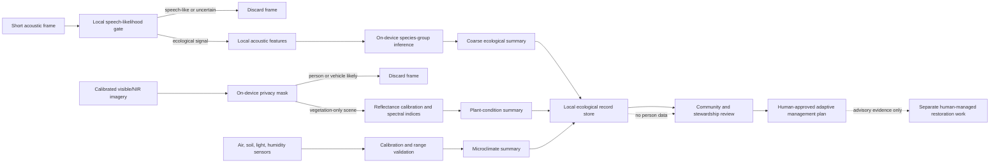
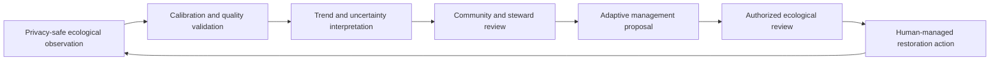

# Urban Green Corridor Eco-Restoration With Biodiversity Monitoring

## Purpose

This design specifies a privacy-preserving, locally verifiable monitoring pipeline for newly created or restored urban green corridors.

The pipeline supports adaptive ecological management by measuring:

- Plant-condition indicators.
- Habitat connectivity indicators.
- Species-group acoustic activity.
- Microclimate conditions.
- Soil and irrigation conditions where separately approved.
- Restoration maintenance observations.
- Community-reviewed citizen-science evidence.

It is not a public-surveillance system. It must not identify, track, profile, classify, or score people who pass through, rest in, work near, or live adjacent to the corridor.

## Core principles

The corridor monitoring system must preserve:

\[
D_{\text{person,persistent}} = 0
\]

\[
I_{\text{identity}} = 0
\]

\[
I_{\text{speech,retained}} = 0
\]

\[
I_{\text{raw-audio,retained}} = 0
\]

\[
I_{\text{raw-video,retained}} = 0
\]

\[
I_{\text{device-tracking}} = 0
\]

\[
A_{\text{public-access}} = 1
\]

Where:

- \(D_{\text{person,persistent}}\) is retained data that identifies, distinguishes, or permits inference about a person.
- \(I_{\text{identity}}\) is any identity inference.
- \(I_{\text{speech,retained}}\) is persistent human speech content.
- \(I_{\text{raw-audio,retained}}\) and \(I_{\text{raw-video,retained}}\) are raw recordings retained beyond immediate local processing.
- \(I_{\text{device-tracking}}\) is collection of persistent device identifiers or trajectories.
- \(A_{\text{public-access}}\) represents continued equal access to the green corridor.

No ecological goal justifies surveillance, exclusion, discriminatory access rules, or treating a community member as a data source by default.

## Monitoring architecture



## Data classes

| Data class | Examples | Processing rule | Retention rule |
|---|---|---|---|
| Ecological acoustic feature | Bird-call band energy, insect temporal pattern, bat-call frequency summary | Compute locally from accepted non-speech frames | Retain privacy-safe aggregate only |
| Speech-likelihood result | `speech_like`, `not_speech_like`, `uncertain` | Use only to decide whether to discard frame | Do not retain |
| Raw audio | Waveform samples | Process in volatile memory only | Discard immediately |
| Image-derived vegetation index | NDVI, EVI, shadow fraction, canopy-cover estimate | Compute locally from calibrated vegetation-only imagery | Retain aggregate index with provenance |
| Raw image | Camera frame | Process in volatile memory only | Discard immediately |
| Privacy-mask outcome | `clear`, `person_or_vehicle_likely`, `uncertain` | Use only to discard unsafe frame | Do not retain |
| Microclimate reading | Air temperature, relative humidity, soil temperature, light level, wind | Validate, aggregate, and retain with calibration metadata | Retain ecological timeseries under bounded policy |
| Citizen-science observation | Plant flowering present, pollinator observed, water fixture issue | Voluntary, structured, non-identifying, reviewed | Retain only with purpose, uncertainty, and review status |
| Maintenance record | Mulch added, irrigation inspected, invasive plants removed | Retain as public stewardship provenance | Retain according to stewardship policy |

## Acoustic biodiversity monitoring without human-speech retention

### Design objective

Acoustic sensors can support biodiversity monitoring because many species produce distinctive frequency, temporal, and rhythmic patterns. However, urban soundscapes contain human speech, music, vehicles, construction, alarms, and other non-target sources.

The safe design is not “record first and anonymize later.” The safe design is:

\[
\text{capture briefly}
\rightarrow
\text{evaluate locally}
\rightarrow
\text{discard speech-like or uncertain audio}
\rightarrow
\text{retain ecological feature summary only}
\]

Research on ecoacoustic monitoring has identified that human speech can be inadvertently captured and that voice activity detection can support privacy-preserving approaches. [129]

### Acoustic processing sequence

1. Capture a short frame in volatile memory, such as one to five seconds.
2. Apply a local high-pass or band-pass filter selected for the target taxa.
3. Run local speech-likelihood detection.
4. If speech-like content or uncertainty is detected, immediately erase the frame.
5. If the frame is classified as ecological and non-speech-like, compute a compact feature vector.
6. Run a local species-group or acoustic-event model.
7. Retain only an aggregate summary with uncertainty.
8. Delete the source waveform and intermediate spectrogram.

### Speech exclusion rule

Let \(s(x)\) be the estimated probability that acoustic frame \(x\) contains intelligible or speech-like human vocal content.

Let \(\tau_s\) be the conservative speech threshold.

\[
\operatorname{retainFeatures}(x) =
\begin{cases}
1, & s(x) < \tau_s \land q(x) \geq \tau_q \\
0, & \text{otherwise}
\end{cases}
\]

Where:

- \(q(x)\) is ecological-signal quality.
- \(\tau_q\) is the minimum signal-quality threshold.

Conservative operation requires:

\[
s(x) \geq \tau_s
\Rightarrow
\operatorname{discard}(x)
\]

\[
\text{uncertain}(s(x))
\Rightarrow
\operatorname{discard}(x)
\]

The system should favor privacy over sample volume.

### Acoustic feature representation

For accepted frames, retain a limited ecological feature record:

\[
F_a =
(
t_b,
z,
f_{\min},
f_{\max},
e_f,
m_t,
\widehat{g},
p_g,
q
)
\]

Where:

- \(t_b\) is a coarse time bin.
- \(z\) is a public corridor-zone identifier.
- \(f_{\min}\) and \(f_{\max}\) are frequency bounds.
- \(e_f\) is band energy.
- \(m_t\) is a temporal modulation summary.
- \(\widehat{g}\) is a predicted ecological species group or event group.
- \(p_g\) is model confidence.
- \(q\) is signal quality.

Do not retain:

```text
raw waveform
speech transcript
speaker representation
voice embedding
speaker count
speaker identity
device identifier
continuous microphone stream
precise person presence timeline
```

### Taxonomic grouping

Use ecological groups that match model reliability and local stewardship needs:

- Native bird group.
- Migratory bird group.
- Pollinator-associated insect activity group.
- Bat activity group.
- Amphibian activity group where habitat is suitable.
- General non-target urban noise class.
- Unknown ecological acoustic event.

Avoid claiming species-level identification unless field validation supports it. For a low-cost urban corridor, group-level trends may be more reliable and more useful for adaptive restoration than unsupported species precision.

### Acoustic confidence

For a detected ecological group \(g\), define confidence:

\[
K_g =
C_{\text{model}}
\cdot
Q_{\text{signal}}
\cdot
C_{\text{calibration}}
\cdot
C_{\text{habitat}}
\]

Where each component lies in \([0,1]\).

A record is eligible for ecological trend analysis when:

\[
K_g \geq K_{\min}
\]

Otherwise, preserve it only as an unknown ecological-sound count or exclude it from biodiversity claims.

## Biodiversity indicators

### Shannon diversity index

For species or validated species-group proportions \(p_i\):

\[
H = -\sum_{i=1}^{S} p_i \ln(p_i)
\]

Where:

- \(S\) is the number of detected groups.
- \(p_i\) is the proportion of validated detections belonging to group \(i\).

Use a time-bounded and location-bounded observation window:

\[
p_i =
\frac{n_i}{\sum_{j=1}^{S} n_j}
\]

Where \(n_i\) is the count of accepted, confidence-qualified ecological detections for group \(i\).

### Interpretation guardrail

Shannon entropy measures distributional diversity in detected groups. It does not prove total biodiversity, habitat quality, species abundance, reproductive success, or ecological restoration success on its own.

Report:

```text
Observed acoustic diversity index:
Observation window:
Species-group classifier version:
Signal acceptance rate:
Speech-discard rate:
Unknown-event rate:
Calibration status:
Interpretation limit:
```

### Evenness

A normalized evenness measure is:

\[
E_H =
\frac{H}{\ln(S)}
\]

Where:

\[
0 \leq E_H \leq 1
\]

Use this to distinguish a corridor dominated by a small number of common groups from one with more evenly distributed detected groups, while retaining the same uncertainty disclosures.

### Occupancy-style evidence

For a repeated set of listening windows, let \(y_{i,t}\) represent detection of group \(i\) in time bin \(t\):

\[
y_{i,t} \in \{0,1\}
\]

An uncorrected detection rate is:

\[
R_i =
\frac{
\sum_t y_{i,t}
}{
T
}
\]

This is a detection-rate proxy, not direct abundance. It should be labeled as such.

## Spectral plant-health monitoring

### Sensor requirement

True NDVI requires near-infrared and red reflectance measurements. A standard RGB camera cannot produce physically valid NDVI because it lacks a near-infrared band.

Use one of these approaches:

| Option | Input bands | Outputs | Suitable claim |
|---|---|---|---|
| Calibrated NIR + red camera | NIR and red | NDVI, NIR/red ratio | Vegetation greenness proxy with calibration |
| Multispectral camera | Blue, red, NIR and optional additional bands | NDVI, EVI, EVI2, canopy metrics | Reflectance-based vegetation index analysis |
| RGB-only camera | Red, green, blue | Visible vegetation indices, canopy color, leaf-area proxy | Visible-color condition proxy only |
| Satellite or aerial imagery | Calibrated multispectral bands | Broad corridor trends | Coarse spatial trend assessment |

NASA and USGS describe NDVI as a ratio of near-infrared and red reflectance, with the conventional form \((NIR - Red)/(NIR + Red)\). [130][131]

### NDVI

\[
NDVI =
\frac{
\rho_{\text{NIR}} - \rho_{\text{Red}}
}{
\rho_{\text{NIR}} + \rho_{\text{Red}}
}
\]

Where:

- \(\rho_{\text{NIR}}\) is calibrated near-infrared reflectance.
- \(\rho_{\text{Red}}\) is calibrated red reflectance.

NDVI commonly ranges from \(-1\) to \(+1\), although valid interpretation depends on sensor calibration, scene conditions, species, canopy structure, soil exposure, and season. USGS notes that low values often occur over barren surfaces and that NDVI is useful for vegetation density and plant-health change assessment. [131][134]

### EVI

The three-band enhanced vegetation index is:

\[
EVI =
G
\cdot
\frac{
\rho_{\text{NIR}} - \rho_{\text{Red}}
}{
\rho_{\text{NIR}}
+
C_1\rho_{\text{Red}}
-
C_2\rho_{\text{Blue}}
+
L
}
\]

A common parameterization is:

\[
G = 2.5
\]

\[
C_1 = 6
\]

\[
C_2 = 7.5
\]

\[
L = 1
\]

EVI is designed to improve vegetation-signal sensitivity and address atmospheric and background effects. [136][142]

### EVI2 for two-band systems

When the system lacks a blue band, use EVI2 only with documented calibration:

\[
EVI2 =
2.5
\cdot
\frac{
\rho_{\text{NIR}} - \rho_{\text{Red}}
}{
\rho_{\text{NIR}}
+
2.4\rho_{\text{Red}}
+
1
}
\]

EVI2 is a two-band EVI reformulation using red and near-infrared inputs. [133]

### Urban-lighting robustness

Urban conditions create strong confounders:

- Time-varying shade.
- Building reflections.
- Vehicle reflections.
- Artificial nighttime illumination.
- Mixed pavement, soil, mulch, turf, and canopy pixels.
- Solar-angle variation.
- Dust and haze.
- Seasonal irrigation changes.
- Camera automatic exposure and white balance.
- Lens contamination.
- Sensor temperature drift.

Use these conventions:

1. Measure only during a defined daylight acquisition window.
2. Disable automatic exposure, automatic white balance, and automatic gain when possible.
3. Use a fixed camera pose and documented field of view.
4. Include a calibrated reflectance target in a non-public-facing field region when practical.
5. Exclude nighttime and low-illumination frames.
6. Reject frames with lens obstruction, excessive blur, glare, or uncertain privacy masking.
7. Store reflectance-calibration parameters and quality flags with each retained index.
8. Compare like-for-like conditions: same season, similar local solar time, similar sensor configuration.
9. Separate canopy vegetation from pavement, bare soil, mulch, and constructed surfaces using a local mask.
10. Report index change with uncertainty, rather than interpreting a single index value as plant health.

### Illumination quality gate

Let \(L\) be local illumination, \(S\) be shadow fraction, \(G\) be glare score, and \(B\) be blur score.

\[
Q_{\text{image}} =
q_L(L)
\cdot
(1-S)
\cdot
(1-G)
\cdot
(1-B)
\]

Retain an image-derived ecological summary only when:

\[
Q_{\text{image}} \geq \tau_{\text{image}}
\]

If a person, vehicle, readable plate, screen, or other privacy-sensitive object is detected or uncertain:

\[
\operatorname{retainImageDerivedData} = 0
\]

The raw frame must be immediately discarded.

### Trend metric

For a vegetation index \(V_t\), compare a current observation with a reference baseline:

\[
\Delta V_t =
V_t - \operatorname{median}(V_{\text{reference window}})
\]

A normalized anomaly score is:

\[
Z_t =
\frac{
V_t - \mu_{\text{reference}}
}{
\max(\sigma_{\text{reference}}, \epsilon)
}
\]

Where \(\epsilon\) prevents division by zero.

Do not automate irrigation, chemical application, pruning, removal, or habitat interventions solely from \(Z_t\). Use it as an alert for human ecological review.

## Canopy water stress

### Crop water stress index

For thermal measurements:

\[
CWSI =
\frac{
(T_{\text{canopy}} - T_{\text{air}})
-
(T_{\text{wet}} - T_{\text{air}})
}{
T_{\text{dry}} - T_{\text{wet}}
}
\]

Equivalent simplification:

\[
CWSI =
\frac{
T_{\text{canopy}} - T_{\text{wet}}
}{
T_{\text{dry}} - T_{\text{wet}}
}
\]

Where:

- \(T_{\text{canopy}}\) is canopy temperature.
- \(T_{\text{air}}\) is nearby air temperature.
- \(T_{\text{wet}}\) is a wet-reference lower baseline.
- \(T_{\text{dry}}\) is a dry-reference upper baseline.

Use CWSI only after site-specific validation. Urban species mixtures, shade, irrigation systems, building heat, soil variability, canopy geometry, and reflected heat can make generic reference temperatures misleading.

### Water-stress decision support

Use a multi-signal alert:

\[
A_{\text{water-stress}} =
w_c \cdot \widehat{CWSI}
+
w_v \cdot \widehat{-\Delta NDVI}
+
w_s \cdot \widehat{S_{\text{soil-dryness}}}
+
w_h \cdot \widehat{H_{\text{heat}}}
\]

Where each term is normalized to \([0,1]\).

The alert should only prompt human review when:

\[
A_{\text{water-stress}} \geq \tau_{\text{review}}
\]

It must not automatically make watering, irrigation, pesticide, herbicide, pruning, or removal decisions.

## Microclimate pipeline

### Recommended local measurements

- Air temperature.
- Relative humidity.
- Heat index or wet-bulb-related indicator where valid.
- Solar irradiance or illuminance.
- Wind speed and direction where appropriate.
- Soil temperature.
- Soil moisture, only with site-specific calibration.
- Surface temperature from non-person-facing thermal sampling.
- Canopy shade fraction.
- Rainfall or irrigation event record.
- Local particulate matter only where sensor quality and governance support it.

### Thermal-comfort and habitat metrics

A corridor heat-mitigation indicator may be represented as:

\[
\Delta T_{\text{corridor}} =
T_{\text{reference}} - T_{\text{corridor}}
\]

Where both readings are time-matched and calibration-qualified.

A cooling-service availability proxy can be defined as:

\[
C_{\text{shade}} =
\frac{
A_{\text{usable shade}}
}{
A_{\text{public corridor}}
}
\]

The system should report measurement uncertainty:

\[
\Delta T_{\text{reported}} =
\Delta T_{\text{corridor}}
\pm
\sigma_{\Delta T}
\]

Do not claim that a corridor provides a health outcome without an appropriate study design, governance approval, and subject-matter validation.

## Privacy-preserving edge pipeline

### Retained ecological record

```json
{
  "format": "augmented-hub.green-corridor-observation.v1",
  "observationWindow": "2026-09-01T18:00:00Z/2026-09-01T18:15:00Z",
  "corridorZone": "public-green-corridor-zone",
  "sensorClass": "acoustic-edge-node",
  "softwareVersion": "1.0.0",
  "calibrationVersion": "2026.09",
  "privacyGate": {
    "rawAudioRetained": false,
    "rawImageRetained": false,
    "speechLikeFramesDiscarded": 12,
    "privacyUncertainFramesDiscarded": 4,
    "personTrackingEnabled": false
  },
  "acousticSummary": {
    "acceptedEcologicalFrames": 18,
    "unknownEcologicalEvents": 6,
    "speciesGroupCounts": {
      "native-bird-group": 8,
      "pollinator-insect-group": 7,
      "bat-activity-group": 3
    },
    "shannonEntropy": 1.01,
    "meanConfidence": 0.81
  },
  "microclimateSummary": {
    "airTemperatureC": 36.4,
    "relativeHumidityPercent": 22.0,
    "soilTemperatureC": 31.7,
    "shadeFraction": 0.46
  },
  "reviewStatus": "pending-steward-review"
}
```

The example contains no person identifiers, voice material, image material, device identifiers, or location history. Replace symbolic location fields with public corridor-zone labels appropriate to local governance.

### Retention rules

| Record type | Retention | Justification |
|---|---|---|
| Raw acoustic frame | Immediate deletion after local gate and feature extraction | Prevent speech retention |
| Raw image frame | Immediate deletion after privacy gate and index extraction | Prevent person and bystander imagery retention |
| Speech-likelihood output | Immediate deletion | The result has no ecological value after discard decision |
| Acoustic ecological aggregate | Bounded ecological research retention | Supports biodiversity trend analysis |
| Image-derived vegetation index | Bounded ecological research retention | Supports canopy trend analysis |
| Microclimate aggregate | Bounded ecological research retention | Supports heat, shade, and irrigation planning |
| Calibration record | Long enough for reproducibility and audit | Supports validity assessment |
| Public review record | Defined stewardship retention | Supports accountable adaptive management |

## Citizen-science participation

### Participation boundary

Citizen science must be optional, accessible, and separate from access to the corridor or any public service.

A person may walk, rest, travel, work, play, access water, use cooling support, or receive civic services without contributing data.

### Suitable observations

Voluntary contributors may submit structured non-identifying observations such as:

- Flowering present or absent.
- Pollinator observed.
- Tree canopy damage visible.
- Invasive plant concern.
- Irrigation leak or dry planting bed.
- Accessible path obstruction.
- Shade structure condition.
- Litter or storm-debris condition.
- Public water fixture availability.
- Bird or insect observation without photographs of people.

### Prohibited citizen-science submissions

The project must not request or retain:

```text
names by default
faces
voice recordings
photos containing identifiable people
license plates
home addresses
device identifiers
continuous movement tracks
health information
disability or augmentation status
immigration or housing status
person behavior labels
unreviewed accusations about individuals
```

### Community observation quality

Let:

- \(P\) be protocol completeness.
- \(M\) be ecological metadata completeness.
- \(V\) be review or verification strength.
- \(U\) be uncertainty disclosure quality.
- \(R\) be rights and privacy compliance.

Then:

\[
Q_{\text{community-observation}} =
0.20P +
0.20M +
0.25V +
0.15U +
0.20R
\]

A community observation may prompt a stewardship review when:

\[
Q_{\text{community-observation}} \geq \tau_{\text{review}}
\]

It may update a trusted corridor record only when independently reviewed according to a documented ecological and community governance process.

EPA describes participatory science as engaging the public in scientific knowledge building and provides quality-assurance resources for participatory-science projects. [96][98][99]

## Adaptive management

### Human-reviewed decision cycle



Potential actions include:

- Adjusting irrigation schedules after field inspection.
- Adding native plant diversity.
- Improving shade and mulch.
- Repairing irrigation leaks.
- Removing invasive species through approved stewardship processes.
- Creating habitat features.
- Modifying lighting to reduce ecological disturbance.
- Improving accessible-path maintenance.
- Adjusting sensor placement to reduce privacy risk or improve ecological validity.

The monitoring system must not automatically execute physical interventions.

### Ecological benefit metric

Define an evidence-based corridor benefit score:

\[
E_{\text{corridor}} =
w_b B +
w_h H +
w_c C +
w_t T -
w_r R
\]

Where:

- \(B\) is validated biodiversity evidence.
- \(H\) is habitat connectivity improvement.
- \(C\) is canopy and vegetation-condition improvement.
- \(T\) is microclimate benefit.
- \(R\) is residual ecological, privacy, accessibility, or maintenance risk.

Weights must be public, documented, and reviewable:

\[
\sum w_i = 1
\]

No single positive outcome may erase a serious privacy, accessibility, or ecological harm. Use non-compensatory gates before computing a composite score.

## Validation plan

### Acoustic privacy validation

- Introduce test audio containing speech, conversation-like sound, music, bird calls, insect calls, wind, vehicle noise, and mixed urban soundscape conditions.
- Verify speech-like and uncertain frames are discarded.
- Verify raw audio is not written to storage.
- Verify no voice embeddings, transcripts, or speaker labels are emitted.
- Verify accepted ecological summaries cannot reconstruct waveform content.
- Verify a failed speech detector defaults to discarding the frame.

### Imaging privacy validation

- Test frames containing people, mobility devices, vehicles, readable signs, plates, vegetation, shadows, and mixed scenes.
- Verify person-or-vehicle-likely and uncertain frames are discarded.
- Verify raw frames are not written to storage.
- Verify camera acquisition is disabled during low-light periods unless a separate non-imaging ecological sensor is used.
- Verify only calibrated, privacy-cleared vegetation summaries are retained.

### Spectral validation

- Compare low-cost sensor results with periodic calibrated reference measurements.
- Test exposure stability, white-balance lock, illumination thresholds, lens contamination, shade, glare, and seasonal variation.
- Document uncertainty by plant type and corridor zone.
- Validate that RGB-only systems are not described as producing NDVI.

### Ecological validity validation

- Perform periodic field observations by qualified ecologists and community stewards.
- Measure agreement between field records and model outputs.
- Distinguish species-group detection rates from species abundance.
- Report false-positive, false-negative, and unknown-event rates.
- Avoid claims beyond the validated range of the model and sensors.

## Research directions

### Acoustic privacy and biodiversity

- Develop conservative local speech-likelihood gates that fail closed.
- Compare direct species-group classification with feature-only ecological event detection.
- Evaluate whether bird, insect, and bat group trends remain useful after aggressive privacy filtering.
- Develop local models that report unknown ecological events instead of forcing low-confidence labels.
- Test seasonal and nighttime performance without retaining audio.

Research question:

\[
\text{How much biodiversity trend value remains after raw-audio deletion and conservative speech exclusion?}
\]

### Urban spectral calibration

- Compare NIR/red low-cost cameras, multispectral cameras, and RGB-only visible-condition proxies.
- Create fixed-pose corridor calibration routines with reflectance targets.
- Quantify how buildings, pavement, artificial light, dust, shade, and heat alter vegetation-index uncertainty.
- Develop a daylight-only quality gate that does not need person-facing imagery.
- Measure whether EVI2 offers stable trend sensitivity where blue-band calibration is unavailable.

Research question:

\[
\text{Which affordable sensor configuration provides repeatable vegetation trends under urban lighting and shade variation?}
\]

### Heat resilience and public benefit

- Measure shade fraction and air-temperature differences along accessible public paths.
- Identify locations where canopy repair, native planting, seating, water, and cooling information would provide high public value.
- Study how green-corridor maintenance can improve thermal comfort without restricting public access.
- Develop transparent uncertainty reporting for localized cooling claims.

Research question:

\[
\text{Can corridor restoration measurably improve shade and thermal conditions while preserving equal, non-surveilled public access?}
\]

### Community governance

- Co-design public notices explaining what the sensors do and do not retain.
- Establish accessible correction paths for community members who identify sensor placement, privacy, access, or ecological concerns.
- Publish reproducible sensor configuration, calibration records, data schemas, retention policies, model cards, and aggregate results.
- Support community steward review before adaptive interventions.
- Evaluate multilingual and low-literacy communication formats for monitoring transparency.

Research question:

\[
\text{Do people understand the monitoring boundary well enough to distinguish ecological sensing from surveillance?}
\]

## Metrics

| Metric | Formula | Target |
|---|---|---:|
| Raw-audio retention | \(\frac{\text{raw audio frames retained}}{\text{audio frames captured}}\) | 0 |
| Raw-image retention | \(\frac{\text{raw image frames retained}}{\text{image frames captured}}\) | 0 |
| Speech-discard compliance | \(\frac{\text{speech-like or uncertain frames discarded}}{\text{speech-like or uncertain frames detected}}\) | 1 |
| Ecological feature acceptance | \(\frac{\text{accepted ecological frames}}{\text{captured frames}}\) | Report with uncertainty; no fixed target |
| Biodiversity trend confidence | \(\operatorname{mean}(K_g)\) for accepted records | At least locally validated threshold |
| Sensor calibration coverage | \(\frac{\text{active sensors with current calibration}}{\text{active sensors}}\) | 1 |
| Accessibility protection | \(\frac{\text{monitoring deployments preserving accessible passage}}{\text{deployments}}\) | 1 |
| Community review coverage | \(\frac{\text{adaptive changes with accessible review record}}{\text{adaptive changes}}\) | 1 |
| Person-data persistence | \(\frac{\text{retained person-derived records}}{\text{monitoring windows}}\) | 0 |

## Project metrics

| Metric | Score | Basis |
|---|---:|---|
| knowledge_factor | 0.91 | Uses calibration, uncertainty, privacy gates, field validation, source-attributed ecological indices, and reproducible record conventions |
| eco_impact_value | 0.90 | Supports habitat connectivity, plant-health detection, water-stress review, cooling and shade evidence, and maintenance prioritization |
| harm_risk | 0.18 | Reduced by volatile-only raw sensing, speech and privacy uncertainty discard rules, no identity inference, no person tracking, and human review |
| accessibility_impact | 0.88 | Protects non-surveilled public access, requires accessible-path preservation, and includes community correction and review routes |
| rights_alignment | 0.97 | Advances privacy, dignity, non-discrimination, ecological stewardship, transparent governance, and community participation |
