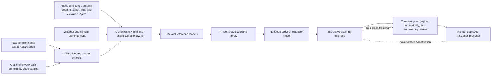

# Digital Twin for Urban Heat Mitigation Scenario Planning

## Purpose

This design defines an urban digital twin for comparing the heat-mitigation potential, uncertainty, co-benefits, tradeoffs, and implementation needs of:

- Reflective or cool roofs.
- Tree planting and canopy maintenance.
- Green walls.
- Green roofs.
- Shade structures.
- Cool pavements and high-albedo materials.
- Water-sensitive green infrastructure.
- Accessible shade and cooling corridors.
- Building-efficiency improvements.
- Community cooling-resource placement.

The digital twin is a decision-support and scenario-planning system.

It does not:

- Identify or track people.
- Infer home occupancy.
- Use household energy data without a separate lawful and privacy-protective program.
- Use phone location, Bluetooth, Wi-Fi probes, cameras, microphones, faces, gait, or device identifiers.
- Automate construction, irrigation, public-space exclusion, or land-use decisions.
- Treat modeled outcomes as guaranteed results.
- Replace community governance, ecological review, engineering review, building-code review, or public-health planning.

## Core principles

The twin must retain only the minimum information needed for environmental modeling:

\[
D_{\text{person,persistent}} = 0
\]

\[
D_{\text{device}} = 0
\]

\[
D_{\text{home-interior}} = 0
\]

\[
D_{\text{movement-history}} = 0
\]

\[
D_{\text{raw-media}} = 0
\]

\[
H_{\text{human-review}} = 1
\]

\[
U_{\text{uncertainty-visible}} = 1
\]

Where:

- \(D_{\text{person,persistent}}\) is retained person-derived information.
- \(D_{\text{device}}\) is retained device or network identifier data.
- \(D_{\text{home-interior}}\) is personally linked indoor measurement or energy-use data.
- \(D_{\text{movement-history}}\) is person movement or presence history.
- \(D_{\text{raw-media}}\) is retained camera, audio, or other raw media.
- \(H_{\text{human-review}}\) means decisions remain accountable to human and community review.
- \(U_{\text{uncertainty-visible}}\) means model uncertainty is included in every material scenario output.

## Why a hybrid model is needed

A city-scale twin must balance physical realism and interactive speed.

A useful architecture has three model layers:

| Layer | Role | Typical computation | Planning use |
|---|---|---|---|
| Physical reference layer | High-fidelity representation of selected buildings, blocks, and representative corridors | EnergyPlus, microclimate CFD or urban canopy modeling, calibrated radiation and surface-energy calculations | Calibration, validation, high-confidence scenario studies |
| Reduced-order layer | Simplified, physically constrained surrogate equations | Urban canopy parameters, energy-balance kernels, response surfaces, reduced-order heat-transfer models | Rapid scenario comparison |
| Interactive scenario layer | Fast response for civic workshops and planning interfaces | Precomputed scenarios, interpolation, uncertainty ranges, emulator predictions | Community exploration and comparative planning |

EnergyPlus is the U.S. Department of Energy’s open-source whole-building energy-modeling engine and models detailed air, moisture, and heat-transfer physics, including separate radiative and convective heat transfer. [274] It is well suited to detailed building and district reference simulations, but its complexity makes it better for calibration and scenario-library generation than for instantaneous citywide interactive recomputation.

EPA describes trees, vegetation, green roofs, and green infrastructure as heat-island mitigation strategies that can cool through shading, radiation effects, and evapotranspiration. [272][273][275]

## Digital twin architecture



## Spatial representation

### Canonical planning cell

Divide the city into cells appropriate to the decision scale:

\[
\mathcal{G} =
\{
g_1, g_2, \ldots, g_n
\}
\]

A cell may be a raster pixel, street segment, block face, parcel aggregate, census tract for aggregate planning, or hexagonal planning zone.

The selected cell size should match the modeling question:

| Planning question | Suitable spatial scale |
|---|---|
| Roof-reflectance adoption | Building or block |
| Tree-canopy placement | Street segment, parcel aggregate, block, or corridor |
| Heat-safe walking route | Sidewalk segment and shade interval |
| Cooling-center catchment | Neighborhood or transit-access area |
| Citywide heat inequality | Aggregate planning area |
| Green-wall pilot | Building façade or representative block |
| Public shade investment | Park, transit stop, plaza, or corridor segment |

The twin should avoid publishing sensitive exact locations for vulnerable ecological sites, community safety reports, or potentially identifying small-area observations.

## Surface energy balance

### Base equation

At a surface or modeled urban cell:

\[
Q^* = Q_H + Q_E + Q_G + \Delta Q_S
\]

Where:

- \(Q^*\) is net all-wave radiation.
- \(Q_H\) is sensible heat flux.
- \(Q_E\) is latent heat flux.
- \(Q_G\) is ground or substrate heat flux.
- \(\Delta Q_S\) is heat storage change in urban materials and vegetation.

The prompt’s form:

\[
Q^* = Q_H + Q_E + Q_G
\]

is a useful first approximation. For urban applications, explicitly including storage change is often valuable because pavement, roofs, walls, and building materials store and release substantial heat across the day and night.

### Net radiation

A practical net-radiation representation is:

\[
Q^* =
(1-\alpha)K_{\downarrow}
+
K_{\uparrow,\text{other}}
+
L_{\downarrow}
-
L_{\uparrow}
\]

Where:

- \(\alpha\) is surface albedo.
- \(K_{\downarrow}\) is incoming shortwave solar radiation.
- \(K_{\uparrow,\text{other}}\) is shortwave radiation reflected from nearby urban surfaces.
- \(L_{\downarrow}\) is incoming longwave radiation.
- \(L_{\uparrow}\) is outgoing longwave radiation.

For a first-order cool-roof scenario, an albedo increase from \(\alpha_0\) to \(\alpha_1\) changes absorbed solar energy by:

\[
\Delta Q_{\text{absorbed}} =
-(\alpha_1-\alpha_0)
K_{\downarrow}
\]

For:

\[
\alpha_1 > \alpha_0
\]

the roof absorbs less shortwave energy under the same incident solar radiation.

EPA describes cool roofs as highly reflective and emissive materials that can remain substantially cooler than traditional roofs during peak conditions. [273][276]

## Cooling potential

### First-order air-temperature response

The prompt cooling-potential expression is:

\[
\Delta T =
\frac{
\Delta Q_H
}{
\rho c_p h
}
\]

Where:

- \(\Delta Q_H\) is the change in sensible heat input or sensible heat flux integrated over the relevant time interval.
- \(\rho\) is air density.
- \(c_p\) is specific heat capacity of air.
- \(h\) is an effective mixing height or control-volume depth.

To make units explicit, if \(\Delta Q_H\) is a heat-energy change per unit ground area over time interval \(\Delta t\), then:

\[
\Delta T \approx
\frac{
\Delta Q_H \Delta t
}{
\rho c_p h
}
\]

This is a simplified control-volume estimate. It must not be treated as a complete urban climate model because wind, advection, shading geometry, surface storage, building exchange, vegetation physiology, humidity, and regional weather influence the realized effect.

### Canopy-driven cooling

A first-order canopy cooling potential may be represented as:

\[
\Delta Q_{\text{canopy}} =
\Delta Q_{\text{shade}}
+
\Delta Q_E
-
\Delta Q_{\text{maintenance}}
\]

Where:

- \(\Delta Q_{\text{shade}}\) is reduced solar heat loading on surfaces and people-facing routes.
- \(\Delta Q_E\) is added latent heat flux from evapotranspiration.
- \(\Delta Q_{\text{maintenance}}\) is energy, water, and lifecycle burden associated with maintaining the intervention.

A scenario should include water constraints:

\[
W_{\text{irrigation}}
\leq
W_{\text{available, sustainable}}
\]

A vegetation intervention that relies on unsustainable irrigation or causes unequal water burdens should not receive an unqualified cooling-benefit claim.

### Green-wall cooling

For a façade intervention, estimate net cooling as:

\[
\Delta Q_{\text{wall}} =
\Delta Q_{\text{shade}}
+
\Delta Q_{\text{evapotranspiration}}
+
\Delta Q_{\text{insulation}}
-
Q_{\text{pump}}
-
Q_{\text{maintenance}}
\]

Where:

- \(Q_{\text{pump}}\) is energy needed for irrigation or circulation.
- \(Q_{\text{maintenance}}\) is recurring lifecycle energy and material cost.

The model should treat green-wall results as design-specific because substrate depth, irrigation, wall orientation, species, local climate, maintenance, shading, and building envelope strongly affect performance.

## Scenario model

### Intervention variables

For planning cell \(g\), define:

\[
x_g =
(
r_g,
c_g,
w_g,
v_g,
s_g
)
\]

Where:

- \(r_g\) is cool-roof or reflective-roof coverage.
- \(c_g\) is tree-canopy coverage or canopy-quality improvement.
- \(w_g\) is green-wall or vertical-vegetation coverage.
- \(v_g\) is vegetated-roof coverage.
- \(s_g\) is shade-infrastructure coverage.

Each is bounded:

\[
0 \leq r_g,c_g,w_g,v_g,s_g \leq 1
\]

### Response model

A reduced-order local temperature response can be modeled as:

\[
\Delta T_g =
\theta_r r_g +
\theta_c c_g +
\theta_w w_g +
\theta_v v_g +
\theta_s s_g +
\theta_{rc}r_gc_g +
\theta_{cv}c_gv_g +
\epsilon_g
\]

Where:

- \(\theta\) terms are calibrated coefficients.
- Interaction terms capture combined benefits or tradeoffs.
- \(\epsilon_g\) represents unexplained variation and model error.

The coefficients must not be assumed universal. They must be calibrated or bounded using reference simulations, local sensor evidence, and documented uncertainty.

### Multi-objective planning

A responsible plan considers more than temperature reduction.

For candidate intervention plan \(X\):

\[
\max_X
\left[
w_t B_{\text{heat}}
+
w_a B_{\text{access}}
+
w_b B_{\text{biodiversity}}
+
w_h B_{\text{health-proxy}}
+
w_c B_{\text{carbon}}
-
w_w R_{\text{water}}
-
w_m R_{\text{maintenance}}
-
w_d R_{\text{displacement}}
-
w_p R_{\text{privacy}}
\right]
\]

Where:

- \(B_{\text{heat}}\) is modeled heat reduction.
- \(B_{\text{access}}\) is shade and cooling access improvement on public routes.
- \(B_{\text{biodiversity}}\) is habitat or corridor benefit.
- \(B_{\text{health-proxy}}\) is a carefully stated environmental exposure proxy, not a clinical outcome.
- \(B_{\text{carbon}}\) is lifecycle carbon benefit.
- \(R_{\text{water}}\) is water-demand risk.
- \(R_{\text{maintenance}}\) is maintenance and failure risk.
- \(R_{\text{displacement}}\) is risk that investments contribute to exclusion or inequitable displacement.
- \(R_{\text{privacy}}\) is privacy risk from data inputs.

All weights must be public, reviewable, and context-specific.

### Non-compensation gate

A high modeled temperature benefit cannot cancel a serious access, privacy, ecological, or displacement risk.

Before composite scoring, require:

\[
R_{\text{privacy}} \leq R_{\text{privacy,max}}
\]

\[
R_{\text{displacement}} \leq R_{\text{displacement,max}}
\]

\[
R_{\text{water}} \leq R_{\text{water,max}}
\]

\[
A_{\text{public-access}} = 1
\]

\[
C_{\text{community-review}} = 1
\]

Only then may a composite score be used to compare admissible scenarios.

## Privacy-preserving calibration

### Accepted calibration inputs

| Input | Privacy boundary | Model use |
|---|---|---|
| Fixed outdoor air-temperature sensors | Environmental readings only | Local thermal calibration |
| Fixed humidity sensors | Environmental readings only | Latent-heat and comfort proxy |
| Fixed irradiance sensors | Environmental readings only | Radiation calibration |
| Fixed wind sensors | Environmental readings only | Ventilation and advection proxy |
| Surface-temperature sensors aimed at infrastructure | No person-facing thermal imaging | Surface energy-balance calibration |
| Public building footprints and roof classifications | Public geospatial data | Roof scenario coverage |
| Public tree-canopy maps | Public ecological data | Canopy scenario development |
| Public land-cover and elevation data | Public environmental data | Surface and flow representation |
| Aggregate energy data | Coarsened, privacy-reviewed, non-household-linked | District-scale energy trend calibration |
| Community observations | Voluntary, no-identity default, reviewed | Model plausibility and missing-condition detection |
| Public heat-health aggregate data | Coarsened, small-cell protected, governance reviewed | Area-level planning context |

### Prohibited calibration inputs

```text
household smart-meter traces
home interior temperatures tied to occupants
phone GPS data
Bluetooth or Wi-Fi device probes
camera footage
thermal person silhouettes
microphone recordings
speech data
face, gait, or body classification
person-level health records
individual disability or augmentation data
individual cooling-center visits
identity-linked transit travel
property-level behavioral inference
```

### Data-minimization model

For each input source \(j\), define utility \(U_j\) and privacy risk \(R_j\).

Accept an input only if:

\[
U_j \geq U_{\min}
\]

\[
R_j \leq R_{\max}
\]

\[
\operatorname{LeastDetailedRepresentation}(j)
=
\operatorname{selected}
\]

If an aggregate environmental measurement can calibrate the same model component as household-level data, use the aggregate environmental measurement.

## Sparse-sensor calibration

### Observation model

Let:

- \(y_i\) be a measured environmental observation.
- \(\hat{y}_i(\theta)\) be the twin prediction.
- \(\theta\) be the model parameter vector.
- \(\varepsilon_i\) be measurement and model error.

\[
y_i =
\hat{y}_i(\theta)
+
\varepsilon_i
\]

Calibrate parameters by minimizing weighted error:

\[
\hat{\theta} =
\arg\min_{\theta}
\sum_{i=1}^{n}
w_i
\left(
y_i-\hat{y}_i(\theta)
\right)^2
+
\lambda
\left\|
\theta-\theta_0
\right\|^2
\]

Where:

- \(w_i\) weights sensor reliability and representativeness.
- \(\theta_0\) is a physically informed prior parameter vector.
- \(\lambda\) regularizes against unstable parameter estimates under sparse data.

### Reliability-weighted calibration

Let:

- \(q_i\) be sensor quality.
- \(c_i\) be calibration confidence.
- \(r_i\) be representativeness for the target cell.
- \(u_i\) be uncertainty penalty.

\[
w_i =
q_i
\cdot
c_i
\cdot
r_i
\cdot
(1-u_i)
\]

With:

\[
0 \leq w_i \leq 1
\]

A sensor with low calibration confidence should not dominate citywide inference merely because it provides frequent readings.

### Data assimilation update

A simple sequential update can use:

\[
x_{t|t} =
x_{t|t-1}
+
K_t
\left(
y_t -
H x_{t|t-1}
\right)
\]

Where:

- \(x_{t|t-1}\) is predicted twin state.
- \(y_t\) is current aggregate sensor observation.
- \(H\) maps state to sensor space.
- \(K_t\) is the gain determined from model and measurement uncertainty.

The implementation may use a Kalman filter, ensemble method, Bayesian regression, Gaussian-process surrogate, or other transparent method appropriate to the actual data and computational budget.

Every assimilation output must retain:

```text
sensor class
calibration state
spatial representativeness
time window
uncertainty estimate
model version
scenario version
privacy classification
```

## Detailed and interactive models

### Detailed reference models

Use detailed modeling for representative high-stakes areas:

- Heat-vulnerable public corridors.
- Cooling-center access routes.
- High-temperature commercial corridors.
- School and library surroundings.
- Transit stops.
- Public parks.
- Dense low-canopy blocks.
- Major roof-retrofit districts.
- Potential green-wall pilots.
- Community-identified heat-burden sites.

EnergyPlus is appropriate for building energy and envelope scenarios because it models building thermal, air, moisture, and radiative/convective processes. [274][282]

Use urban microclimate modeling where the scenario needs more detailed representation of:

- Street-canyon shading.
- Tree geometry.
- Surface materials.
- Wind flow.
- Vegetation evapotranspiration.
- Human-scale outdoor heat conditions.
- Building-wall and pavement interaction.

### Real-time interaction strategy

Do not run a citywide high-fidelity microclimate simulation every time a community participant moves a scenario slider.

Instead:

1. Define a scenario space.
2. Run detailed reference simulations for selected representative combinations.
3. Validate against privacy-safe environmental sensors.
4. Train or fit a transparent surrogate model.
5. Quantify prediction error.
6. Use the surrogate only within its validated scenario range.
7. Mark extrapolated scenarios clearly.
8. Send high-impact or out-of-range scenarios back to detailed simulation and human review.

A surrogate approximation is:

\[
\widehat{T}(x) =
f_{\text{surrogate}}(x)
\]

With prediction interval:

\[
\widehat{T}(x)
\pm
z_{\alpha/2}
\sigma_{\text{surrogate}}(x)
\]

The interactive interface must display both the central estimate and uncertainty range.

## Scenario outputs

Every scenario response should include:

```text
Scenario name.
Spatial scope.
Intervention coverage.
Model version.
Calibration date.
Data period.
Predicted air-temperature change.
Predicted surface-temperature change.
Predicted shade change.
Predicted building-energy change where modeled.
Estimated water requirement.
Estimated lifecycle maintenance requirement.
Habitat and biodiversity implications.
Accessible-route implications.
Equity and displacement review status.
Privacy classification.
Uncertainty interval.
Out-of-range warning if applicable.
Community review status.
```

Example plain-language output:

```text
Scenario: Increase tree canopy and shade structures along a public walking corridor.

Modeled result:
The twin estimates lower afternoon surface heat and increased shaded-route continuity during the modeled summer condition.

Uncertainty:
The estimate varies with tree survival, irrigation availability, building shade, wind, and local maintenance.

Important limits:
This is a planning scenario, not a guarantee of personal heat exposure or health outcome.

Access:
The design must preserve step-free routes, clear widths, seating access, and transit-stop visibility.
```

## Equity, access, and anti-displacement review

### Equal benefit requirement

The twin should measure who gains access to cooler and shaded public routes, not only total citywide temperature change.

Let \(B_g\) be the modeled public cooling benefit for planning area \(g\).

\[
P_{\text{benefit-parity}} =
\min_g
\frac{
B_g
}{
\max(\bar{B},\epsilon)
}
\]

Where \(\bar{B}\) is the citywide average public benefit.

A plan should disclose areas that receive lower modeled benefit and explain why.

### Access indicators

Track:

- Shade continuity along accessible routes.
- Cooling-center route burden.
- Public-water access along heat corridors.
- Transit-stop shade.
- Public seating and rest opportunity.
- Step-free route preservation.
- Tree-canopy distribution.
- Heat exposure at public facilities.
- Public participation in scenario selection.
- Maintenance and irrigation continuity.

The twin must not use a neighborhood’s lower political power, lower property value, lower internet access, or weaker data coverage as a reason to allocate fewer heat-mitigation resources.

### Anti-displacement review

Every major scenario should include a qualitative and quantitative review of possible displacement or exclusion pressures.

A scenario is not ready for implementation if:

\[
R_{\text{displacement}}
>
R_{\text{displacement,max}}
\]

or if public participation and mitigation planning are absent.

Potential mitigations include:

- Community land stewardship.
- Public-benefit agreements.
- Affordable-housing protections.
- Local hiring and maintenance pathways.
- Public water and shade guarantees.
- Community governance over public-space upgrades.
- Transparent capital-planning process.

## Ecological safeguards

Heat mitigation must support ecological function rather than use vegetation as decorative infrastructure.

Evaluate:

- Native and drought-appropriate plant selection.
- Soil health.
- Water demand.
- Pollinator habitat.
- Bird-safe design.
- Invasive species risk.
- Maintenance access.
- Root-zone requirements.
- Shade distribution.
- Biodiversity connectivity.
- Heat and drought survival probability.
- Construction material lifecycle impact.

An ecological feasibility gate is:

\[
F_{\text{eco}} =
F_{\text{water}}
\land
F_{\text{soil}}
\land
F_{\text{habitat}}
\land
F_{\text{maintenance}}
\]

A scenario should not be promoted if it depends on unavailable water, lacks a maintenance pathway, creates habitat harm, or shifts burdens onto already underserved communities.

## Community scenario participation

Provide accessible, non-identifying ways to shape the twin:

- Public workshops.
- Library or cooling-center kiosks.
- Printed maps.
- Tactile and high-contrast planning materials.
- Plain-language scenario summaries.
- Multilingual materials.
- Optional community observations.
- Anonymous correction form.
- Public review meetings.
- Staff-assisted participation.
- Offline scenario package.

Community participants should be able to ask:

```text
Where are the hottest public walking routes?
Which transit stops have the least shade?
What happens if we plant more drought-appropriate canopy here?
How much water does this scenario require?
Does this proposal preserve accessible pathways?
Which neighborhoods receive fewer modeled benefits?
What assumptions affect this result?
What information is missing?
```

The system should answer with sources, uncertainty, and a clear separation between modeled estimate and verified observation.

## Validation

### Physical validation

Compare twin predictions with fixed environmental sensor data:

\[
MAE =
\frac{1}{n}
\sum_{i=1}^{n}
\left|
T_i - \widehat{T}_i
\right|
\]

\[
RMSE =
\sqrt{
\frac{1}{n}
\sum_{i=1}^{n}
\left(
T_i-\widehat{T}_i
\right)^2
}
\]

\[
\operatorname{Bias} =
\frac{1}{n}
\sum_{i=1}^{n}
\left(
\widehat{T}_i-T_i
\right)
\]

Report validation separately by:

- Time of day.
- Season.
- Land-cover category.
- Shade condition.
- Heat-event severity.
- Sensor class.
- Model scenario range.
- Neighborhood or planning area, using privacy-safe aggregation.

### Scenario validation

Where an intervention has been implemented, use a pre-registered before-and-after or matched comparison design.

For treated area \(g\) and comparison area \(c\):

\[
\Delta T_{\text{DiD}} =
(
\bar{T}_{g,\text{post}} -
\bar{T}_{g,\text{pre}}
)
-
(
\bar{T}_{c,\text{post}} -
\bar{T}_{c,\text{pre}}
)
\]

Do not claim causation unless comparison assumptions, pre-trends, weather normalization, sensor consistency, and potential confounders are examined.

### Privacy validation

- Verify no person-level or device-level data source is accepted.
- Verify no camera, microphone, or raw media input is present.
- Verify public results suppress small cells that could expose individuals or sensitive sites.
- Verify sensor records contain only environmental fields.
- Verify community observations are voluntary and do not require identity.
- Verify no public service is conditioned on contributing data.
- Verify model outputs are not used to rank or restrict residents.

## Project metrics

| Metric | Formula | Target |
|---|---|---:|
| Temperature prediction error | \(MAE\) and \(RMSE\) by scenario class | Publicly reported with calibration context |
| Sensor calibration coverage | Active sensors with current calibration divided by active sensors | 1 |
| Privacy-safe input rate | Approved non-personal inputs divided by all inputs | 1 |
| Uncertainty disclosure coverage | Scenario outputs with uncertainty divided by scenario outputs | 1 |
| Accessible-route protection | Scenarios preserving required accessible passage divided by candidate scenarios | 1 |
| Public-benefit parity | \(P_{\text{benefit-parity}}\) | Publicly defined minimum |
| Ecological feasibility | Scenarios passing \(F_{\text{eco}}\) divided by promoted scenarios | 1 |
| Community review coverage | Promoted scenarios with documented accessible review divided by promoted scenarios | 1 |
| Scenario reproducibility | Rebuilt scenario packages matching declared inputs and model version divided by rebuild attempts | 1 |

## Project metrics

| Metric | Score | Basis |
|---|---:|---|
| knowledge_factor | 0.92 | Combines physically interpretable equations, detailed reference models, calibration methods, uncertainty reporting, and reproducible scenario requirements |
| eco_impact_value | 0.94 | Supports reflective roofs, canopy, green infrastructure, energy reduction, heat resilience, shade, habitat, and public cooling access |
| harm_risk | 0.18 | Reduced through strict exclusion of person and household tracking, visible uncertainty, anti-displacement review, ecological feasibility gates, and human governance |
| accessibility_impact | 0.93 | Requires accessible-route analysis, public participation, cooling and shade access, plain-language outputs, offline materials, and non-digital participation |
| rights_alignment | 0.98 | Supports privacy, dignity, ecological restoration, accessibility, transparency, repairable civic infrastructure, community governance, and equitable public benefit |
