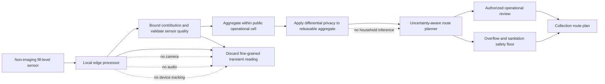

# Urban Waste Management With Differential Privacy

## Purpose

This design defines a privacy-preserving smart-waste system that uses aggregate fill-level information to plan municipal collection routes while minimizing the risk that observations reveal a household’s waste pattern, behavior, schedule, health information, economic situation, religious practice, family status, or other sensitive circumstance.

The system supports:

- Overflow prevention.
- Efficient collection routing.
- Lower fuel and energy use.
- Reduced unnecessary collection trips.
- Accessible-path and sanitation maintenance.
- Privacy-preserving operational planning.
- Publicly accountable differential-privacy parameters.
- Local edge processing.
- Community correction and repair pathways.

The system does not support:

- Household surveillance.
- Waste-content recognition.
- Camera or audio monitoring.
- Person identification.
- Mobile-device tracking.
- Property-level behavioral profiling.
- Social scoring.
- Law-enforcement inference.
- Eligibility decisions.
- Automated penalties.
- Differentially private outputs used as evidence about a specific household.

## Core design rule

Differential privacy is a protection for a carefully defined release or query. It is not a substitute for data minimization, purpose limitation, access control, secure edge design, or non-surveillance sensor selection.

The system must satisfy:

\[
D_{\text{person,persistent}} = 0
\]

\[
D_{\text{household-profile}} = 0
\]

\[
D_{\text{raw-media}} = 0
\]

\[
D_{\text{device-identifier}} = 0
\]

\[
G_{\text{service-denial}} = 0
\]

\[
C_{\text{sanitation}} \geq C_{\min}
\]

Where:

- \(D_{\text{person,persistent}}\) is persistent person-derived information.
- \(D_{\text{household-profile}}\) is a property- or household-linked waste behavior profile.
- \(D_{\text{raw-media}}\) is retained raw video, imagery, or audio.
- \(D_{\text{device-identifier}}\) is retained device or network identity data.
- \(G_{\text{service-denial}}\) is an access or service gate based on waste data.
- \(C_{\text{sanitation}}\) is sanitation and collection coverage.

## Privacy-first architecture



## Data minimization hierarchy

The preferred sequence is:

\[
\text{Non-imaging sensor}
\rightarrow
\text{edge validation}
\rightarrow
\text{clipping}
\rightarrow
\text{cell aggregation}
\rightarrow
\text{differential privacy}
\rightarrow
\text{route planning}
\]

Not:

\[
\text{household-level tracking}
\rightarrow
\text{central database}
\rightarrow
\text{anonymization claim}
\]

### Permitted sensor inputs

| Input | Purpose | Retention | Restriction |
|---|---|---|---|
| Fill percentage | Overflow-risk estimation | Short local operational interval or aggregate cell record | No household profile |
| Weight change, if needed | Sensor-quality cross-check | Short local operational interval | No waste-content classification |
| Lid-open or service event | Device-health or tamper detection | Aggregate device-maintenance state | No identity or access log |
| Battery level | Maintenance planning | Device maintenance record | No user data |
| Sensor quality | Confidence and fault detection | Aggregate maintenance record | No person inference |
| Temperature or fire-risk sensor | Public safety and asset protection | Bounded safety record | Not used to profile waste source |
| Vehicle route telemetry | Fleet maintenance and route verification | Bounded operational retention | Not joined to household-level fill records |

### Prohibited inputs

```text
camera images
video
audio
microphone recordings
waste-content recognition
facial recognition
license plates
Bluetooth identifiers
Wi-Fi probe requests
cellular identifiers
household names
unit numbers tied to fill events
occupancy inference
daily behavior profiles
religion, health, or consumption inference
property enforcement scores
individual compliance scores
```

## Differential privacy definition

A randomized mechanism \(M\) satisfies \(\epsilon\)-differential privacy when, for all neighboring datasets \(D\) and \(D'\) differing in one protected contribution, and all possible released output sets \(S\):

\[
\Pr[M(D) \in S]
\leq
e^\epsilon
\Pr[M(D') \in S]
\]

Differential privacy provides a mathematical way to quantify privacy loss when one entity’s data appears in a dataset. NIST SP 800-226 defines neighboring datasets as those differing in one individual’s data and describes both pure \(\epsilon\)-DP and approximate \((\epsilon,\delta)\)-DP. [242][243]

For urban waste routing, the protected unit should be carefully selected through public governance. A defensible conservative choice may be:

- One waste bin contribution to a public aggregation cell per reporting window, or
- One property contribution only when the system is technically unable to avoid property-level sensing and the privacy review demonstrates that collection and aggregation rules prevent household-level release or profile formation.

The safest deployment uses shared, public, or cell-aggregated operational units rather than household-level records.

## Spatial aggregation

### Public operational cells

Partition a service area into public operational cells \(g\):

\[
\mathcal{G} =
\{
g_1,g_2,\dots,g_m
\}
\]

Each cell contains at least \(k\) eligible bins:

\[
n_g \geq k
\]

Where \(k\) is a community-governed minimum aggregation threshold.

A bin should not be released, visualized, or routed as a public record when:

\[
n_g < k
\]

Instead, the system should:

- Merge the bin with a larger adjacent cell.
- Use a longer time window.
- Use a scheduled collection baseline.
- Use direct inspection through a privacy-minimized operational process.
- Suppress the release entirely.

### Fill aggregation

Let \(f_b\) be a normalized fill contribution from bin \(b\), after clipping:

\[
f_b \in [0, f_{\max}]
\]

For cell \(g\):

\[
F_g =
\sum_{b \in g} f_b
\]

Average fill estimate:

\[
\bar{F}_g =
\frac{
F_g
}{
n_g
}
\]

### Contribution clipping

Clipping bounds sensitivity.

\[
\widetilde{f_b} =
\min
\left(
\max(f_b, 0),
f_{\max}
\right)
\]

If the released statistic is the total clipped fill in one cell, its \(\ell_1\) sensitivity is:

\[
\Delta_1 f = f_{\max}
\]

If the released statistic is average clipped fill and every cell has at least \(k\) bins:

\[
\Delta_1 \bar{f}
\leq
\frac{
f_{\max}
}{
k
}
\]

The aggregation threshold and clipping bound must be stated in public technical documentation.

## Laplace mechanism

### Use case

The Laplace mechanism is suitable for pure \(\epsilon\)-differential privacy when releasing a scalar aggregate, such as total or average fill within a public operational cell.

For query \(f(D)\) with \(\ell_1\)-sensitivity \(\Delta_1 f\):

\[
M(D) =
f(D) + Y
\]

Where:

\[
Y
\sim
\operatorname{Laplace}
\left(
0,
\frac{\Delta_1 f}{\epsilon}
\right)
\]

NIST SP 800-226 describes the Laplace mechanism as adding zero-centered Laplace noise with scale \(\Delta_1 / \epsilon\) for a query with \(\ell_1\) sensitivity \(\Delta_1\). [243]

The prompt relationship:

\[
\epsilon =
\frac{
\Delta f
}{
\sigma
}
\]

is usable as an intuition for Laplace scale when \(\sigma\) means the Laplace scale parameter:

\[
b =
\frac{
\Delta_1 f
}{
\epsilon
}
\]

However, \(\sigma\) conventionally denotes standard deviation for a Gaussian distribution. For Laplace noise with scale \(b\):

\[
\operatorname{Var}(Y) = 2b^2
\]

\[
\sigma_{\text{Laplace}} =
\sqrt{2}b
\]

Therefore:

\[
\epsilon =
\frac{
\sqrt{2}\Delta_1 f
}{
\sigma_{\text{Laplace}}
}
\]

when \(\sigma_{\text{Laplace}}\) refers to standard deviation rather than scale.

## Gaussian mechanism

### Use case

Use a Gaussian mechanism when an \((\epsilon,\delta)\)-differential privacy guarantee is appropriate and the system needs composition accounting across multiple releases or higher-dimensional aggregate vectors.

For \(\ell_2\)-sensitivity \(\Delta_2 f\), a common calibration bound for \(0 < \epsilon < 1\) is:

\[
\sigma^2 =
\frac{
2\Delta_2^2
\ln(1.25/\delta)
}{
\epsilon^2
}
\]

Equivalently:

\[
\sigma =
\frac{
\Delta_2
\sqrt{
2\ln(1.25/\delta)
}
}{
\epsilon
}
\]

NIST SP 800-226 describes the Gaussian mechanism in the approximate \((\epsilon,\delta)\)-DP setting and gives this common calibration form. [243]

A Gaussian mechanism should not be selected merely because it is familiar. The choice depends on:

- Whether the output is scalar or vector-valued.
- Whether repeated release is required.
- Sensitivity model.
- Privacy budget.
- Need for composition accounting.
- Required route-planning utility.
- Small-cell risks.
- Overflow safety requirements.
- Public disclosure policy.
- Availability of a qualified privacy review.

## Recommended mechanism selection

| Planning objective | Recommended method | Why |
|---|---|---|
| One cell-level average fill release per collection window | Laplace mechanism | Simple scalar query and pure \(\epsilon\)-DP |
| Multi-cell vector release used by a centralized planner | Gaussian mechanism with explicit \((\epsilon,\delta)\) accounting | Supports vector release and composition accounting |
| Local routing with no external release | No DP release required if only local aggregate values exist and no person-level data is retained | Data minimization and access control may be stronger than adding noise to a non-shared local signal |
| Public transparency dashboard | Coarsened spatial aggregation plus DP, small-cell suppression, and delayed release | Limits household or location-pattern inference |
| Immediate overflow safety response | Deterministic safety override based on non-identifying physical condition | Do not let DP noise cause an overflowing bin to be ignored |
| Research dataset publication | DP aggregate release with documented budget and utility analysis | Supports review while limiting contribution inference |

The highest-value privacy protection is often to avoid creating household-linked data. Differential privacy should be used for shared aggregates, dashboards, interdepartmental analytics, or any output that could otherwise reveal a contribution.

## Route-planning model

### DP-aware fill estimate

Let:

\[
\widehat{F}_g =
F_g + \eta_g
\]

Where \(\eta_g\) is Laplace or Gaussian noise.

The route planner should use uncertainty-aware thresholds:

\[
\operatorname{collect}(g) =
\begin{cases}
1, & \widehat{F}_g - z_q \sigma_g \geq \tau_{\text{collection}} \\
1, & \operatorname{overflowSafety}(g) = \text{true} \\
0, & \text{otherwise}
\end{cases}
\]

Where:

- \(\sigma_g\) is the mechanism or estimator uncertainty.
- \(z_q\) is a conservative quantile multiplier.
- \(\tau_{\text{collection}}\) is the collection threshold.

For overflow prevention, use an upper-confidence condition:

\[
\operatorname{overflowRisk}(g) =
\begin{cases}
1, & \widehat{F}_g + z_q \sigma_g \geq \tau_{\text{overflow}} \\
0, & \text{otherwise}
\end{cases}
\]

This prevents a noisy low estimate from suppressing a needed collection decision.

### Collection cost

For planned vehicle routes \(r\):

\[
C =
\sum_{r \in \mathcal{R}}
\left(
\alpha_d d_r +
\alpha_t t_r +
\alpha_e e_r +
\alpha_o o_r +
\alpha_a a_r
\right)
\]

Where:

- \(d_r\) is route distance.
- \(t_r\) is route time.
- \(e_r\) is route energy or fuel use.
- \(o_r\) is expected overflow cost.
- \(a_r\) is accessibility or public-right-of-way interference cost.

The routing objective is:

\[
\min_{\mathcal{R}} C
\]

Subject to:

\[
\operatorname{overflowRisk}(g) = 1
\Rightarrow
g \in \operatorname{servedCells}(\mathcal{R})
\]

\[
\operatorname{accessibilityClearance}(\mathcal{R}) = \text{true}
\]

\[
\operatorname{sanitationCoverage}(\mathcal{R}) \geq C_{\min}
\]

\[
\operatorname{privacyBudgetRemaining} > 0
\]

for any route decision that relies on a newly released DP aggregate.

### Equity floor

A lower sensor-confidence score or lower data coverage must not become a reason to neglect a community.

Let \(C_g\) be collection coverage in service cell \(g\), and \(C_{\text{all}}\) be overall coverage.

\[
P_{\text{collection-parity}} =
\min_g
\frac{
C_g
}{
C_{\text{all}}
}
\]

The service design should meet:

\[
P_{\text{collection-parity}}
\geq
P_{\min}
\]

The value \(P_{\min}\) must be publicly defined through operations, sanitation, environmental-justice, accessibility, and community review.

## Privacy budget governance

### Budget accounting

For a sequence of privacy-consuming releases with budgets \(\epsilon_1,\epsilon_2,\dots,\epsilon_n\), basic composition is:

\[
\epsilon_{\text{total}} =
\sum_{j=1}^{n}\epsilon_j
\]

For approximate DP releases:

\[
\delta_{\text{total}} =
\sum_{j=1}^{n}\delta_j
\]

A privacy budget must be attached to a defined protected unit, purpose, time window, and release audience.

```text
Protected unit:
Aggregation cell:
Time window:
Release purpose:
Mechanism:
Sensitivity:
Epsilon:
Delta, if applicable:
Composition rule:
Retention:
Audience:
Approval:
Privacy review date:
```

### Budget exhaustion

If a planned public or interdepartmental release would exceed the approved privacy budget:

\[
\epsilon_{\text{spent}} + \epsilon_{\text{new}}
>
\epsilon_{\text{approved}}
\]

then the system must:

- Refuse the new release.
- Offer a coarser aggregation.
- Offer a longer time window.
- Use a lower-sensitivity statistic.
- Delay publication.
- Use a scheduled collection baseline.
- Request explicit governance review.

Budget exhaustion must not stop sanitation service:

\[
\operatorname{BudgetExhausted}
\Rightarrow
\operatorname{ScheduledCollectionFallback}
\]

not:

\[
\operatorname{BudgetExhausted}
\Rightarrow
\operatorname{NoCollection}
\]

## Edge-node design

### Local edge processing

Each edge node should:

1. Read a non-imaging fill sensor.
2. Validate physical range and sensor-health conditions.
3. Convert reading into a bounded normalized fill value.
4. Hold fine-grained values only for the minimum operational interval.
5. Contribute clipped data into a public operational-cell aggregate.
6. Delete the fine-grained transient value.
7. Publish only authorized aggregate outputs.
8. Enter a scheduled-service fallback on sensor failure.
9. Never transmit raw media, household identity, device identifiers, or sensor event history.

### Sensor confidence

Let:

- \(q_b\) be sensor quality.
- \(c_b\) be calibration confidence.
- \(r_b\) be range-validity score.

\[
K_b =
q_b
\cdot
c_b
\cdot
r_b
\]

If:

\[
K_b < K_{\min}
\]

then the bin’s reading should not create a fine-grained inference or route action. The system should use a maintenance flag, scheduled collection, broader aggregate estimate, or manual inspection according to public operating policy.

## Public transparency

Publish:

- Purpose limitation.
- Sensor types.
- Explicit exclusion of cameras, microphones, waste-content recognition, device tracking, and household profiling.
- Aggregation-cell method.
- Minimum cell size.
- Clipping bounds.
- Differential privacy mechanism.
- \(\epsilon\), \(\delta\), sensitivity, and composition accounting.
- Data retention policy.
- Overflow and sanitation fallback rules.
- Service-equity audit results.
- Accessibility and public-right-of-way protections.
- Repair and correction pathway.
- Versioned software and policy manifest.

Plain-language notice:

```text
This waste system uses non-imaging fill sensors to support collection planning.

It does not use cameras, microphones, phone tracking, facial recognition, or waste-content recognition.

Public reporting uses privacy-protective aggregate information.
No household waste history is published or used to score people.
```

## Testing requirements

### Privacy tests

- Verify no image, video, audio, microphone, or radio-device collection path exists.
- Verify no household name, address, unit number, identity, device identifier, or behavior profile field exists in retained data.
- Verify fine-grained readings are deleted after aggregation.
- Verify only approved cell-level aggregate outputs are released.
- Verify small cells are suppressed or merged.
- Verify the privacy-budget ledger blocks unauthorized additional releases.
- Verify aggregated releases cannot be joined to a persistent bin-level history.
- Verify public dashboards contain no property-level information.

### Differential-privacy tests

- Verify sensitivity calculation matches clipping policy.
- Verify Laplace scale equals \(\Delta_1 f/\epsilon\).
- Verify Gaussian standard deviation matches the chosen \((\epsilon,\delta)\) policy.
- Verify independent noise is generated for each authorized release.
- Verify random-number generation uses a cryptographically secure source.
- Verify output range handling does not bias privacy analysis without documentation.
- Verify composition accounting records all releases.
- Verify route planning uses uncertainty intervals.
- Verify overflow safety override works when DP estimates are uncertain.

### Operational tests

- Test sensor drift, low battery, sensor obstruction, fire-risk event, and communications loss.
- Verify scheduled collection fallback remains available.
- Verify overflow-prone cells receive timely service.
- Verify accessible sidewalks, curb ramps, transit stops, and public entries remain clear during collection.
- Verify route optimization does not shift disproportionate missed-collection burden to any service area.
- Verify local edge nodes continue safe operation without cloud connectivity.

## Project metrics

| Metric | Formula | Target |
|---|---|---:|
| Fine-grained retention rate | \(\frac{\text{retained bin-level readings}}{\text{sensor intervals}}\) | 0 after authorized aggregation interval |
| Raw-media retention rate | \(\frac{\text{retained raw-media records}}{\text{sensor intervals}}\) | 0 |
| Small-cell release violations | Number of releases where \(n_g < k\) | 0 |
| DP budget compliance | \(\frac{\text{authorized releases within budget}}{\text{all releases}}\) | 1 |
| Overflow response coverage | \(\frac{\text{overflow-risk cells served}}{\text{overflow-risk cells}}\) | 1 |
| Collection parity | \(P_{\text{collection-parity}}\) | At least adopted floor |
| Route-energy reduction | \(\frac{E_{\text{baseline}}-E_{\text{actual}}}{E_{\text{baseline}}}\) | Report only if sanitation and privacy conditions pass |
| Accessibility clearance | \(\frac{\text{routes preserving protected access paths}}{\text{collection routes}}\) | 1 |
| Privacy-safe route rate | \(\frac{\text{plans using approved aggregate-only inputs}}{\text{route plans}}\) | 1 |

## Project metrics

| Metric | Score | Basis |
|---|---:|---|
| knowledge_factor | 0.92 | Uses formal DP definitions, sensitivity bounds, privacy budgets, uncertainty-aware routing, public documentation, and testable retention rules |
| eco_impact_value | 0.88 | Supports lower collection mileage, reduced overflow, cleaner public spaces, more efficient fleet use, and transparent material-management planning |
| harm_risk | 0.18 | Reduced through non-imaging sensors, clipping, aggregation, DP release controls, no household profiles, no raw media, and service-floor requirements |
| accessibility_impact | 0.90 | Requires public-right-of-way protection, accessible route clearance, sanitation continuity, and accessible correction paths |
| rights_alignment | 0.98 | Supports privacy, dignity, non-discrimination, public health, ecological responsibility, repair, transparency, and community accountability |
